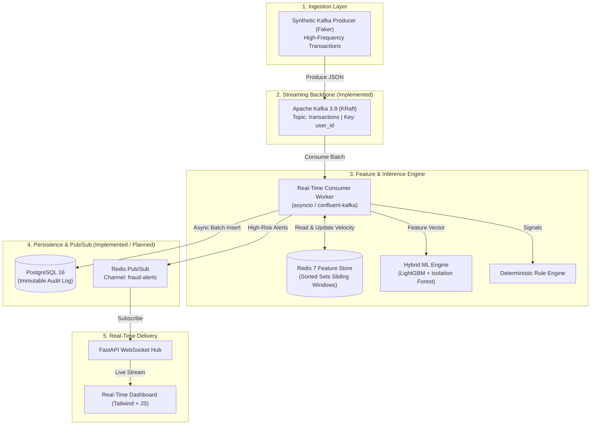

# Real-Time Fraud Detection Streaming System

A production-grade, event-driven streaming system for real-time financial fraud detection, designed to process high-frequency transaction streams with sub-millisecond feature extraction, hybrid machine learning scoring, immutable database persistence, and live WebSocket alert fan-out.

---

## 1. Project Overview

Modern financial platforms process thousands of transactions per second. Fraud detection must operate within strict latency budgets (<50 ms) to approve or decline authorizations before checkout timeouts occur.

This system demonstrates an end-to-end distributed architecture:
- Ingests high-frequency financial events via **Apache Kafka** partitioned by `user_id`.
- Computes sliding-window velocity aggregations (e.g., 60-second and 10-minute spend/frequency) in **Redis**.
- Performs in-process hybrid inference using **LightGBM** (supervised classification) and **Isolation Forest** (unsupervised anomaly detection).
- Immutably persists transactions, computed feature vectors, risk scores, and decisions to **PostgreSQL**.
- Fans out high-risk alerts over **Redis Pub/Sub** to a **FastAPI WebSocket hub** feeding a live analytics dashboard.

---

## 2. System Architecture



Detailed architectural blueprints and decision rationales are available in [docs/01-architecture.md](docs/01-architecture.md).

---

## 3. Technology Stack

| Technology | Role | Rationale |
| :--- | :--- | :--- |
| **Apache Kafka 3.8.0** | Event Ingestion & Buffer | Distributed commit log, partition ordering via `user_id`, KRaft consensus without ZooKeeper. |
| **PostgreSQL 16 (Alpine)** | System of Record | ACID compliance, composite indexing on `(user_id, created_at DESC)`, exact `NUMERIC` monetary precision. |
| **Redis 7 (Alpine)** | Feature Store & Pub/Sub | Sub-millisecond latency for sliding-window velocity features using Sorted Sets; lightweight Pub/Sub alert fan-out. |
| **Python 3.12** | Core Application Logic | Modern type hints, high-performance runtime, native async support. |
| **`uv`** | Dependency & Env Manager | Blazing-fast virtual environment, lockfile, and package management. |
| **LightGBM** | Supervised Fraud Scoring | Fast CPU-bound gradient boosted tree inference for tabular transaction patterns. |
| **Isolation Forest** | Unsupervised Anomaly Detection | Identifies zero-day fraud patterns and statistical outliers without historical fraud labels. |
| **FastAPI & WebSockets** | Edge Streaming Hub | Async ASGI server for concurrent persistent browser connections. |
| **Docker Compose** | Local Infrastructure | Declarative, containerized local stack with health checks and persistent volumes. |

---

## 4. Repository Structure

```text
real-time-fraud-detection/
│
├── artifacts/                       # Serialized models, feature metadata & bundles
│
├── data/
│   └── raw/
│       ├── transactions_10k.csv     # 10k realistic transaction dataset (1.0% multi-modal fraud)
│       └── demo_inference_10.csv    # 10 diverse demo transactions for model inference validation
│
├── database/
│   └── init.sql                     # PostgreSQL schema DDL, constraints, indexes & fixtures
│
├── docs/
│   ├── 01-architecture.md           # System architecture, data flow, failure boundaries
│   ├── 02-infrastructure.md           # Docker Compose, networking, volume topologies
│   ├── 03-database.md                 # Relational schema, B-tree indexes & query analysis
│   ├── 04-ml-pipeline.md             # Hybrid ML pipeline, PR-AUC & CPU benchmark
│   └── stage-02 to stage-13...       # Specifications & execution guides for each stage
│
├── producers/                       # Synthetic transaction generator CLI scripts (Stage 4)
│   ├── transaction_producer.py      # Executable producer script with Token Bucket rate limiter
│   ├── anomalies.py                 # Multi-modal fraud attack generators (spikes, geo, ATO)
│   └── config.py                    # Producer configuration and librdkafka options
│
├── src/
│   └── fraud_detection/             # Core application package (src-layout)
│       ├── core/                    # Shared settings (pydantic-settings) & structured JSON logger
│       │   ├── config.py
│       │   └── logger.py
│       │
│       ├── schemas/                 # Pydantic data contracts
│       │   ├── transaction.py       # Inbound transaction event schema
│       │   └── alert.py             # Outbound fraud alert schema
│       │
│       ├── ml/                      # Modular machine learning pipeline
│       │   ├── data_loader.py       # Synthetic data generator with multi-modal fraud
│       │   ├── preprocessing.py     # Imputation & category domain risk encodings
│       │   ├── features.py          # Feature definitions & real-time vector assembly
│       │   ├── evaluate.py          # PR-AUC, F1 threshold tuning & confusion matrix
│       │   ├── train.py             # Fitting LightGBM + Isolation Forest & serialization
│       │   └── inference.py         # Sub-millisecond in-process CPU scoring engine
│       │
│       ├── streaming/               # Kafka producers, consumers & Redis feature store (Stage 4+)
│       │   ├── config.py            # Kafka producer tuning and librdkafka parameters
│       │   ├── anomalies.py         # Synthetic attack injection generators
│       │   └── producer.py          # Async transaction producer with Token Bucket limiter
│       │
│       └── api/                     # FastAPI ASGI gateway & WebSocket hub (Stage 9+)
│
├── tests/                           # Automated unit test suite (schemas, preprocessing, ML, producer)
│   ├── conftest.py                  # Pytest fixtures and mock objects
│   ├── test_api.py                  # FastAPI health check and prediction endpoint tests
│   ├── test_producer.py             # Kafka producer, Token Bucket limiter & anomaly tests
│   ├── test_schemas.py              # Pydantic data contract validation tests
│   ├── test_preprocessing.py        # Feature transformation, clipping & imputation tests
│   ├── test_features.py             # Feature order and vector extraction tests
│   ├── test_evaluate.py             # PR-AUC, ROC-AUC and threshold optimization tests
│   ├── test_inference.py            # Real-time CPU scoring engine & latency SLA tests
│   └── test_data_loader.py          # Synthetic generation & 10k dataset loading tests
│
├── .env.example                     # Infrastructure configuration template
├── .gitignore                       # Git exclusions (Python, Docker, artifacts, secrets)
├── .pre-commit-config.yaml          # Pre-commit hooks (Ruff linter/formatter, file checks, security)
├── docker-compose.yml               # Kafka KRaft, PostgreSQL 16, Redis 7 orchestration
├── main.py                          # Primary FastAPI application entrypoint (Uvicorn server)
├── pyproject.toml                   # Package definition, uv dependencies, pytest & CLI entrypoints
└── README.md                        # Project documentation and reproduction guide

```

---

## 5. Prerequisites

Before running the system, ensure the following software is installed on your workstation:

- **Docker Desktop** (or Docker Engine v24+ with Docker Compose v2.20+)
  - Windows: Docker Desktop with WSL2 backend recommended.
  - Linux: Native Docker Engine with `docker-compose-plugin`.
- **Git**
- **uv** (v0.4.0 or newer)
  - Fast Python package installer and resolver.
- **Python 3.12** (managed automatically via `uv` or installed locally).

---

## 6. `uv` Setup Instructions

> **Note:** Dependency and environment commands are executed manually by the developer.

### 6.1 Install `uv`
- **Windows (PowerShell):**
  ```powershell
  powershell -ExecutionPolicy ByPass -c "irm https://astral.sh/uv/install.ps1 | iex"
  ```
- **macOS / Linux:**
  ```bash
  curl -LsSf https://astral.sh/uv/install.sh | sh
  ```

### 6.2 Initialize & Sync Environment
From the `real-time-fraud-detection/` directory:

```bash
# Pin and install Python 3.12
uv python install 3.12

# Create a virtual environment
uv venv --python 3.12

# Activate the virtual environment:
# Windows PowerShell:
.venv\Scripts\Activate.ps1
# Linux / macOS:
source .venv/bin/activate
```

### 6.3 Synchronize & Install Dependencies
```bash
# Synchronize virtual environment with all core and development dependencies (pytest, pre-commit, ruff)
uv sync
```


### 6.4 Execute Stage 3 ML Training & CPU Benchmark
```bash
# Execute Stage 3 training and benchmark via registered CLI script
uv run fraud-train

# Alternatively, execute directly via Python module path
uv run python -m fraud_detection.ml.train
```

### 6.5 Test Saved Model Inference on Demo 10 Transactions
```bash
# Score the 10 demo transactions (approved, flagged, rejected) using the saved model
uv run fraud-infer

# Alternatively, execute directly via Python module path
uv run python -m fraud_detection.ml.inference
```

### 6.6 Run Automated Unit Tests
```bash
# 1. Install development & testing dependencies (pytest, pytest-cov, httpx, pre-commit)
uv sync --extra dev

# 2. Run all unit tests across schemas, preprocessing, features, inference, and API
uv run pytest

# 3. Run tests with terminal coverage report
uv run pytest --cov=fraud_detection --cov-report=term-missing
```

### 6.7 Code Quality & Pre-Commit Hooks
```bash
# 1. Install pre-commit hooks into git (runs automatically before each 'git commit')
uv run pre-commit install

# 2. Run all pre-commit hooks manually against all files
uv run pre-commit run --all-files

# 3. Format and lint directly via Ruff
uv run ruff check --fix
uv run ruff format
```

### 6.8 Launch FastAPI Application (`main.py`)
```bash
# Start the FastAPI ASGI server with auto-reload (hosted on port 8000)
uv run python main.py

# Alternatively, launch via Uvicorn CLI directly:
uv run uvicorn main:app --reload --host 0.0.0.0 --port 8000
```

- **Interactive API Documentation (Swagger UI):** [`http://localhost:8000/docs`](http://localhost:8000/docs)
- **Alternative API Docs (ReDoc):** [`http://localhost:8000/redoc`](http://localhost:8000/redoc)
- **Health & Readiness Probe:** [`http://localhost:8000/healthz`](http://localhost:8000/healthz)
- **Real-Time Fraud Scoring Endpoint:** `POST http://localhost:8000/api/v1/predict`

### 6.9 Synthetic High-Frequency Kafka Producer (Stage 4)
```bash
# 1. Start continuous Kafka producer streaming at 50 TPS with 2% anomaly injection
uv run python producers/transaction_producer.py --tps 50 --anomaly-rate 0.02

# Or use the installed CLI entrypoint:
uv run fraud-producer --tps 50 --anomaly-rate 0.02

# 2. Run simulation in dry-run mode (emits 10 formatted events without requiring Kafka):
uv run python producers/transaction_producer.py --dry-run --max-events 10

# 3. Verify live messages consumed from Kafka cluster:
# Windows PowerShell (single line):
docker compose exec kafka /opt/kafka/bin/kafka-console-consumer.sh --bootstrap-server localhost:9092 --topic transactions --property print.key=true --from-beginning --max-messages 5
```


---


## 7. Infrastructure Startup & Verification (Step 1)

### 7.1 Start Infrastructure
From the project root:

```bash
# 1. Copy environment template
# Windows PowerShell:
Copy-Item .env.example .env
# Linux / macOS:
cp .env.example .env

# 2. Launch Kafka, PostgreSQL, and Redis in detached mode
docker compose up -d
```

### 7.2 Verify Container Health
Check running services:
```bash
docker compose ps
```

All three services should report `Up (healthy)`:
- `fraud-kafka` (`apache/kafka:3.8.0`)
- `fraud-postgres` (`postgres:16-alpine`)
- `fraud-redis` (`redis:7-alpine`)

### 7.3 Detailed Service Health Verification

```bash
# 1. Verify PostgreSQL connectivity
docker compose exec postgres pg_isready -U postgres -d fraud_detection

# 2. Verify Redis responsiveness
docker compose exec redis redis-cli ping

# 3. Verify Kafka broker status
docker compose exec kafka /opt/kafka/bin/kafka-broker-api-versions.sh --bootstrap-server localhost:9092
```

Detailed reproduction steps and troubleshooting guides are available in [docs/02-infrastructure.md](docs/02-infrastructure.md).

---

## 8. Implementation Stages Roadmap

- [x] **Stage 1: Environment Setup & Container Orchestration**
  - Apache Kafka in KRaft mode (no ZooKeeper)
  - PostgreSQL 16 Alpine with persistent volume and health check
  - Redis 7 Alpine with AOF persistence and health check
  - Dedicated bridge network `fraud-network`
  - Documentation: [docs/02-infrastructure.md](docs/02-infrastructure.md)
- [x] **Stage 2: Relational Database Schema & Index Optimization** — [Documentation](docs/03-database.md) | [Specification](docs/stage-02-database.md)
  - Tables: `users`, `accounts`, `transactions` with UUIDv4 PKs and strict FKs
  - Monetary precision: `NUMERIC(12, 2)` and non-zero check constraints
  - Composite B-Tree index on `(user_id, created_at DESC)` and partial index on high-risk rows
  - JSONB audit snapshots for Redis features and deterministic rule violations
  - DDL initialization script: `database/init.sql` mounted into Docker
- [x] **Stage 3: Offline ML Model Training & Serialization** — [Documentation](docs/04-ml-pipeline.md) | [Specification](docs/stage-03-ml-pipeline.md)
  - Hybrid ML Architecture: Supervised LightGBM classifier + Unsupervised Isolation Forest anomaly detector
  - Class Imbalance Handling: `scale_pos_weight` tuned to ~199:1 inverse class ratio
  - Primary Evaluation Metric: Precision-Recall Area Under Curve (PR-AUC > 0.85)
  - F1-Score threshold optimization on validation split (dual thresholds: `APPROVED`, `FLAGGED`, `REJECTED`)
  - Serialization: Compressed bundle in `artifacts/fraud_model.joblib`
  - In-process CPU Inference Benchmark: < 1.0 ms mean latency per transaction
- [x] **Stage 4: Synthetic High-Frequency Kafka Producer** — [Specification & Guide](docs/stage-04-kafka-producer.md)
  - Engine: Asynchronous `confluent-kafka` producer with C-level `librdkafka` tuning (`linger.ms=5`, `snappy` compression)
  - Rate Limiting: Token Bucket algorithm for steady-state throughput (configurable TPS via `--tps`)
  - Key Invariance: Strictly routes messages with `key=str(user_id)` to guarantee intra-partition chronological order
  - Anomaly Topologies: Card testing velocity bursts (8-15 tx/20s), high-value ATOs ($1.2k-$5k), impossible geo-travel, nocturnal fraud
  - Execution: `uv run python producers/transaction_producer.py` or `uv run fraud-producer` with `--dry-run` simulation support

- [ ] **Stage 5: Redis Real-Time Feature Store** — [Specification & Guide](docs/stage-05-redis-feature-store.md)
- [ ] **Stage 6: Core Event Consumer & Real-Time ML Inference Engine** — [Specification & Guide](docs/stage-06-inference-engine.md)
- [ ] **Stage 7: PostgreSQL Persistence Layer** — [Specification & Guide](docs/stage-07-postgres-persistence.md)
- [ ] **Stage 8: Redis Pub/Sub Event Fan-Out** — [Specification & Guide](docs/stage-08-redis-pubsub.md)
- [ ] **Stage 9: FastAPI WebSocket Hub** — [Specification & Guide](docs/stage-09-fastapi-websocket.md)
- [ ] **Stage 10: Real-Time Dashboard & End-to-End Stress Testing** — [Specification & Guide](docs/stage-10-dashboard-and-stress-testing.md)
- [ ] **Stage 11: MLOps: Experiment Tracking, Model Registry & Drift Monitoring** — [Specification & Guide](docs/stage-11-mlops-pipeline.md)
- [ ] **Stage 12: CI/CD: Automated Testing, Linting & Container Packaging** — [Specification & Guide](docs/stage-12-cicd-pipeline.md)
- [ ] **Stage 13: Microsoft Azure Cloud Deployment & UI Host ($200 Budget Optimized)** — [Specification & Guide](docs/stage-13-azure-cloud-deployment.md)

---

## 9. Teardown & Cleanup

To stop containers while preserving persistent volumes:
```bash
docker compose down
```

To stop containers and destroy all volumes (fresh reset):
```bash
docker compose down -v
```
