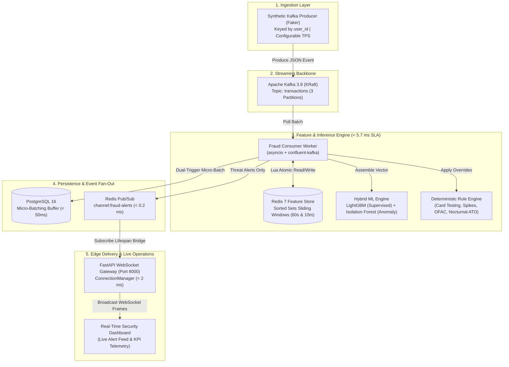

# Real-Time Financial Fraud Detection Streaming System

[](https://www.python.org/)
[](https://fastapi.tiangolo.com/)
[](https://kafka.apache.org/)
[](https://redis.io/)
[](https://www.postgresql.org/)
[](https://lightgbm.readthedocs.io/)
[](tests/)
[](https://github.com/astral-sh/ruff)

A production-grade, distributed, event-driven streaming system for **real-time financial fraud detection**. Built following industry-standard **PEP 517/518 `src-layout`** architecture, it processes high-frequency payment transaction streams with sub-millisecond sliding-window feature extraction in Redis, hybrid machine learning scoring on CPU, deterministic compliance rules, micro-batched PostgreSQL persistence, and live WebSocket alert fan-out.

> [!TIP]
> **Complete Beginner?** You can run the entire system in **Zero-Docker Simulation Mode** in under 3 minutes without installing Docker, Kafka, Redis, or PostgreSQL! Jump straight to [Section 2: Beginner Fast-Track](#2-beginner-fast-track-zero-docker-simulation-in-3-minutes).
>
> **সম্পূর্ণ বাংলা গাইড প্রয়োজন?** শিক্ষানবিসদের জন্য তৈরি বিস্তারিত বাংলা ডকুমেন্টেশন ও গাইড পড়তে দেখুন: [docs/Real_Time_Fraud_Detection_Bengali_Guide.md](docs/Real_Time_Fraud_Detection_Bengali_Guide.md) অথবা Word ফাইল: [docs/Real_Time_Fraud_Detection_Bengali_Guide.docx](docs/Real_Time_Fraud_Detection_Bengali_Guide.docx)।

---

## Table of Contents

- [1. System Overview & Architecture](#1-system-overview--architecture)
- [2. Beginner Fast-Track: Zero-Docker Simulation in 3 Minutes](#2-beginner-fast-track-zero-docker-simulation-in-3-minutes)
- [3. Full Production Setup (With Docker Infrastructure)](#3-full-production-setup-with-docker-infrastructure)
  - [3.1 Prerequisites](#31-prerequisites)
  - [3.2 Environment & Dependency Setup](#32-environment--dependency-setup)
  - [3.3 Launch & Verify Docker Containers](#33-launch--verify-docker-containers)
- [4. End-to-End Pipeline Execution Guide](#4-end-to-end-pipeline-execution-guide)
  - [4.1 Stage 3: Train & Benchmark Hybrid ML Models](#41-stage-3-train--benchmark-hybrid-ml-models)
  - [4.2 Stage 4: Run High-Frequency Kafka Producer](#42-stage-4-run-high-frequency-kafka-producer)
  - [4.3 Stage 5: Redis Real-Time Feature Store Benchmark](#43-stage-5-redis-real-time-feature-store-benchmark)
  - [4.4 Stage 6: Real-Time Fraud Consumer Worker](#44-stage-6-real-time-fraud-consumer-worker)
  - [4.5 Stage 7: PostgreSQL Micro-Batching Persistence Buffer](#45-stage-7-postgresql-micro-batching-persistence-buffer)
  - [4.6 Stage 8: Real-Time Threat Alert Listener](#46-stage-8-real-time-threat-alert-listener)
  - [4.7 Stage 9: FastAPI WebSocket Gateway & REST Hub](#47-stage-9-fastapi-websocket-gateway--rest-hub)
- [5. How the Detection Engine Works (Under the Hood)](#5-how-the-detection-engine-works-under-the-hood)
  - [5.1 Hybrid Machine Learning Model](#51-hybrid-machine-learning-model)
  - [5.2 Deterministic Security & Compliance Rules](#52-deterministic-security--compliance-rules)
  - [5.3 Composite Risk Score & Verdict Formulation](#53-composite-risk-score--verdict-formulation)
- [6. REST API & WebSocket Endpoint Reference](#6-rest-api--websocket-endpoint-reference)
- [7. Project Directory Tour (Standard `src-layout`)](#7-project-directory-tour-standard-src-layout)
- [8. Automated Testing & Code Quality](#8-automated-testing--code-quality)
- [9. Beginner Troubleshooting & FAQ](#9-beginner-troubleshooting--faq)
- [10. Project Roadmap (Stages 1 to 13)](#10-project-roadmap-stages-1-to-13)

---

## 1. System Overview & Architecture

When a user initiates an online transaction (e.g. credit card payment), the bank has less than **50 milliseconds** to answer: *Is this payment legitimate, suspicious, or fraudulent?*

This repository implements the entire life cycle of an event-driven fraud prevention platform:



### The 5 Core Subsystems
1. **Event Ingestion:** Transactions are published to Kafka keyed strictly by `user_id`, guaranteeing chronological intra-partition ordering.
2. **Real-Time Velocity Features:** Sliding-window statistics (e.g. transactions in last 60 seconds, cumulative spend in last 10 minutes) are extracted atomically in Redis using compiled Lua scripts in `< 0.5 ms`.
3. **Hybrid AI Inference & Rules:** Supervised LightGBM evaluates known fraud patterns, Unsupervised Isolation Forest flags novel anomalies, and hard business rules enforce regulatory compliance.
4. **Micro-Batched Persistence:** Persists scored events, rule triggers, and point-in-time feature snapshots to PostgreSQL using `asyncpg` with a 50-item / 50ms dual-trigger buffer.
5. **Real-Time Alert Fan-Out:** High-risk threats (`FLAGGED` or `REJECTED`) are broadcast via Redis Pub/Sub to a horizontally scalable FastAPI WebSocket gateway.

Detailed system blueprints and design trade-offs are documented in [docs/01-architecture.md](docs/01-architecture.md).

---

## 2. Beginner Fast-Track: Zero-Docker Simulation in 3 Minutes

Don't have Docker installed? No problem! Every single subsystem in this repository includes an **offline in-memory simulation engine** so you can learn, experiment, and run everything locally:

### Step 1: Install Dependencies
```bash
# 1. Install uv (if not already installed)
# Windows (PowerShell):
powershell -ExecutionPolicy ByPass -c "irm https://astral.sh/uv/install.ps1 | iex"
# Linux / macOS:
curl -LsSf https://astral.sh/uv/install.sh | sh

# 2. Synchronize all project dependencies
uv sync
```

### Step 2: Run All 120 Automated Unit Tests
```bash
uv run pytest
```
*Expected output: `120 passed` (or 119 passed, 1 skipped) in ~20 seconds.*

### Step 3: Test Saved AI Model Inference on 10 Demo Transactions
```bash
uv run fraud-infer
```
*Scores 10 sample transactions across normal, velocity attack, and impossible travel patterns, outputting structured risk scores and decisions.*

### Step 4: Run Real-Time Consumer with In-Memory Simulation
```bash
uv run fraud-consumer --mock --max-messages 25
```
*Simulates the full consumer pipeline: retrieves velocity features from an in-memory Sorted Set store, scores transactions through LightGBM and Isolation Forest, applies deterministic rules, and logs verdicts.*

### Step 5: Start the Streaming Gateway & Open Interactive Docs
```bash
uv run fraud-gateway --port 8000
```
Open your web browser:
- **Interactive Swagger Documentation:** [`http://localhost:8000/docs`](http://localhost:8000/docs)
- **Deep Health Check:** [`http://localhost:8000/healthz`](http://localhost:8000/healthz)
- **Live System Metrics:** [`http://localhost:8000/api/v1/metrics`](http://localhost:8000/api/v1/metrics)

### Step 6: Test MLOps Drift Detection & Continuous Retraining
```bash
uv run python scripts/run_retraining.py --simulate-drift --dry-run
```
*Simulates statistical data & concept drift, evaluates Population Stability Index (PSI) and KS-test statistics, fits candidate models, validates promotion gates (PR-AUC >= 0.85, P95 latency <= 3.0 ms), and outputs governance audit summary.*

---

## 3. Full Production Setup (With Docker Infrastructure)

### 3.1 Prerequisites
Ensure the following tools are installed on your machine:
- **Docker Desktop** (or Docker Engine v24+ with Compose v2.20+)
- **Git**
- **uv** (v0.4.0 or newer)
- **Python 3.12** (managed automatically via `uv` or installed locally)

### 3.2 Environment & Dependency Setup
```bash
# 1. Create your local environment configuration from template
# Windows PowerShell:
Copy-Item .env.example .env
# Linux / macOS:
cp .env.example .env

# 2. Synchronize virtual environment with all core & dev dependencies
uv sync
```

### 3.3 Launch & Verify Docker Containers
From the root directory:
```bash
# 1. Start Apache Kafka (KRaft), PostgreSQL 16, and Redis 7 in background
docker compose up -d

# 2. Check running container status
docker compose ps
```
All 3 containers should display `healthy`:
- `fraud-kafka` (Apache Kafka 3.8.0 KRaft — port 9092)
- `fraud-postgres` (PostgreSQL 16 Alpine — port 5432)
- `fraud-redis` (Redis 7.0 Alpine — port 6379)

#### Test Individual Service Health:
```bash
# Verify PostgreSQL
docker compose exec postgres pg_isready -U postgres -d fraud_detection

# Verify Redis
docker compose exec redis redis-cli ping

# Verify Kafka broker
docker compose exec kafka /opt/kafka/bin/kafka-broker-api-versions.sh --bootstrap-server localhost:9092
```

---

## 4. End-to-End Pipeline Execution Guide

Run each component in separate terminal windows to observe the live distributed pipeline in action.

### 4.1 Stage 3: Train & Benchmark Hybrid ML Models
Trains the supervised LightGBM classifier and unsupervised Isolation Forest on `data/raw/transactions_10k.csv`, evaluates PR-AUC against the validation split, benchmarks CPU latency (< 1.0 ms), and serializes the model to `artifacts/fraud_model.joblib`:
```bash
uv run fraud-train
# Or:
uv run python -m fraud_detection.ml.train
```

### 4.2 Stage 4: Run High-Frequency Kafka Producer
Streams realistic transactions generated with `Faker` alongside injected fraud attacks (velocity bursts, impossible travel, high-dollar outliers):
```bash
# 1. Stream 50 transactions per second into Kafka topic 'transactions' with 2% anomaly injection:
uv run python scripts/run_producer.py --tps 50 --anomaly-rate 0.02

# Or using the installed CLI entrypoint:
uv run fraud-producer --tps 50 --anomaly-rate 0.02

# 2. Offline Dry-Run Mode (emits 10 formatted events to console without requiring Kafka):
uv run python scripts/run_producer.py --dry-run --max-events 10
```

### 4.3 Stage 5: Redis Real-Time Feature Store Benchmark
Validates sliding-window velocity aggregations using atomic Lua scripts under concurrent load:
```bash
# 1. Run concurrency benchmark against live Redis (5,000 ops across 50 async workers):
uv run python scripts/run_benchmark.py --num-ops 5000 --concurrency 50

# Or using the installed CLI entrypoint:
uv run fraud-redis-benchmark --num-ops 5000 --concurrency 50

# 2. Inspect active Sorted Set keys and verify 30-minute key TTL in Redis:
docker compose exec redis redis-cli KEYS "user:*:tx_history"
docker compose exec redis redis-cli TTL "user:<user_id>:tx_history"
```

### 4.4 Stage 6: Real-Time Fraud Consumer Worker
Pulls batches from Kafka, extracts Redis velocity features, executes ML models and deterministic rules, scores risk, and routes verdicts:
```bash
# 1. Start continuous Kafka fraud consumer worker:
uv run python scripts/run_consumer.py --auto-offset-reset latest

# Or using the installed CLI entrypoint:
uv run fraud-consumer --auto-offset-reset latest

# 2. Run simulation mode (stops after 50 transactions without requiring Kafka):
uv run fraud-consumer --mock --max-messages 50
```

### 4.5 Stage 7: PostgreSQL Micro-Batching Persistence Buffer
Persists evaluated transactions, rule triggers, and point-in-time feature snapshots into PostgreSQL:
```bash
# 1. Run standalone micro-batch persistence worker demo (persists 100 transactions):
uv run python scripts/run_persistence_worker.py --count 100

# In offline simulation mode:
uv run python scripts/run_persistence_worker.py --count 100 --mock

# 2. Inspect persisted records and summary metrics directly in PostgreSQL:
docker compose exec postgres psql -U postgres -d fraud_detection -c "SELECT status, count(*), round(avg(risk_score), 4) as avg_risk, round(sum(amount), 2) as volume FROM transactions GROUP BY status;"
```

### 4.6 Stage 8: Real-Time Threat Alert Listener
Subscribes to Redis Pub/Sub channel `channel:fraud-alerts` and formats live threat cards in the terminal:
```bash
# 1. Run terminal threat alert subscriber:
uv run python scripts/listen_alerts.py --mock --max-alerts 10

# Or via installed entrypoint:
uv run fraud-listen-alerts --mock --max-alerts 10

# 2. In live Docker mode, subscribe directly using redis-cli:
docker compose exec redis redis-cli SUBSCRIBE channel:fraud-alerts
```

### 4.7 Stage 9: FastAPI WebSocket Gateway & REST Hub
Starts the ASGI streaming server bridging Redis Pub/Sub alerts to web browsers over WebSockets:
```bash
# 1. Launch FastAPI gateway server:
uv run python scripts/run_gateway.py --port 8000

# Or via installed entrypoint:
uv run fraud-gateway --port 8000

# Or via Uvicorn directly:
uv run uvicorn main:app --port 8000 --reload
```

### 4.8 Stage 10: Real-Time Operations Dashboard & Stress/Chaos Testing
Launch the mission control operations dashboard, run sustained 100+ TPS load tests, and verify consumer crash resilience:
```bash
# 1. Open the Real-Time Mission Control Dashboard in your browser:
# Start the gateway server (if not already running)
uv run python scripts/run_gateway.py --port 8000
# Navigate to: http://localhost:8000/dashboard/

# 2. Run sustained 100+ TPS end-to-end stress test benchmark (profiles per-hop latencies):
uv run python scripts/stress_test.py --mock --tps 100 --duration 5

# 3. Run chaos engineering worker crash and offset recovery verification harness:
uv run python scripts/chaos_test.py --mock
```

### 4.9 Stage 11: MLOps: Experiment Tracking, Model Registry & Continuous Retraining
Monitors statistical feature drift (Population Stability Index [PSI], Kolmogorov-Smirnov [KS-test]), tracks experiments, validates model governance gates, and executes continuous retraining:
```bash
# 1. Run statistical drift evaluation on live/recent batches (retrains only if PSI >= 0.25):
uv run python scripts/run_retraining.py

# 2. Simulate severe production data and concept drift to test the automated retraining trigger:
# (Injects 3.5x amount spikes, velocity bursts, and target fraud rate shifts)
uv run python scripts/run_retraining.py --simulate-drift

# 3. Dry-Run Mode: Evaluate drift and candidate promotion gates without replacing active production model:
uv run python scripts/run_retraining.py --simulate-drift --dry-run

# 4. Force Retraining: Immediately retrain candidate models, evaluate gates, and update registry:
uv run python scripts/run_retraining.py --force

# 5. Run MLOps Automated Test Suite (12 unit and integration tests):
uv run pytest tests/test_mlops.py -v
```

---

## 5. How the Detection Engine Works (Under the Hood)

### 5.1 Hybrid Machine Learning Model
The system uses a two-pronged AI strategy executed in **under 3.0 ms** on CPU:
- **LightGBM Classifier (Supervised):** Trained on historical transactions with severe class imbalance (`scale_pos_weight ≈ 199.0`). It outputs a calibrated fraud probability $P(\text{fraud}) \in [0.0, 1.0]$.
- **Isolation Forest (Unsupervised):** Builds an ensemble of random isolation trees to detect zero-day fraud patterns, high-dimensional anomalies, and unusual behavior without requiring historical labels.

### 5.2 Deterministic Security & Compliance Rules
Machine learning probabilities can occasionally produce false negatives on high-risk compliance violations. The deterministic rule engine evaluates strict guardrails that immediately override the decision:

| Rule Code | Trigger Condition | Override Verdict | Fraud Reason |
| :--- | :--- | :--- | :--- |
| **`RULE_01`** | Velocity `tx_count_1m >= 8` | `REJECTED` | Automated card testing / bot attack |
| **`RULE_02`** | Amount `amount >= $25,000.00` | `FLAGGED` | High-value single charge threshold |
| **`RULE_03`** | Calculated displacement speed $> 900\text{ km/h}$ between consecutive transactions | `REJECTED` | Geographic impossibility (Velocity anomaly) |
| **`RULE_04`** | Country on OFAC / Sanctions blacklist | `REJECTED` | Regulatory compliance violation |
| **`RULE_05`** | New device + Hour between 2:00 AM – 4:30 AM + Amount $> 5 \times \text{median}$ | `FLAGGED` | Nocturnal account takeover (ATO) |

### 5.3 Composite Risk Score & Verdict Formulation
The composite risk score ($R \in [0.0000, 1.0000]$) combines supervised probability, anomaly score, and rule penalties:

$$R = \min\left(1.0, \; 0.65 \cdot P_{\text{lgbm}} + 0.35 \cdot S_{\text{anomaly}} + \sum \text{Penalties}_{\text{rules}}\right)$$

- **Decision Thresholds:**
  - $R < 0.4000$ $\rightarrow$ **`APPROVED`** (Normal transaction)
  - $0.4000 \le R < 0.7500$ $\rightarrow$ **`FLAGGED`** (Queued for secondary review / 2FA challenge)
  - $R \ge 0.7500$ $\rightarrow$ **`REJECTED`** (Transaction blocked immediately)

---

## 6. REST API & WebSocket Endpoint Reference

The FastAPI gateway hosts both REST endpoints and real-time streaming WebSockets:

| Method | Endpoint | Description | Sample Response / Event |
| :--- | :--- | :--- | :--- |
| `GET` | `/dashboard/` | Real-time operations mission control single-page app | Interactive dark glassmorphism dashboard UI |
| `GET` | `/healthz` | Comprehensive component health (Kafka, Redis, Postgres) | `{"status": "healthy", "components": {...}}` |
| `POST` | `/api/v1/predict` | Synchronous real-time fraud scoring API | `{"transaction_id": "...", "status": "APPROVED", "risk_score": 0.082}` |
| `GET` | `/api/v1/metrics` | Real-time streaming throughput and latency metrics | `{"total_processed": 1420, "average_latency_ms": 1.45}` |
| `GET` | `/api/v1/alerts/recent` | Recent high-risk alerts for dashboard hydration | `[{"transaction_id": "...", "status": "REJECTED", "risk_score": 0.94}]` |
| `GET` | `/api/v1/alerts/summary` | Aggregate alert breakdown (count by status & rules) | `{"flagged_count": 12, "rejected_count": 8}` |
| `WS` | `/ws/live-stream` | Real-time WebSocket feed fanning out threat alerts | Streams `FRAUD_ALERT` JSON payload frames in `< 2 ms` |
| `GET` | `/docs` | Interactive Swagger UI API documentation | Interactive OpenAPI browser testing page |

---

## 7. Project Directory Tour (Standard `src-layout`)

This repository strictly adheres to modern Python packaging best practices (PEP 517 / PEP 518). All application code lives inside `src/fraud_detection/` as an installable package, and all runnable CLI scripts reside in `scripts/`:

```text
real-time-fraud-detection/
│
├── artifacts/                       # Serialized model bundles and metadata (fraud_model.joblib)
├── dashboard/                       # Single-page operations mission control dashboard
│   ├── index.html                   # HTML5 dark glassmorphism layout, KPI cards & tickers
│   └── app.js                       # Resilient WebSocket client, backoff reconnect & Web Audio chime
├── data/
│   └── raw/
│       ├── transactions_10k.csv     # 10k synthetic transaction dataset (1.0% multi-modal fraud)
│       └── demo_inference_10.csv    # 10 diverse demo transactions for inference validation
│
├── database/
│   └── init.sql                     # PostgreSQL schema DDL, indexes & foreign key fixtures
│
├── docs/                            # Architectural blueprints, stage specs, and Bengali guide
│   ├── 01-architecture.md           # System architecture, data flow, failure boundaries
│   ├── Real_Time_Fraud_Detection_Bengali_Guide.md   # Complete beginner Bengali guide (Markdown)
│   ├── Real_Time_Fraud_Detection_Bengali_Guide.docx # Complete beginner Bengali guide (Word Document)
│   ├── stage-01-infrastructure.md   # Stage 1: Docker Compose, KRaft, networking & volumes
│   ├── stage-02-database.md         # Stage 2: PostgreSQL schema, indexes & query performance
│   ├── stage-03-ml-pipeline.md      # Stage 3: LightGBM + Isolation Forest offline pipeline
│   ├── stage-04-kafka-producer.md   # Stage 4: High-frequency Kafka producer with Token Bucket
│   ├── stage-05-redis-feature-store.md # Stage 5: Redis sliding-window velocity feature store
│   ├── stage-06-inference-engine.md # Stage 6: Real-time Kafka consumer, rules & ML scoring
│   ├── stage-07-postgres-persistence.md # Stage 7: PostgreSQL async micro-batch persistence
│   ├── stage-08-redis-pubsub.md     # Stage 8: Redis Pub/Sub threat alert fan-out
│   ├── stage-09-fastapi-websocket.md # Stage 9: FastAPI ASGI WebSocket streaming hub
│   ├── stage-10-dashboard-and-stress-testing.md # Stage 10: Real-time operational dashboard
│   ├── stage-11-mlops-pipeline.md   # Stage 11: Drift detection & model retraining
│   ├── stage-12-cicd-pipeline.md    # Stage 12: GitHub Actions CI/CD & container packaging
│   └── stage-13-azure-cloud-deployment.md # Stage 13: Azure Cloud deployment architecture
│
├── scripts/                         # Executable utility and standalone runner scripts
│   ├── run_producer.py              # Synthetic transaction producer launcher
│   ├── run_consumer.py              # Real-time fraud consumer worker launcher
│   ├── run_persistence_worker.py    # PostgreSQL micro-batching buffer demo
│   ├── run_gateway.py               # FastAPI streaming gateway server launcher
│   ├── run_benchmark.py             # Redis feature store concurrency benchmark launcher
│   ├── run_retraining.py            # MLOps continuous retraining & drift monitor launcher
│   ├── listen_alerts.py             # Real-time terminal threat alert listener
│   ├── stress_test.py               # 100+ TPS end-to-end stress test & latency profiling
│   ├── chaos_test.py                # Worker crash, offset recovery & DB deduplication
│   └── generate_bengali_guide.py    # Comprehensive Bengali guide compiler (.docx & .md)
│
├── src/
│   └── fraud_detection/             # Core application package (Single Source of Truth)
│       ├── core/                    # Shared settings (pydantic-settings) & structured JSON logger
│       ├── schemas/                 # Pydantic V2 data contracts (Transaction, Alert)
│       ├── rules/                   # Deterministic security & compliance rule engine
│       ├── ml/                      # Machine learning training, evaluate & CPU inference
│       ├── mlops/                   # Experiment tracking, model registry & drift detection
│       ├── storage/                 # Redis feature store, Lua scripts & Postgres connection pool
│       ├── streaming/               # Kafka producer, consumer worker & persistence buffer
│       └── api/                     # FastAPI ASGI gateway, WebSocket manager & routes
│
├── tests/                           # Automated Pytest suite (120 tests across all stages)
├── .env.example                     # Environment variables configuration template
├── .gitignore                       # Git exclusions (Python, Docker, artifacts, secrets)
├── .pre-commit-config.yaml          # Pre-commit hooks (Ruff linter/formatter, security checks)
├── docker-compose.yml               # Kafka KRaft, PostgreSQL 16, Redis 7 orchestration
├── main.py                          # Primary FastAPI application entrypoint (Uvicorn server)
├── pyproject.toml                   # Package definition, uv dependencies, pytest & CLI entrypoints
└── README.md                        # Project documentation and reproduction guide
```

---

## 8. Automated Testing & Code Quality

The repository includes a comprehensive automated test suite with **120 tests** covering every layer of the system:

```bash
# 1. Run all unit tests
uv run pytest

# 2. Run tests with verbose output and test names
uv run pytest -v

# 3. Run Stage 11 MLOps test suite (tracking, registry, drift detector):
uv run pytest tests/test_mlops.py -v

# 4. Run tests with code coverage report
uv run pytest --cov=fraud_detection --cov-report=term-missing
```

### Pre-Commit Quality Hooks
We maintain zero-warning code quality via `ruff` and `pre-commit`:
```bash
# 1. Install pre-commit hooks into git (runs automatically on 'git commit')
uv run pre-commit install

# 2. Run all hooks manually across all files
uv run pre-commit run --all-files

# 3. Format and lint code with Ruff
uv run ruff check --fix
uv run ruff format
```

---

## 9. Beginner Troubleshooting & FAQ

### Q1: I don't have Docker installed. Can I still run this project?
**Yes!** Every component has a built-in simulation mode that works 100% offline in Python memory:
- **Consumer:** `uv run fraud-consumer --mock --max-messages 20`
- **Producer:** `uv run python scripts/run_producer.py --dry-run --max-events 10`
- **Redis Benchmark:** `uv run python scripts/run_benchmark.py --mock --num-ops 1000`
- **Persistence Worker:** `uv run python scripts/run_persistence_worker.py --mock --count 50`
- **Alert Listener:** `uv run python scripts/listen_alerts.py --mock --max-alerts 5`
- **Stress Benchmark:** `uv run python scripts/stress_test.py --mock --tps 100 --duration 5`
- **Chaos Resilience:** `uv run python scripts/chaos_test.py --mock`
- **MLOps Retraining:** `uv run python scripts/run_retraining.py --simulate-drift --dry-run`

### Q2: Port already in use error (`8000`, `5432`, `6379`, or `9092`)
If a local service is already using one of these ports:
- **Port 8000:** Specify a different port when launching: `uv run fraud-gateway --port 8080`.
- **Port 5432 / 6379 / 9092:** You may have a local PostgreSQL or Redis service running outside Docker. Either stop your local service (`sudo systemctl stop postgresql` / `net stop postgresql`) or edit the host port mappings in `docker-compose.yml` (e.g. change `"5432:5432"` to `"5433:5432"`).

### Q3: How do I inspect data stored in PostgreSQL and Redis?
```bash
# Query PostgreSQL transactions table:
docker compose exec postgres psql -U postgres -d fraud_detection -c "SELECT transaction_ref, amount, status, risk_score FROM transactions LIMIT 5;"

# Inspect Redis Sorted Set keys:
docker compose exec redis redis-cli KEYS "user:*:tx_history"
```

### Q4: How do I cleanly reset or tear down everything?
```bash
# Stop containers while preserving database and volume data:
docker compose down

# Stop containers and wipe all database volumes (fresh start):
docker compose down -v
```

---

## 10. Project Roadmap (Stages 1 to 13)

| Stage | Name | Specification | Status |
| :---: | :--- | :--- | :--- | :---: |
| **01** | Environment Setup & Container Orchestration (KRaft, Redis 7, Postgres 16) | [stage-01-infrastructure.md](docs/stage-01-infrastructure.md) | ✅ Complete |
| **02** | Relational Database Schema & B-Tree Index Optimization | [stage-02-database.md](docs/stage-02-database.md) | ✅ Complete |
| **03** | Offline ML Model Training & Fast CPU Inference Benchmark | [stage-03-ml-pipeline.md](docs/stage-03-ml-pipeline.md) | ✅ Complete |
| **04** | Synthetic High-Frequency Kafka Producer with Token Bucket Rate Limiting | [stage-04-kafka-producer.md](docs/stage-04-kafka-producer.md) | ✅ Complete |
| **05** | Redis Real-Time Feature Store (Atomic Lua Sliding Windows) | [stage-05-redis-feature-store.md](docs/stage-05-redis-feature-store.md) | ✅ Complete |
| **06** | Real-Time Kafka Consumer, Deterministic Rules & ML Scoring Engine | [stage-06-inference-engine.md](docs/stage-06-inference-engine.md) | ✅ Complete |
| **07** | PostgreSQL Async Persistence Layer & Micro-Batching Buffer | [stage-07-postgres-persistence.md](docs/stage-07-postgres-persistence.md) | ✅ Complete |
| **08** | Redis Pub/Sub Event Fan-Out & Threat Alert Broadcasting | [stage-08-redis-pubsub.md](docs/stage-08-redis-pubsub.md) | ✅ Complete |
| **09** | FastAPI ASGI WebSocket Hub & Streaming Gateway | [stage-09-fastapi-websocket.md](docs/stage-09-fastapi-websocket.md) | ✅ Complete |
| **10** | Real-Time Dashboard & End-to-End Stress Testing | [stage-10-dashboard-and-stress-testing.md](docs/stage-10-dashboard-and-stress-testing.md) | ✅ Complete |
| **11** | MLOps: Experiment Tracking, Model Registry & Drift Monitoring | [stage-11-mlops-pipeline.md](docs/stage-11-mlops-pipeline.md) | ✅ Complete |
| **12** | CI/CD: Automated Testing, Linting & Container Packaging | [stage-12-cicd-pipeline.md](docs/stage-12-cicd-pipeline.md) | 📋 Specified |
| **13** | Microsoft Azure Cloud Deployment ($200 Budget Optimized) | [stage-13-azure-cloud-deployment.md](docs/stage-13-azure-cloud-deployment.md) | 📋 Specified |
