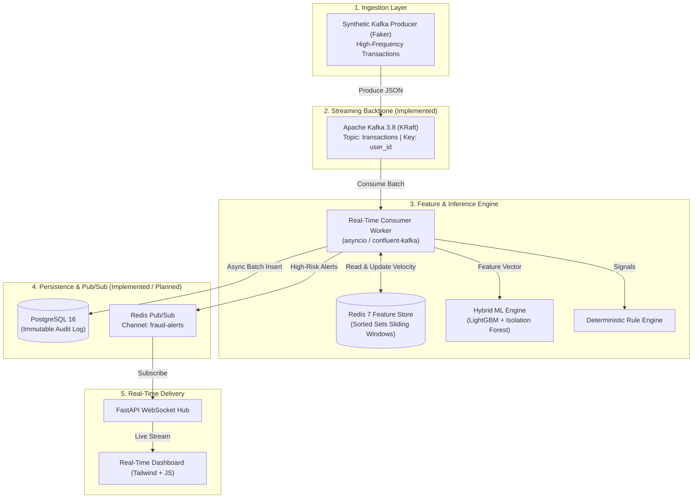

# Real-Time Fraud Detection Streaming System

A production-grade, event-driven streaming system for real-time financial fraud detection, designed to process high-frequency transaction streams with sub-millisecond feature extraction, hybrid machine learning scoring, immutable database persistence, and live WebSocket alert fan-out.

---

## 1. Project Overview

Modern financial platforms process thousands of transactions per second. Fraud detection must operate within strict latency budgets (<50 ms) to approve or decline authorizations before checkout timeouts occur.

This system demonstrates an end-to-end distributed architecture:
- Ingests high-frequency financial events via **Apache Kafka** partitioned by `user_id`.
- Computes sliding-window velocity aggregations (e.g., 60-second and 10-minute spend/frequency) in **Redis**.
- Performs in-process hybrid inference using **LightGBM** (supervised classification) and **Isolation Forest** (unsupervised anomaly detection).
- Immutably persists transactions, computed feature vectors, risk scores, and decisions to **PostgreSQL**.
- Fans out high-risk alerts over **Redis Pub/Sub** to a **FastAPI WebSocket hub** feeding a live analytics dashboard.

---

## 2. System Architecture



Detailed architectural blueprints and decision rationales are available in [docs/01-architecture.md](docs/01-architecture.md).

---

## 3. Technology Stack

| Technology | Role | Rationale |
| :--- | :--- | :--- |
| **Apache Kafka 3.8.0** | Event Ingestion & Buffer | Distributed commit log, partition ordering via `user_id`, KRaft consensus without ZooKeeper. |
| **PostgreSQL 16 (Alpine)** | System of Record | ACID compliance, composite indexing on `(user_id, created_at DESC)`, exact `NUMERIC` monetary precision. |
| **Redis 7 (Alpine)** | Feature Store & Pub/Sub | Sub-millisecond latency for sliding-window velocity features using Sorted Sets; lightweight Pub/Sub alert fan-out. |
| **Python 3.12** | Core Application Logic | Modern type hints, high-performance runtime, native async support. |
| **`uv`** | Dependency & Env Manager | Blazing-fast virtual environment, lockfile, and package management. |
| **LightGBM** | Supervised Fraud Scoring | Fast CPU-bound gradient boosted tree inference for tabular transaction patterns. |
| **Isolation Forest** | Unsupervised Anomaly Detection | Identifies zero-day fraud patterns and statistical outliers without historical fraud labels. |
| **FastAPI & WebSockets** | Edge Streaming Hub | Async ASGI server for concurrent persistent browser connections. |
| **Docker Compose** | Local Infrastructure | Declarative, containerized local stack with health checks and persistent volumes. |

---

## 4. Repository Structure

```text
real-time-fraud-detection/
│
├── docs/
│   ├── 01-architecture.md           # System architecture, data flow, failure boundaries
│   └── 02-infrastructure.md           # Docker Compose, networking, volume topologies
│
├── .env.example                     # Infrastructure configuration template
├── .gitignore                       # Git exclusions (Python, Docker, artifacts, secrets)
├── docker-compose.yml               # Kafka KRaft, PostgreSQL 16, Redis 7 orchestration
└── README.md                        # Project documentation and reproduction guide
```

*Note: Component directories (`producers/`, `consumers/`, `models/`, `database/`, `dashboard/`) will be introduced in their respective implementation stages.*

---

## 5. Prerequisites

Before running the system, ensure the following software is installed on your workstation:

- **Docker Desktop** (or Docker Engine v24+ with Docker Compose v2.20+)
  - Windows: Docker Desktop with WSL2 backend recommended.
  - Linux: Native Docker Engine with `docker-compose-plugin`.
- **Git**
- **uv** (v0.4.0 or newer)
  - Fast Python package installer and resolver.
- **Python 3.12** (managed automatically via `uv` or installed locally).

---

## 6. `uv` Setup Instructions

> **Note:** Dependency and environment commands are executed manually by the developer.

### 6.1 Install `uv`
- **Windows (PowerShell):**
  ```powershell
  powershell -ExecutionPolicy ByPass -c "irm https://astral.sh/uv/install.ps1 | iex"
  ```
- **macOS / Linux:**
  ```bash
  curl -LsSf https://astral.sh/uv/install.sh | sh
  ```

### 6.2 Initialize & Sync Environment
From the `real-time-fraud-detection/` directory:

```bash
# Pin and install Python 3.12
uv python install 3.12

# Create a virtual environment
uv venv --python 3.12

# Activate the virtual environment:
# Windows PowerShell:
.venv\Scripts\Activate.ps1
# Linux / macOS:
source .venv/bin/activate
```

---

## 7. Infrastructure Startup & Verification (Step 1)

### 7.1 Start Infrastructure
From the project root:

```bash
# 1. Copy environment template
# Windows PowerShell:
Copy-Item .env.example .env
# Linux / macOS:
cp .env.example .env

# 2. Launch Kafka, PostgreSQL, and Redis in detached mode
docker compose up -d
```

### 7.2 Verify Container Health
Check running services:
```bash
docker compose ps
```

All three services should report `Up (healthy)`:
- `fraud-kafka` (`apache/kafka:3.8.0`)
- `fraud-postgres` (`postgres:16-alpine`)
- `fraud-redis` (`redis:7-alpine`)

### 7.3 Detailed Service Health Verification

```bash
# 1. Verify PostgreSQL connectivity
docker compose exec postgres pg_isready -U postgres -d fraud_detection

# 2. Verify Redis responsiveness
docker compose exec redis redis-cli ping

# 3. Verify Kafka broker status
docker compose exec kafka /opt/kafka/bin/kafka-broker-api-versions.sh --bootstrap-server localhost:9092
```

Detailed reproduction steps and troubleshooting guides are available in [docs/02-infrastructure.md](docs/02-infrastructure.md).

---

## 8. Implementation Stages Roadmap

- [x] **Stage 1: Environment Setup & Container Orchestration**
  - Apache Kafka in KRaft mode (no ZooKeeper)
  - PostgreSQL 16 Alpine with persistent volume and health check
  - Redis 7 Alpine with AOF persistence and health check
  - Dedicated bridge network `fraud-network`
  - Documentation: [docs/02-infrastructure.md](docs/02-infrastructure.md)
- [ ] **Stage 2: Relational Database Schema & Index Optimization** — [Specification & Guide](docs/stage-02-database.md)
- [ ] **Stage 3: Offline ML Model Training & Serialization** — [Specification & Guide](docs/stage-03-ml-pipeline.md)
- [ ] **Stage 4: Synthetic High-Frequency Kafka Producer** — [Specification & Guide](docs/stage-04-kafka-producer.md)
- [ ] **Stage 5: Redis Real-Time Feature Store** — [Specification & Guide](docs/stage-05-redis-feature-store.md)
- [ ] **Stage 6: Core Event Consumer & Real-Time ML Inference Engine** — [Specification & Guide](docs/stage-06-inference-engine.md)
- [ ] **Stage 7: PostgreSQL Persistence Layer** — [Specification & Guide](docs/stage-07-postgres-persistence.md)
- [ ] **Stage 8: Redis Pub/Sub Event Fan-Out** — [Specification & Guide](docs/stage-08-redis-pubsub.md)
- [ ] **Stage 9: FastAPI WebSocket Hub** — [Specification & Guide](docs/stage-09-fastapi-websocket.md)
- [ ] **Stage 10: Real-Time Dashboard & End-to-End Stress Testing** — [Specification & Guide](docs/stage-10-dashboard-and-stress-testing.md)
- [ ] **Stage 11: MLOps: Experiment Tracking, Model Registry & Drift Monitoring** — [Specification & Guide](docs/stage-11-mlops-pipeline.md)
- [ ] **Stage 12: CI/CD: Automated Testing, Linting & Container Packaging** — [Specification & Guide](docs/stage-12-cicd-pipeline.md)
- [ ] **Stage 13: Microsoft Azure Cloud Deployment & UI Host ($200 Budget Optimized)** — [Specification & Guide](docs/stage-13-azure-cloud-deployment.md)

---

## 9. Teardown & Cleanup

To stop containers while preserving persistent volumes:
```bash
docker compose down
```

To stop containers and destroy all volumes (fresh reset):
```bash
docker compose down -v
```
