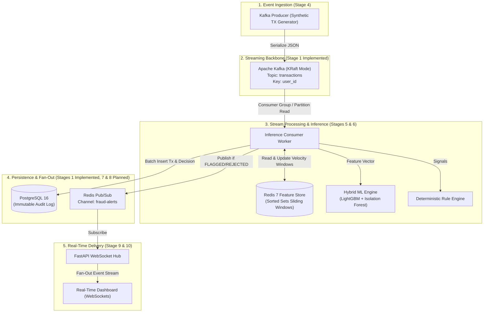
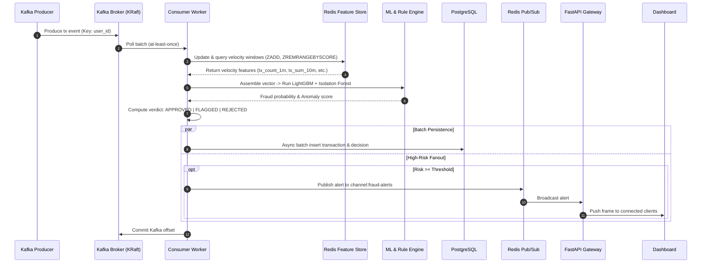

# 01 — System Architecture

## 1. System Overview

The **Real-Time Fraud Detection System** is an event-driven, low-latency streaming pipeline designed to ingest high-frequency financial transactions, compute dynamic behavioral velocity features in sub-millisecond windows, perform real-time hybrid machine learning inference (supervised gradient boosting + unsupervised anomaly isolation), persist immutable audit records, and stream high-risk alerts to live operational dashboards via WebSockets.

### Status Tracking & Lifecycle Stages

| Layer / Stage | Component | Status | Notes |
| :--- | :--- | :--- | :--- |
| **Stage 1** | Container Orchestration (Kafka KRaft, Postgres, Redis) | **Implemented** | Local infrastructure running via Docker Compose |
| **Stage 2** | Relational DB Schema & Index Optimization | **Implemented** | DDL, constraints, composite B-tree & partial indexes |
| **Stage 3** | Offline ML Model Training & Serialization | **Implemented** | LightGBM + Isolation Forest, PR-AUC, CPU benchmark |
| **Stage 4** | Synthetic High-Frequency Kafka Producer | *Planned* | Configurable TPS with anomaly injection |
| **Stage 5** | Redis Real-Time Feature Store | *Planned* | Sliding time windows with Sorted Sets |
| **Stage 6** | Consumer & Real-Time ML Inference Engine | *Planned* | Feature assembly, rule evaluation, verdicts |
| **Stage 7** | PostgreSQL Async Persistence Layer | *Planned* | Connection pooling, batch writes, DLQ |
| **Stage 8** | Redis Pub/Sub Event Fan-Out | *Planned* | High-risk alert publication |
| **Stage 9** | FastAPI WebSocket Gateway | *Planned* | Live alert streaming & client lifecycle |
| **Stage 10** | Real-Time Dashboard & Stress Benchmarks | *Planned* | Frontend UI, load & resilience testing |
| **Stage 11** | MLOps: Experiment Tracking & Drift Monitoring | *Planned* | MLflow, model registry, PSI drift evaluation |
| **Stage 12** | CI/CD: Automated Testing & Container Packaging | *Planned* | GitHub Actions, Ruff, Mypy, Pytest, ACR push |
| **Stage 13** | Microsoft Azure Cloud Deployment & UI Host | *Planned* | Azure VM/ACA, budget alerts, public live dashboard |

---

## 2. End-to-End System Architecture

---

## 3. Component Responsibilities & Technology Selection Rationale

### Apache Kafka (KRaft Mode)
- **Role:** Distributed, durable, replayable commit log acting as the ingestion buffer and streaming backbone.
- **Why Kafka?**
  - **Decoupling:** Protects downstream inference workers from high producer traffic bursts through bounded consumer pull semantics.
  - **Partitioning & Ordering:** Partitioning by `user_id` guarantees strict per-user transaction ordering across concurrent consumers without global locking.
  - **KRaft Mode (No ZooKeeper):** Eliminates external consensus complexity by managing metadata directly inside Kafka quorum controllers, reducing operational overhead, recovery latency, and memory footprint.

### Redis 7 (Alpine)
- **Role:** Dual-purpose in-memory engine:
  1. *Real-time sliding window feature store* (using Sorted Sets `ZADD`, `ZREMRANGEBYSCORE`, `ZCARD`, `ZUNIONSTORE` for 60-second and 10-minute velocity aggregates).
  2. *Lightweight Pub/Sub message broker* for event fan-out to edge WebSocket hubs.
- **Why Redis?**
  - In-memory data structures provide predictable sub-millisecond read/write latencies required to evaluate transaction velocity before a credit card authorization times out (typically <50ms SLA).

### PostgreSQL 16 (Alpine)
- **Role:** System of record and relational audit trail.
- **Why PostgreSQL?**
  - Strong ACID guarantees, rich indexing capabilities (e.g., composite B-Tree indexes on `(user_id, created_at DESC)`), and native support for exact monetary precision (`NUMERIC(12, 2)`), risk scoring, and JSONB payload archival.

### FastAPI & WebSockets
- **Role:** Asynchronous ASGI edge gateway providing persistent, bidirectional WebSocket communication to browser dashboards.
- **Why FastAPI & WebSockets?**
  - Built on `uvicorn` and `starlette`, handling thousands of concurrent idle client connections with minimal memory overhead while maintaining low broadcast latency from Redis Pub/Sub channels.

### Local In-Process ML Inference
- **Role:** Inference executes directly within the Python consumer process rather than over a remote microservice/HTTP RPC boundary.
- **Why Local Inference?**
  - Eliminates network hop overhead (saving 5–15 ms per transaction), serialization/deserialization penalty, and remote service failure states. The worker loads serialized LightGBM and Isolation Forest models directly into memory for CPU-optimized inference.

---

## 4. Event Lifecycle & Data Flow

---

## 5. Architectural & System Design Principles

### 1. Partitioning and Message Ordering Guarantees
- Kafka topics are keyed by `user_id`.
- Kafka guarantees that all records with the same partition key land in the same partition and are consumed strictly sequentially by the same consumer thread.
- This prevents race conditions when computing per-user sliding window velocity features in Redis.

### 2. At-Least-Once Delivery and Idempotency
- The system adopts **at-least-once processing semantics**.
- Consumers process batches, persist transactions to PostgreSQL with unique constraints (`idempotency_key` or `transaction_id`), and commit Kafka offsets only after durable persistence.
- In the event of a worker crash, replayed messages are handled idempotently via `ON CONFLICT (transaction_id) DO NOTHING`.

### 3. Backpressure Management
- Because Kafka uses a **pull-based** consumer model, consumers fetch only what they can process based on `max.poll.records`. Downstream bottlenecks do not cause worker memory overflow or dropped packets.

### 4. Failure Boundaries & Graceful Degradation
- If Redis is degraded, fallback baseline rule scoring can proceed with cold features or defaults while triggering operational alerts.
- If PostgreSQL connection pool encounters transient saturation, consumer buffering and exponential backoff retry policies prevent message loss before offset commit.
- If WebSocket clients disconnect, consumer processing and database persistence are completely unaffected due to the decoupled Redis Pub/Sub boundary.
