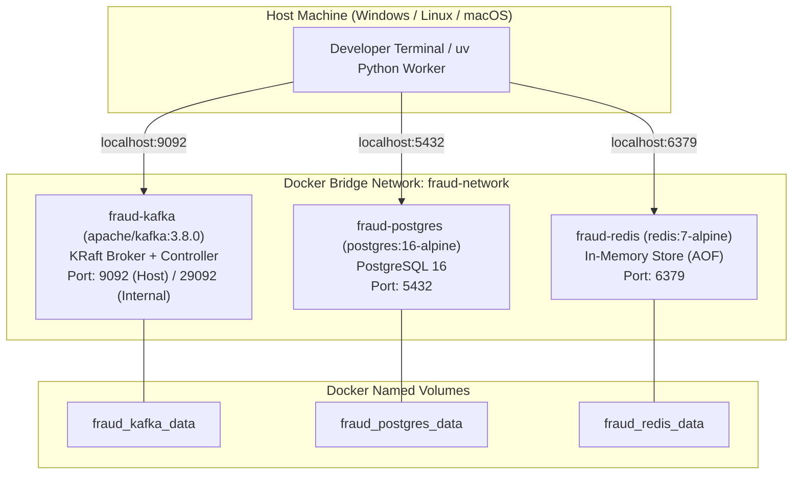

# 02 — Infrastructure & Container Orchestration

## 1. Overview

Stage 1 defines the containerized foundational infrastructure required to run the Real-Time Fraud Detection System locally. The stack consists of:

1. **Apache Kafka 3.8.0** in **KRaft mode** (no ZooKeeper) as the distributed event log.
2. **PostgreSQL 16 (Alpine)** as the relational database and immutable transaction audit store.
3. **Redis 7 (Alpine)** with Append-Only File (AOF) persistence as the in-memory feature store and Pub/Sub broker.
4. A dedicated Docker bridge network (`fraud-network`) and named persistent volumes.

---

## 2. Docker Compose Architecture



---

## 3. Service Specifications

### 3.1 Apache Kafka (KRaft Mode)
- **Container Name:** `fraud-kafka`
- **Image:** `apache/kafka:3.8.0`
- **KRaft Mode Rationale:** Traditional Kafka deployments required an Apache ZooKeeper cluster for cluster metadata and leader election. Kafka Raft Metadata mode (KRaft) consolidates metadata management into Kafka itself via an internal Raft quorum, significantly improving startup time, simplifying operational maintenance, and reducing resource usage.
- **Port Mapping:**
  - `9092:9092` — External listener exposed to host machine processes (producers, consumers, Python scripts).
  - `29092` — Internal inter-container listener for services within `fraud-network`.
  - `9093` — Internal controller listener dedicated to KRaft metadata consensus.
- **Listeners Configuration:**
  ```text
  KAFKA_LISTENERS: PLAINTEXT://0.0.0.0:29092,EXTERNAL://0.0.0.0:9092,CONTROLLER://0.0.0.0:9093
  KAFKA_ADVERTISED_LISTENERS: PLAINTEXT://kafka:29092,EXTERNAL://localhost:9092
  KAFKA_LISTENER_SECURITY_PROTOCOL_MAP: PLAINTEXT:PLAINTEXT,EXTERNAL:PLAINTEXT,CONTROLLER:PLAINTEXT
  ```
- **Cluster ID:** Fixed base64 16-byte UUID (`MkU3OEVBNTcwNTJENDM2Qk`) formatted automatically on initial volume creation.
- **Health Check:**
  ```yaml
  test: ["CMD-SHELL", "/opt/kafka/bin/kafka-broker-api-versions.sh --bootstrap-server localhost:9092 || exit 1"]
  interval: 10s
  timeout: 10s
  retries: 5
  start_period: 15s
  ```

### 3.2 PostgreSQL 16 Alpine
- **Container Name:** `fraud-postgres`
- **Image:** `postgres:16-alpine`
- **Environment Parameters:**
  - `POSTGRES_USER`: `postgres` (or as configured in `.env`)
  - `POSTGRES_PASSWORD`: `postgres_password` (or as configured in `.env`)
  - `POSTGRES_DB`: `fraud_detection`
  - `PGDATA`: `/var/lib/postgresql/data/pgdata` (sub-path prevents mount permission collisions)
- **Port Mapping:** `5432:5432`
- **Volume:** `fraud_postgres_data` mapped to `/var/lib/postgresql/data`
- **Health Check:**
  ```yaml
  test: ["CMD-SHELL", "pg_isready -U ${POSTGRES_USER:-postgres} -d ${POSTGRES_DB:-fraud_detection}"]
  interval: 10s
  timeout: 5s
  retries: 5
  start_period: 10s
  ```

### 3.3 Redis 7 Alpine
- **Container Name:** `fraud-redis`
- **Image:** `redis:7-alpine`
- **Command:** `redis-server --appendonly yes`
  - Rationale: Append-Only File (AOF) logs every write command received by the server, ensuring real-time velocity counters survive container restarts with minimal performance degradation.
- **Port Mapping:** `6379:6379`
- **Volume:** `fraud_redis_data` mapped to `/data`
- **Health Check:**
  ```yaml
  test: ["CMD", "redis-cli", "ping"]
  interval: 10s
  timeout: 5s
  retries: 5
  start_period: 5s
  ```

---

## 4. Networking & Storage Topology

### Dedicated Bridge Network: `fraud-network`
- Isolates fraud detection infrastructure from other Docker workloads.
- Provides automatic Docker DNS resolution: containers address each other by service name (e.g., `kafka:29092`, `postgres:5432`, `redis:6379`).

### Persistent Volumes
- `fraud_kafka_data`: Persists Kafka commit logs and KRaft cluster metadata across restarts.
- `fraud_postgres_data`: Persists database files, schema tables, and WAL records.
- `fraud_redis_data`: Persists Redis `appendonly.aof` file.

---

## 5. Environment Variables & Configuration

The deployment relies on a root `.env` file copied from `.env.example`:

```bash
# PostgreSQL Configuration
POSTGRES_USER=postgres
POSTGRES_PASSWORD=postgres_password
POSTGRES_DB=fraud_detection
POSTGRES_PORT=5432

# Redis Configuration
REDIS_PORT=6379

# Kafka Configuration
KAFKA_PORT=9092
KAFKA_CONTROLLER_PORT=9093
KAFKA_CLUSTER_ID=MkU3OEVBNTcwNTJENDM2Qk
```

---

## 6. Reproduction & Startup Instructions

### 6.1 Prerequisites
- Docker Engine & Docker Compose (v2.20+)
- Windows PowerShell (or Bash / Zsh for Linux/macOS)
- `uv` (v0.4.0+) for Python environment orchestration

### 6.2 Step 1 Execution Commands

#### Windows PowerShell:
```powershell
# 1. Navigate to the project root
cd real-time-fraud-detection

# 2. Create the active environment file from the example template
Copy-Item .env.example .env

# 3. Start containers in detached mode
docker compose up -d

# 4. Monitor container status and health
docker compose ps
```

#### Linux / macOS:
```bash
# 1. Navigate to the project root
cd real-time-fraud-detection

# 2. Create the active environment file from the example template
cp .env.example .env

# 3. Start containers in detached mode
docker compose up -d

# 4. Monitor container status and health
docker compose ps
```

---

## 7. Verification Procedures

### 7.1 Verify Container Status & Health
Run:
```bash
docker compose ps
```
**Expected Output:**
All three services must report `STATUS: Up (healthy)`:
```text
NAME             IMAGE                 COMMAND                  SERVICE      STATUS
fraud-kafka      apache/kafka:3.8.0    "/__cacert_entrypoin…"   kafka        Up (healthy)
fraud-postgres   postgres:16-alpine    "docker-entrypoint.s…"   postgres     Up (healthy)
fraud-redis      redis:7-alpine        "docker-entrypoint.s…"   redis        Up (healthy)
```

### 7.2 Verify PostgreSQL Connectivity
Run:
```bash
docker compose exec postgres pg_isready -U postgres -d fraud_detection
```
**Expected Output:**
```text
/var/run/postgresql:5432 - accepting connections
```

Or query the server version:
```bash
docker compose exec postgres psql -U postgres -d fraud_detection -c "SELECT version();"
```

### 7.3 Verify Redis Connectivity & Persistence
Run:
```bash
docker compose exec redis redis-cli ping
```
**Expected Output:**
```text
PONG
```

Verify persistence mode:
```bash
docker compose exec redis redis-cli config get appendonly
```
**Expected Output:**
```text
1) "appendonly"
2) "yes"
```

### 7.4 Verify Kafka Broker & Topic Operations
Check broker metadata:
```bash
docker compose exec kafka /opt/kafka/bin/kafka-broker-api-versions.sh --bootstrap-server localhost:9092
```

Create a verification topic:
```bash
docker compose exec kafka /opt/kafka/bin/kafka-topics.sh --create --topic infra-test --partitions 1 --replication-factor 1 --bootstrap-server localhost:9092
```

List topics to confirm:
```bash
docker compose exec kafka /opt/kafka/bin/kafka-topics.sh --list --bootstrap-server localhost:9092
```

Delete the verification topic:
```bash
docker compose exec kafka /opt/kafka/bin/kafka-topics.sh --delete --topic infra-test --bootstrap-server localhost:9092
```

---

## 8. Teardown & Reset Commands

To stop containers while **preserving data volumes**:
```bash
docker compose down
```

To stop containers and **delete all persistent volumes** (full fresh start):
```bash
docker compose down -v
```

---

## 9. Troubleshooting Common Issues

### Issue 1: Port Collisions (`5432`, `6379`, or `9092` already in use)
- **Symptom:** `Bind for 0.0.0.0:5432 failed: port is already allocated`.
- **Cause:** A local PostgreSQL, Redis, or Kafka instance is already bound to default ports on the host.
- **Resolution:** Modify the port mappings in your `.env` file (e.g., `POSTGRES_PORT=5433`, `REDIS_PORT=6380`, `KAFKA_PORT=9094`) and restart with `docker compose up -d`.

### Issue 2: Docker Daemon Not Running
- **Symptom:** `error during connect: This error may indicate that the docker daemon is not running`.
- **Resolution:** Start Docker Desktop on Windows/macOS, or start the systemd service on Linux (`sudo systemctl start docker`).

### Issue 3: Kafka Broker Fails to Start (Cluster ID / Volume Conflict)
- **Symptom:** `InconsistentBrokerMetadataException` or `Unformatted storage directory`.
- **Cause:** Volume retains state from an earlier formatting attempt with a mismatched cluster ID.
- **Resolution:** Remove the stale volume using `docker compose down -v` and restart with `docker compose up -d`.
