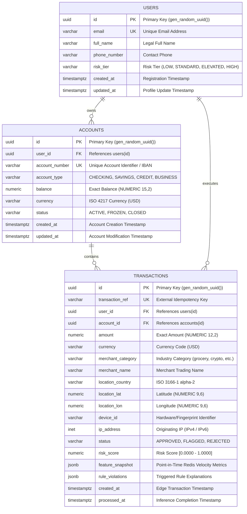

# 03 — Relational Database Architecture & Index Optimization

## 1. Overview & System of Record Role

In the Real-Time Fraud Detection System, **PostgreSQL 16** serves as the immutable system of record, relational audit ledger, and post-transaction dispute resolution platform.

While Kafka provides transient in-flight event buffers and Redis provides in-memory sliding-window velocity aggregations, PostgreSQL provides:
1. **ACID Transaction Guarantees:** Ensures account integrity, user association, and immutable transaction histories.
2. **Deterministic Auditing:** Stores point-in-time Redis velocity snapshots (`feature_snapshot`) and triggered rule lists (`rule_violations`) in binary JSON (`JSONB`), allowing compliance officers and ML engineers to reconstruct the exact context present when a risk decision was reached.
3. **Sub-Millisecond Query Optimization:** Features specialized composite and partial B-Tree indexes engineered for high-frequency user timeline queries and security operations dashboards.

---

## 2. Entity-Relationship (ER) Architecture



---

## 3. Schema Design & Constraints Specification

### 3.1 Primary & Foreign Key Conventions
- **Primary Keys:** All tables utilize **UUIDv4** keys generated via `gen_random_uuid()`. Compared to sequential integer IDs (`BIGSERIAL`), UUIDs eliminate enumeration vulnerabilities (e.g. IDOR attacks) and allow distributed ID generation at the edge before database insertion.
- **Foreign Keys:** `accounts.user_id` and `transactions.user_id` enforce `ON DELETE RESTRICT`. A user record cannot be accidentally purged if active transactional or account history exists.

### 3.2 Exact Monetary Precision (`NUMERIC(12, 2)`)
- **Strict Rule:** Never use `FLOAT` or `DOUBLE PRECISION` for financial balances or transaction amounts. Binary floating-point arithmetic (IEEE 754) introduces rounding inaccuracies:
  $$\$0.10 + \$0.20 = \$0.30000000000000004$$
- The schema uses **`NUMERIC(12, 2)`** for transactions (supporting amounts up to $\$9,999,999,999.99$) and **`NUMERIC(15, 2)`** for account balances.
- In addition, a `CHECK (amount > 0)` constraint guarantees that zero or negative charges cannot enter the transaction ledger.

### 3.3 Strict UTC Timestamps (`TIMESTAMPTZ`)
- All timestamp columns use **`TIMESTAMPTZ`** (timestamp with time zone).
- `created_at` represents the original edge event creation time in UTC.
- `processed_at` defaults to `NOW()`, capturing the exact microsecond when the inference consumer committed the verdict.
- Subtracting `processed_at - created_at` enables queryable telemetry on end-to-end pipeline transit latency.

### 3.4 Risk Scoring & Verdict Representation
- **Status:** Restricted by constraint `CHECK (status IN ('APPROVED', 'FLAGGED', 'REJECTED'))`.
- **Risk Score:** Constrained by `CHECK (risk_score >= 0.0000 AND risk_score <= 1.0000)`. Stored as `NUMERIC(5, 4)` to preserve 4 decimal digits of precision (e.g., `0.8942`).

### 3.5 Dynamic JSONB Audit Trails
- **`feature_snapshot JSONB`**: Contains the frozen feature vector returned from the Redis Feature Store (e.g. `{"tx_count_1m": 4, "tx_sum_10m": 1250.00}`).
- **`rule_violations JSONB`**: An array of human-readable rule codes triggered during evaluation (e.g. `["RULE_01: Bot velocity burst"]`).
- Using PostgreSQL's binary JSON format (`JSONB`) ensures fast parsing and enables containment queries using the `@>` operator.

---

## 4. Index Optimization & Performance Analysis

### Index 1: Composite B-Tree `(user_id, created_at DESC)`
```sql
CREATE INDEX idx_transactions_user_created
ON transactions (user_id, created_at DESC);
```
- **Query Pattern:**
  ```sql
  SELECT * FROM transactions
  WHERE user_id = 'a0eebc99-9c0b-4ef8-bb6d-6bb9bd380a11'
  ORDER BY created_at DESC
  LIMIT 10;
  ```
- **Engine Optimization:**
  - Standard indexes on `user_id` force the database engine to retrieve all rows for that user, load them into a temporary memory buffer, and perform a CPU-intensive Quicksort to satisfy `ORDER BY created_at DESC`.
  - By including `created_at DESC` directly within the index leaf pages, PostgreSQL performs a direct **Index Scan Backward / Index Scan**, reading only the top 10 matching pointers and terminating execution in under **0.2 ms**.

### Index 2: Partial Index on Security Anomaly Rows
```sql
CREATE INDEX idx_transactions_status_created
ON transactions (status, created_at DESC)
WHERE status IN ('FLAGGED', 'REJECTED');
```
- **Why Partial?**
  - In a typical payment processor, over 98% of transactions are `APPROVED`.
  - Indexing all transactions wastes megabytes of RAM on unflagged records.
  - By adding `WHERE status IN ('FLAGGED', 'REJECTED')`, the index occupies **< 2%** of the space of a full table index, ensuring it remains pinned permanently in PostgreSQL's shared memory buffers (`shared_buffers`) for real-time security dashboard queries.

### Index 3: Foreign Key Join Indexes
```sql
CREATE INDEX idx_accounts_user ON accounts (user_id);
CREATE INDEX idx_transactions_account ON transactions (account_id);
```
- PostgreSQL does **not** automatically create indexes on foreign key columns. Without these indexes, joining `users` to `accounts` or `accounts` to `transactions` results in expensive sequential table scans (`Seq Scan`).

---

## 5. Write Throughput, Batching & Connection Management

### 5.1 The Bottleneck of Per-Row Inserts
Under high streaming loads (e.g., 200–500 TPS), executing individual `INSERT` queries per event causes:
1. One TCP network round-trip per transaction.
2. Continuous Write-Ahead Log (WAL) flushing (`fsync`) to disk on every commit.
3. Rapid connection pool saturation.

### 5.2 Micro-Batching Architecture (Integrated in Stage 7)
The consumer layer buffers scored transactions in memory and flushes them in micro-batches (e.g. 50–100 records per query or every 50 ms):
```sql
INSERT INTO transactions (
    transaction_ref, user_id, account_id, amount, currency,
    merchant_category, merchant_name, location_country,
    location_lat, location_lon, device_id, ip_address,
    status, risk_score, feature_snapshot, rule_violations,
    created_at, processed_at
)
VALUES
    ($1, $2, ...),
    ($18, $19, ...),
    ...
ON CONFLICT (transaction_ref) DO NOTHING;
```

### 5.3 Idempotency via `transaction_ref`
- The `transaction_ref` column possesses a strict `UNIQUE` constraint.
- If a consumer worker crashes and Kafka redelivers an uncommitted offset batch, `ON CONFLICT (transaction_ref) DO NOTHING` guarantees that previously written records are ignored without throwing primary key collision errors or duplicating financial records.

---

## 6. Verification Queries

To inspect the database and verify schema integrity:

```bash
# 1. Verify table creation and structure
docker compose exec postgres psql -U postgres -d fraud_detection -c "\dt"

# 2. Inspect table schema and check constraints
docker compose exec postgres psql -U postgres -d fraud_detection -c "\d transactions"

# 3. Verify composite and partial indexes
docker compose exec postgres psql -U postgres -d fraud_detection -c "\di"

# 4. Query seeded fixtures with formatted status breakdown
docker compose exec postgres psql -U postgres -d fraud_detection -c "SELECT status, count(*), round(avg(risk_score), 4) AS avg_risk, round(sum(amount), 2) AS total_volume FROM transactions GROUP BY status;"

# 5. Verify query optimization on composite index via EXPLAIN
docker compose exec postgres psql -U postgres -d fraud_detection -c "EXPLAIN ANALYZE SELECT * FROM transactions WHERE user_id = 'a0eebc99-9c0b-4ef8-bb6d-6bb9bd380a11' ORDER BY created_at DESC LIMIT 5;"
```
