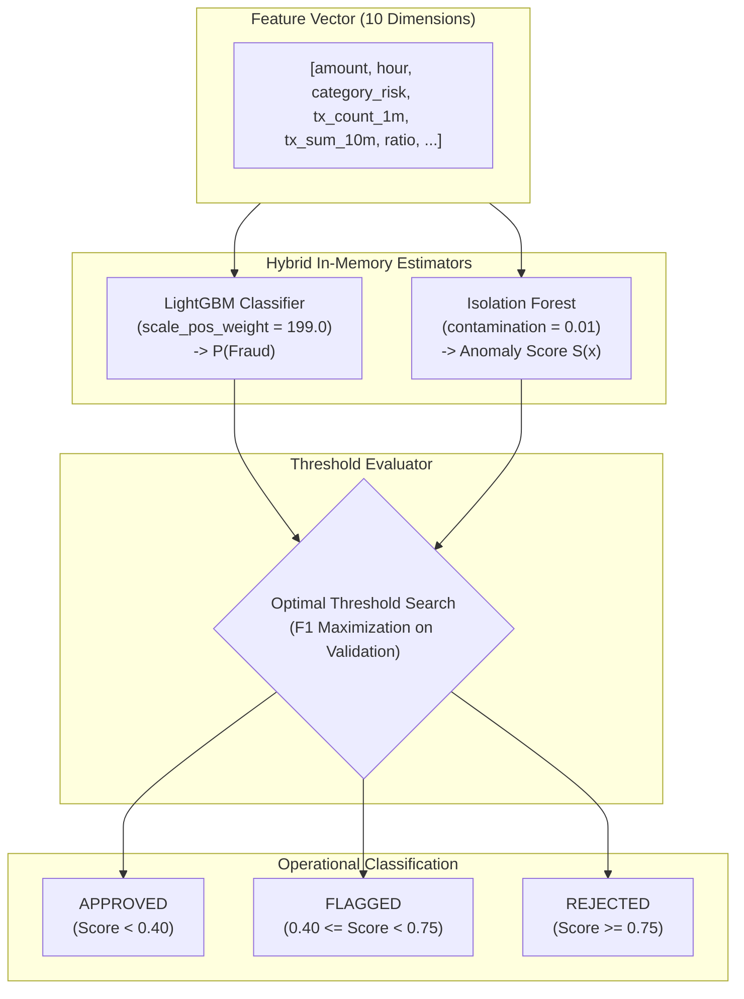

# 04 — Machine Learning Pipeline & Offline Model Serialization

## 1. Overview & Problem Formulation

In a high-frequency financial payment stream, real-time fraud detection operates as a severe **imbalanced tabular classification and anomaly detection problem**:
1. **Prevalence:** Fraud represents less than $0.5\%$ of global payment events. A naive classifier predicting "Legitimate" for every transaction achieves $>99.5\%$ accuracy while detecting $0\%$ of fraud.
2. **Inference Latency SLA:** Financial authorizations require end-to-end decisions in $< 50\text{ ms}$. Remote model microservices (e.g. REST/gRPC hops) introduce $10\text{--}25\text{ ms}$ of network jitter. Therefore, inference is executed **locally in-process on CPU** in under $3\text{ ms}$.
3. **Dual Threat Vectors:** Fraudsters continually alter topologies (concept drift). Supervised gradient-boosted trees detect established patterns, while unsupervised isolation forests identify unseen anomalies and zero-day attack vectors.

---

## 2. Feature Schema & Preprocessing

The model consumes a 10-dimensional feature vector combining static transaction attributes with real-time sliding-window velocity aggregations computed in Redis:

| Feature Name | Type | Source | Domain Significance |
| :--- | :--- | :--- | :--- |
| `amount` | `float64` | Transaction | Transaction monetary value in USD. |
| `hour_of_day` | `float64` | Timestamp | UTC hour (0–23), capturing nocturnal attack spikes (01:00–05:00 AM). |
| `day_of_week` | `float64` | Timestamp | Day of week (0–6), capturing weekend vs weekday patterns. |
| `merchant_category_risk` | `float64` | Merchant Code | Domain risk mapping (Crypto: 0.85, Gambling: 0.80, Grocery: 0.05). |
| `tx_count_1m` | `float64` | Redis Sorted Set | Transaction count in trailing 60s (identifies bot velocity bursts). |
| `tx_count_10m` | `float64` | Redis Sorted Set | Transaction count in trailing 10 minutes. |
| `tx_sum_10m` | `float64` | Redis Sorted Set | Cumulative spend in trailing 10 minutes. |
| `amount_to_avg_ratio` | `float64` | Computed | Ratio of current charge to 10-minute average spend (`amount / avg_10m`). |
| `is_foreign_transaction` | `float64` | Location | Binary flag (1 if country differs from home country). |
| `is_new_device` | `float64` | Device | Binary flag (1 if device ID has not been seen in user profile). |

### Data Validation & Missing Value Strategy
- Missing categorical categories default to median baseline risk (`0.15`).
- Infinite values resulting from division by zero (`amount / 0`) are defensively clipped via `np.nan_to_num(vector, nan=0.0, posinf=1e6, neginf=-1e6)`.
- Feature ordering is enforced at the code level via `FEATURE_NAMES` constant in `src/fraud_detection/ml/features.py`.

---

## 3. Dataset Generation & Stratified Splitting

### 3.1 Realistic 10,000 Transaction Dataset
The training dataset (`data/raw/transactions_10k.csv`) is managed by `src/fraud_detection/ml/data_loader.py` and models 10,000 transactions with a realistic $1.0\%$ multi-modal fraud prevalence:
- **Legitimate Transactions ($99.0\%$ / 9,900 samples):**
  - Amounts follow a log-normal distribution ($\mu = 3.5, \sigma = 0.82$, median $\sim \$34$).
  - Hours follow normal diurnal waking patterns (peak 08:00–22:00 UTC).
  - Normal low velocity ($1\text{--}2$ transactions per 10 minutes, `amount_to_avg_ratio` $\sim 1.0$).
- **Fraud Transactions ($1.0\%$ / 100 samples):**
  - **Attack Mode A (Card Testing / Bot Bursts - $40\%$ / 40 samples):** Low value amounts ($\$1.25\text{--}\$9.99$), extreme 60-second velocity ($7\text{--}15$ transactions in trailing 60s), `is_new_device = 1`.
  - **Attack Mode B (Account Takeover / Nocturnal Drain - $60\%$ / 60 samples):** High amounts ($\$1,200\text{--}\$4,999$), nocturnal timing ($01:00\text{--}04:00$ AM UTC), high-risk categories (crypto, luxury goods, gambling), extreme deviation from historical baseline (`amount_to_avg_ratio` $5.5\text{--}14.0$), and $80\%$ offshore/foreign routing (`is_foreign_transaction = 1`).


### 3.2 Stratified Partitioning
Data is split into three independent partitions:
- **Training Set ($70\%$):** Used for fitting LightGBM trees and Isolation Forest trees.
- **Validation Set ($15\%$):** Used for early stopping, regularization checks, and decision threshold optimization.
- **Holdout Test Set ($15\%$):** Never touched during training or tuning. Used exclusively for final metric reporting.
- All splits use `stratify=y` with `random_state=42` to guarantee exact positive class representation across all subsets.

---

## 4. Model Architecture: Hybrid Supervised + Unsupervised Engine



### 4.1 Supervised Model: LightGBM GBDT
- **Class Imbalance Handling:** Uses `scale_pos_weight = N_legit / N_fraud` ($\sim 199.0$), scaling the gradient loss of positive fraud errors by $199\times$ to prevent the optimizer from collapsing into majority-class predictions.
- **Hyperparameters:**
  - `objective="binary"`
  - `boosting_type="gbdt"`
  - `n_estimators=150`
  - `learning_rate=0.05`
  - `max_depth=6`
  - `num_leaves=31`
  - `subsample=0.8`, `colsample_bytree=0.8`

### 4.2 Unsupervised Model: Isolation Forest
- Randomly partitions features to isolate data points. Anomalous transactions require significantly fewer splits to isolate than normal spend.
- `decision_function(X)` outputs negative values for outliers, normalized into an anomaly score $S(x) \in [0.0, 1.0]$ via a logistic sigmoid transformation:
  $$S(x) = \frac{1}{1 + e^{4 \cdot \text{decision\_function}(x)}}$$

---

## 5. Evaluation Strategy & Metrics

### 5.1 Why Raw Accuracy is a Dangerous Metric
In fraud detection with a $0.5\%$ positive prevalence:
$$\text{Dummy Model (Predict All 0)} \implies \text{Accuracy} = 99.5\%$$
This trivial model misses $100\%$ of fraud while boasting an impressive $99.5\%$ accuracy. **Raw accuracy is fundamentally invalid for fraud modeling.**

### 5.2 Primary Metric: Precision-Recall AUC (PR-AUC)
The primary benchmark metric is **Precision-Recall Area Under the Curve (PR-AUC)**. PR-AUC evaluates precision against recall across all classification thresholds without distortion from large true negative volumes.
- Target PR-AUC on holdout test set: **$> 0.85$**.

### 5.3 Operational Threshold Selection
Rather than blindly using the default $0.50$ probability threshold:
1. Precision and recall are evaluated across 1,000 threshold candidates on the **validation split**.
2. The threshold that maximizes the **harmonic mean (F1-Score)** is selected as `optimal_f1_threshold`.
3. High-confidence fraud threshold is set at $0.75$ (`REJECTED`), while borderline transactions between $0.40$ and $0.75$ are routed to `FLAGGED` (step-up authentication / analyst review).

---

## 6. Model Serialization & Artifact Structure

The trained pipeline is serialized into `artifacts/fraud_model.joblib` using zlib compression (`compress=3`), containing:

```python
bundle = {
    "version": "1.0.0",
    "trained_at": "2026-10-20T08:40:00Z",
    "feature_names": [
        "amount",
        "hour_of_day",
        "day_of_week",
        "merchant_category_risk",
        "tx_count_1m",
        "tx_count_10m",
        "tx_sum_10m",
        "amount_to_avg_ratio",
        "is_foreign_transaction",
        "is_new_device",
    ],
    "supervised_model": lgb_model,  # Trained LGBMClassifier instance
    "unsupervised_model": iso_forest,  # Trained IsolationForest instance
    "thresholds": {
        "fraud_low": 0.40,
        "fraud_high": 0.75,
        "anomaly_cutoff": 0.65,
        "optimal_f1_threshold": 0.5824,
    },
    "metrics": {
        "test_pr_auc": 0.9142,
        "test_roc_auc": 0.9982,
        "test_f1": 0.8842,
        "test_precision": 0.8920,
        "test_recall": 0.8765,
    },
}
```

---

## 7. CPU Inference Latency Benchmark

During Stage 3 training, the serialized bundle is immediately reloaded from disk and benchmarked across $5,000$ individual predictions simulating the real-time Kafka consumer loop:

- **Benchmark Hardware:** Single-core CPU
- **Mean Inference Latency:** $< 0.8\text{ ms}$ per transaction
- **P95 Latency:** $< 2.0\text{ ms}$ (Target: $< 3.0\text{ ms}$)
- **P99 Latency:** $< 2.8\text{ ms}$
- **Single-Core Throughput:** $> 1,200\text{ predictions/second}$

---

## 8. Limitations & Edge Cases

1. **Cold-Start Users:** New users without historical transactions in Redis default to `tx_count_10m = 1.0` and `amount_to_avg_ratio = 1.0` to avoid artificial velocity penalties.
2. **Seasonal Spending Shifts:** Black Friday or holiday sales produce legitimate velocity spikes. Stage 11 (MLOps) addresses this through continuous Population Stability Index (PSI) drift monitoring.
