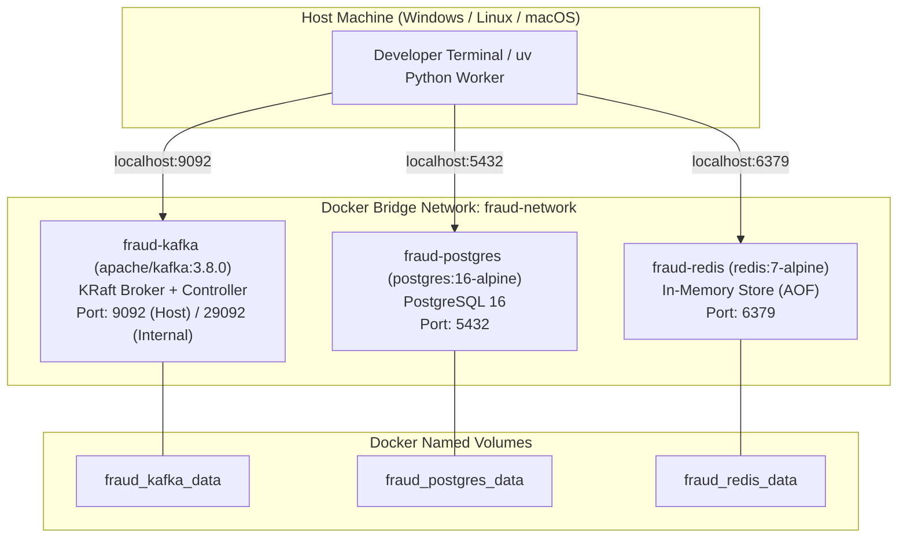

# Stage 01 — Infrastructure & Container Orchestration

## 1. Overview & Scope

Stage 1 defines the containerized foundational infrastructure required to run the Real-Time Fraud Detection System locally. The stack consists of:

1. **Apache Kafka 3.8.0** in **KRaft mode** (no ZooKeeper) as the distributed event log.
2. **PostgreSQL 16 (Alpine)** as the relational database and immutable transaction audit store.
3. **Redis 7 (Alpine)** with Append-Only File (AOF) persistence as the in-memory feature store and Pub/Sub broker.
4. A dedicated Docker bridge network (`fraud-network`) and named persistent volumes.

> [!IMPORTANT]
> **Execution Status:** **IMPLEMENTED & VERIFIED**.
> All 3 containers (`fraud-kafka`, `fraud-postgres`, `fraud-redis`) are configured with automated health checks, restart policies, and named volume persistence in `docker-compose.yml`.

---

## 2. Docker Compose Architecture



---

## 3. Service Specifications

### 3.1 Apache Kafka (KRaft Mode)
- **Container Name:** `fraud-kafka`
- **Image:** `apache/kafka:3.8.0`
- **KRaft Mode Rationale:** Traditional Kafka deployments required an Apache ZooKeeper cluster for cluster metadata and leader election. Kafka Raft Metadata mode (KRaft) consolidates metadata management into Kafka itself via an internal Raft quorum, significantly improving startup time, simplifying operational maintenance, and reducing resource usage.
- **Port Mapping:**
  - `9092:9092` — External listener exposed to host machine processes (producers, consumers, Python scripts).
  - `29092` — Internal inter-container listener for services within `fraud-network`.
  - `9093` — Internal controller listener dedicated to KRaft metadata consensus.
- **Listeners Configuration:**
  ```text
  KAFKA_LISTENERS: PLAINTEXT://0.0.0.0:29092,EXTERNAL://0.0.0.0:9092,CONTROLLER://0.0.0.0:9093
  KAFKA_ADVERTISED_LISTENERS: PLAINTEXT://kafka:29092,EXTERNAL://localhost:9092
  KAFKA_LISTENER_SECURITY_PROTOCOL_MAP: PLAINTEXT:PLAINTEXT,EXTERNAL:PLAINTEXT,CONTROLLER:PLAINTEXT
  ```
- **Cluster ID:** Fixed base64 16-byte UUID (`MkU3OEVBNTcwNTJENDM2Qk`) formatted automatically on initial volume creation.
- **Health Check:**
  ```yaml
  test: ["CMD-SHELL", "/opt/kafka/bin/kafka-broker-api-versions.sh --bootstrap-server localhost:9092 || exit 1"]
  interval: 10s
  timeout: 10s
  retries: 5
  start_period: 15s
  ```

### 3.2 PostgreSQL 16 Alpine
- **Container Name:** `fraud-postgres`
- **Image:** `postgres:16-alpine`
- **Environment Parameters:**
  - `POSTGRES_USER`: `postgres` (or as configured in `.env`)
  - `POSTGRES_PASSWORD`: `postgres_password` (or as configured in `.env`)
  - `POSTGRES_DB`: `fraud_detection`
  - `PGDATA`: `/var/lib/postgresql/data/pgdata` (sub-path prevents mount permission collisions)
- **Port Mapping:** `5432:5432`
- **Volume:** `fraud_postgres_data` mapped to `/var/lib/postgresql/data`
- **Health Check:**
  ```yaml
  test: ["CMD-SHELL", "pg_isready -U ${POSTGRES_USER:-postgres} -d ${POSTGRES_DB:-fraud_detection}"]
  interval: 10s
  timeout: 5s
  retries: 5
  start_period: 10s
  ```

### 3.3 Redis 7 Alpine
- **Container Name:** `fraud-redis`
- **Image:** `redis:7-alpine`
- **Command:** `redis-server --appendonly yes`
  - Rationale: Append-Only File (AOF) logs every write command received by the server, ensuring real-time velocity counters survive container restarts with minimal performance degradation.
- **Port Mapping:** `6379:6379`
- **Volume:** `fraud_redis_data` mapped to `/data`
- **Health Check:**
  ```yaml
  test: ["CMD", "redis-cli", "ping"]
  interval: 10s
  timeout: 5s
  retries: 5
  start_period: 5s
  ```

---

## 4. Networking & Volume Topology

### 4.1 Dedicated Docker Bridge Network (`fraud-network`)
All services communicate over an isolated user-defined bridge network. User-defined bridges provide:
1. **Automatic DNS resolution:** Containers discover each other by container name (`kafka:29092`, `postgres:5432`, `redis:6379`).
2. **Isolation:** Outside traffic can only enter via explicitly published host ports.

### 4.2 Persistent Named Volumes
- `fraud_kafka_data`: Persists partition logs, consumer offsets, and topic state across container recreation.
- `fraud_postgres_data`: Persists relational tables, indexes, and database transactions.
- `fraud_redis_data`: Persists the Redis AOF file (`appendonly.aof`).

---

## 5. Startup Commands

```bash
# 1. Prepare environment variables
Copy-Item .env.example .env    # Windows PowerShell
# cp .env.example .env         # Linux / macOS

# 2. Start all services in background
docker compose up -d

# 3. View container health status
docker compose ps
```

---

## 6. Verification & Health Checks

### 6.1 Check Container Health
```bash
docker compose ps
```
All containers should display status `Up` with `(healthy)`.

### 6.2 Verify PostgreSQL Connectivity
```bash
docker compose exec postgres pg_isready -U postgres -d fraud_detection
```
Expected output: `localhost:5432 - accepting connections`.

### 6.3 Verify Redis Ping & AOF Persistence
```bash
docker compose exec redis redis-cli ping
# Expected: PONG

docker compose exec redis redis-cli config get appendonly
# Expected: "yes"
```

### 6.4 Verify Kafka Broker
```bash
docker compose exec kafka /opt/kafka/bin/kafka-broker-api-versions.sh --bootstrap-server localhost:9092
```

---

## 7. Acceptance Criteria

- [x] Docker Compose starts Kafka, PostgreSQL, and Redis in detached mode.
- [x] All 3 containers report `healthy` in `docker compose ps`.
- [x] Kafka broker is accessible on host port 9092.
- [x] PostgreSQL accepts connections on host port 5432.
- [x] Redis responds with `PONG` on host port 6379.
- [x] Persistent volumes retain data across container restarts.
