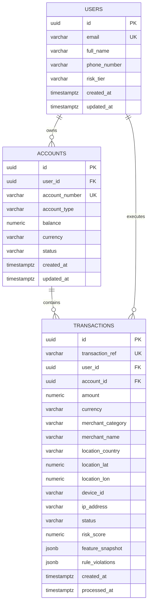

# Stage 02 — Relational Database Schema & Index Optimization

## 1. Stage Objective & Scope

Stage 2 focuses on creating the relational foundation and persistent system of record in PostgreSQL 16. In an enterprise financial fraud pipeline, the relational database serves as the immutable audit log, regulatory compliance archive, and source of truth for post-transaction dispute resolution and model retraining.

**Primary Deliverable:** `database/init.sql` mounted into `/docker-entrypoint-initdb.d/init.sql` on the PostgreSQL container, establishing tables, constraints, foreign keys, exact monetary precision types, JSONB feature stores, and specialized composite B-Tree indexes.

> [!IMPORTANT]
> **Execution Status:** **IMPLEMENTED & READY FOR VERIFICATION**.
> Complete DDL script available in `database/init.sql` and mounted into `docker-compose.yml`.

---

## 2. Entity-Relationship & Schema Architecture



---

## 3. Detailed Technical Specifications

### 3.1 Table Definitions & Column Types

#### `users` Table
Stores customer profiles and baseline risk classifications.
- `id UUID PRIMARY KEY DEFAULT gen_random_uuid()`
- `email VARCHAR(255) NOT NULL UNIQUE`
- `full_name VARCHAR(255) NOT NULL`
- `phone_number VARCHAR(50)`
- `risk_tier VARCHAR(20) DEFAULT 'STANDARD' CHECK (risk_tier IN ('LOW', 'STANDARD', 'ELEVATED', 'HIGH'))`
- `created_at TIMESTAMPTZ NOT NULL DEFAULT NOW()`
- `updated_at TIMESTAMPTZ NOT NULL DEFAULT NOW()`

#### `accounts` Table
Stores banking or payment accounts tied to users.
- `id UUID PRIMARY KEY DEFAULT gen_random_uuid()`
- `user_id UUID NOT NULL REFERENCES users(id) ON DELETE RESTRICT`
- `account_number VARCHAR(34) NOT NULL UNIQUE` (Supports IBAN lengths up to 34 chars)
- `account_type VARCHAR(50) NOT NULL DEFAULT 'CHECKING'`
- `balance NUMERIC(15, 2) NOT NULL DEFAULT 0.00`
- `currency VARCHAR(3) NOT NULL DEFAULT 'USD'`
- `status VARCHAR(20) NOT NULL DEFAULT 'ACTIVE' CHECK (status IN ('ACTIVE', 'FROZEN', 'CLOSED'))`
- `created_at TIMESTAMPTZ NOT NULL DEFAULT NOW()`
- `updated_at TIMESTAMPTZ NOT NULL DEFAULT NOW()`

#### `transactions` Table
The immutable transactional audit ledger containing both financial payloads and ML evaluation metadata.
- `id UUID PRIMARY KEY DEFAULT gen_random_uuid()`
- `transaction_ref VARCHAR(64) NOT NULL UNIQUE` (External idempotency key from Kafka producer)
- `user_id UUID NOT NULL REFERENCES users(id) ON DELETE RESTRICT`
- `account_id UUID NOT NULL REFERENCES accounts(id) ON DELETE RESTRICT`
- `amount NUMERIC(12, 2) NOT NULL CHECK (amount > 0)` (Strict non-floating monetary representation)
- `currency VARCHAR(3) NOT NULL DEFAULT 'USD'`
- `merchant_category VARCHAR(100) NOT NULL` (e.g., `crypto`, `electronics`, `grocery`, `gambling`)
- `merchant_name VARCHAR(255) NOT NULL`
- `location_country VARCHAR(2) NOT NULL` (ISO 3166-1 alpha-2)
- `location_lat NUMERIC(9, 6)`
- `location_lon NUMERIC(9, 6)`
- `device_id VARCHAR(128)`
- `ip_address INET`
- `status VARCHAR(20) NOT NULL CHECK (status IN ('APPROVED', 'FLAGGED', 'REJECTED'))`
- `risk_score NUMERIC(5, 4) NOT NULL CHECK (risk_score >= 0.0000 AND risk_score <= 1.0000)`
- `feature_snapshot JSONB NOT NULL DEFAULT '{}'` (Stores point-in-time velocity features from Redis)
- `rule_violations JSONB NOT NULL DEFAULT '[]'` (Array of deterministic rule trigger descriptions)
- `created_at TIMESTAMPTZ NOT NULL` (Original transaction event timestamp generated at edge)
- `processed_at TIMESTAMPTZ NOT NULL DEFAULT NOW()` (Timestamp when consumer worker committed decision)

---

## 4. Index Design & Query Pattern Optimization

### Index 1: Composite B-Tree on `(user_id, created_at DESC)`
```sql
CREATE INDEX idx_transactions_user_created
ON transactions (user_id, created_at DESC);
```
- **Why this index exists:** Fraud investigations and customer service queries require retrieving the most recent transactions for a specific user (e.g., `SELECT * FROM transactions WHERE user_id = $1 ORDER BY created_at DESC LIMIT 20`).
- **Performance Trade-off:** By matching both the filtering predicate (`user_id = $1`) and the sorting column (`created_at DESC`), PostgreSQL performs an **Index Scan** with zero heap sorting overhead. The cost is negligible additional write amplification on inserts.

### Index 2: Status & Time B-Tree on `(status, created_at DESC)`
```sql
CREATE INDEX idx_transactions_status_created
ON transactions (status, created_at DESC)
WHERE status IN ('FLAGGED', 'REJECTED');
```
- **Partial Index Strategy:** 98%+ of normal transactions will be `APPROVED`. By indexing only `FLAGGED` and `REJECTED` rows, the index size remains minimal (~2% of the table size), keeping it completely resident in RAM for fast operational dashboard queries.

### Index 3: Idempotency Key Index
- Handled automatically by `UNIQUE (transaction_ref)`. Enables sub-millisecond lookups for deduplication during `ON CONFLICT (transaction_ref) DO NOTHING`.

---

## 5. Write Throughput & Connection Considerations

1. **High Ingestion Write Patterns:**
   - Single-row `INSERT` statements over HTTP/TCP bottleneck at high TPS due to network round-trip time (RTT).
   - The persistence layer (Stage 7) will execute **micro-batched `COPY` or multi-row `INSERT` statements** (e.g., 50–100 rows per batch) within a single transaction.
2. **Monetary Precision:**
   - Never use `FLOAT` or `DOUBLE PRECISION` for currency due to IEEE 754 binary floating-point rounding errors (e.g., `0.1 + 0.2 = 0.30000000000000004`).
   - We strictly mandate `NUMERIC(12, 2)` (supports transactions up to 9,999,999,999.99).
3. **JSONB Auditing:**
   - Storing `feature_snapshot` as `JSONB` preserves the exact dynamic Redis features (velocity count, moving sum) present when the decision was made, enabling deterministic offline backtesting.

---

## 6. Implementation Deliverables (When Triggered)

When Stage 2 is triggered (`Start Step 2`), the following actions will be performed:
1. Create `database/init.sql` with full DDL, constraints, seed data, and indexes.
2. Update `docker-compose.yml` to mount `database/init.sql` into `/docker-entrypoint-initdb.d/init.sql`.
3. Restart the PostgreSQL container or run `init.sql` against the existing database.
4. Update `README.md` and `docs/03-database.md`.

---

## 7. Verification & Acceptance Criteria

When Stage 2 is executed, it must satisfy:
- [ ] `database/init.sql` runs cleanly without syntax errors.
- [ ] Tables `users`, `accounts`, and `transactions` exist.
- [ ] Foreign keys enforce referential integrity (`user_id` and `account_id`).
- [ ] Status check constraint rejects values outside `APPROVED`, `FLAGGED`, `REJECTED`.
- [ ] Risk score check constraint rejects values outside `[0.0000, 1.0000]`.
- [ ] Composite index `(user_id, created_at DESC)` is present and used by `EXPLAIN ANALYZE`.
- [ ] Seed fixtures (test users and accounts) are loaded.
