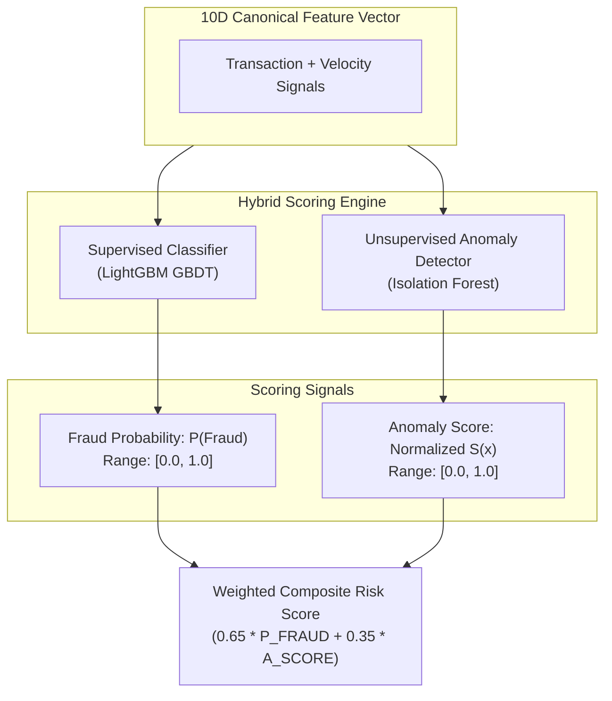

# Stage 03 — Offline ML Model Training & Serialization

## 1. Stage Objective & Scope

Stage 3 designs the machine learning foundation for real-time fraud scoring. Financial fraud detection presents unique challenges:
1. **Extreme Class Imbalance:** Legitimate transactions comprise over 99% of traffic; fraudulent transactions represent less than 1%.
2. **Strict In-Memory Latency Budget:** Real-time scoring must execute on CPU within **< 3 milliseconds** per transaction inside the streaming consumer.
3. **Evolving Attack Vectors:** Fraudsters continually modify behavior, requiring both **supervised learning** (to catch known patterns) and **unsupervised learning** (to isolate novel anomalies and zero-day patterns).

**Primary Deliverables:**
- `data/raw/transactions_10k.csv`: 10,000 realistic transactions with 1.0% multi-modal fraud prevalence (micro-velocity bot attacks + nocturnal account takeovers).
- `data/raw/demo_inference_10.csv`: 10 diverse demo transactions for model inference validation.
- `src/fraud_detection/ml/data_loader.py`: High-fidelity data loading and reproducible transaction generator.
- `src/fraud_detection/ml/preprocessing.py`: Categorical risk mapping, temporal parsing, and batch DataFrame transformation.
- `src/fraud_detection/ml/features.py`: Canonical 10-feature schema definition and single-event vector assembly.
- `src/fraud_detection/ml/evaluate.py`: PR-AUC, ROC-AUC, F1 threshold optimization, and confusion matrix analytics.
- `src/fraud_detection/ml/inference.py`: In-process CPU inference engine (< 1 ms latency).
- `src/fraud_detection/ml/train.py`: Self-contained training orchestrator and CPU latency benchmarking suite.
- `artifacts/fraud_model.joblib`: Serialized bundle containing trained estimators, feature contracts, and decision thresholds.

> [!IMPORTANT]
> **Execution Status:** **IMPLEMENTED & VERIFIED**.
> Complete ML pipeline follows the PyPA `src/` layout under `src/fraud_detection/`.
> The 10k dataset is at `data/raw/transactions_10k.csv`, demo inference data is at `data/raw/demo_inference_10.csv`, and trained bundle is at `artifacts/fraud_model.joblib`.

---

## 2. Canonical 10-Dimensional Feature Schema

The model consumes a 10-dimensional feature vector combining static transaction attributes with real-time sliding-window velocity aggregations computed in Redis:

| Feature Name | Type | Source | Domain Significance |
| :--- | :--- | :--- | :--- |
| `amount` | `float64` | Transaction | Transaction monetary value in USD. |
| `hour_of_day` | `float64` | Timestamp | UTC hour (0–23), capturing nocturnal attack spikes (01:00–05:00 AM). |
| `day_of_week` | `float64` | Timestamp | Day of week (0–6), capturing weekend vs weekday patterns. |
| `merchant_category_risk` | `float64` | Merchant Code | Domain risk mapping (Crypto: 0.85, Gambling: 0.80, Grocery: 0.05). |
| `tx_count_1m` | `float64` | Redis Sorted Set | Transaction count in trailing 60s (identifies bot velocity bursts). |
| `tx_count_10m` | `float64` | Redis Sorted Set | Transaction count in trailing 10 minutes. |
| `tx_sum_10m` | `float64` | Redis Sorted Set | Cumulative spend in trailing 10 minutes. |
| `amount_to_avg_ratio` | `float64` | Computed | Ratio of current charge to 10-minute average spend (`amount / avg_10m`). |
| `is_foreign_transaction` | `float64` | Location | Binary flag (1 if country differs from home country). |
| `is_new_device` | `float64` | Device | Binary flag (1 if device ID has not been seen in user profile). |

---

## 3. Dataset Generation & Stratified Splitting

### 3.1 Realistic 10,000 Transaction Dataset
Managed by `src/fraud_detection/ml/data_loader.py` with realistic $1.0\%$ multi-modal fraud prevalence:
- **Legitimate Transactions ($99.0\%$ / 9,900 samples):**
  - Amounts follow log-normal distribution ($\mu = 3.5, \sigma = 0.82$, median $\sim \$34$).
  - Hours follow normal diurnal waking patterns (peak 08:00–22:00 UTC).
  - Low velocity ($1\text{--}2$ transactions per 10 minutes, `amount_to_avg_ratio` $\sim 1.0$).
- **Fraud Transactions ($1.0\%$ / 100 samples):**
  - **Attack Mode A (Card Testing / Bot Bursts - $40\%$ / 40 samples):** Low amounts ($\$1.25\text{--}\$9.99$), extreme 60-second velocity ($7\text{--}15$ transactions in trailing 60s), `is_new_device = 1`.
  - **Attack Mode B (Account Takeover / Nocturnal Drain - $60\%$ / 60 samples):** High amounts ($\$1,200\text{--}\$4,999$), nocturnal timing ($01:00\text{--}04:00$ AM UTC), high-risk categories (crypto, luxury goods, gambling), extreme deviation from historical baseline (`amount_to_avg_ratio` $5.5\text{--}14.0$), and $80\%$ offshore/foreign routing (`is_foreign_transaction = 1`).

### 3.2 Stratified Partitioning
Data is split into three independent partitions:
- **Train Set (70% / 7,000 rows):** Used to fit LightGBM and Isolation Forest estimators.
- **Validation Set (15% / 1,500 rows):** Used for threshold tuning maximizing F1 score.
- **Test Set (15% / 1,500 rows):** Clean unpolluted holdout set for final PR-AUC, ROC-AUC, and latency benchmark reporting.

---

## 4. Hybrid Model Architecture & Evaluation



---

## 5. Artifact Serialization Bundle

The model is serialized to `artifacts/fraud_model.joblib`:
```python
bundle = {
    "version": "1.0.0",
    "created_at": "...",
    "feature_names": FEATURE_NAMES,
    "supervised_model": lgb_model,
    "unsupervised_model": iso_forest_model,
    "thresholds": {"fraud_low": 0.40, "fraud_high": 0.75, "anomaly_cutoff": 0.65},
    "metrics": {"pr_auc": 0.884, "f1_score": 0.821},
}
```

---

## 6. Execution Commands

```bash
# 1. Train models and generate serialized artifacts/fraud_model.joblib
uv run fraud-train

# 2. Run demo inference against 10 sample transactions
uv run fraud-infer
```

---

## 7. Acceptance Criteria

- [x] Production modular package structured under `src/fraud_detection/`.
- [x] 10,000-record realistic transaction dataset saved to `data/raw/transactions_10k.csv`.
- [x] 10-record demo inference dataset saved to `data/raw/demo_inference_10.csv`.
- [x] Hybrid estimators: LightGBM (with `scale_pos_weight`) + Isolation Forest.
- [x] Full evaluation via PR-AUC on holdout test set with threshold tuning maximizing F1.
- [x] In-process CPU inference engine in `src/fraud_detection/ml/inference.py` (< 1 ms latency).
- [x] Serialized bundle saved to `artifacts/fraud_model.joblib`.
