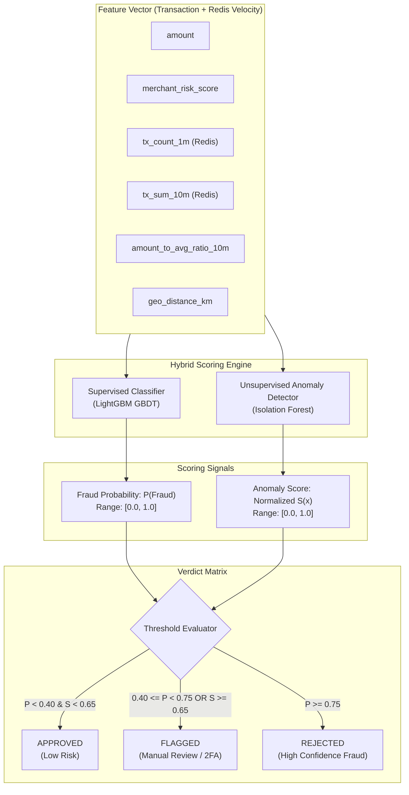

# Stage 03 — Offline ML Model Training & Serialization

## 1. Stage Objective & Scope

Stage 3 designs the machine learning foundation for real-time fraud scoring. Financial fraud detection presents unique challenges:
1. **Extreme Class Imbalance:** Legitimate transactions comprise over 99.8% of traffic; fraudulent transactions represent less than 0.2%.
2. **Strict In-Memory Latency Budget:** Real-time scoring must execute on CPU within **< 3 milliseconds** per transaction inside the streaming consumer.
3. **Evolving Attack Vectors:** Fraudsters continually modify behavior, requiring both **supervised learning** (to catch known patterns) and **unsupervised learning** (to isolate novel anomalies and zero-day patterns).

**Primary Deliverables:**
- `data/raw/transactions_10k.csv`: 10,000 realistic transactions with 1.0% multi-modal fraud prevalence (micro-velocity bot attacks + nocturnal account takeovers).
- `src/fraud_detection/ml/data_loader.py`: High-fidelity data loading and reproducible transaction generator.
- `src/fraud_detection/ml/preprocessing.py`: Categorical risk mapping, temporal parsing, and batch DataFrame transformation.
- `src/fraud_detection/ml/features.py`: Canonical 10-feature schema definition and single-event vector assembly.
- `src/fraud_detection/ml/evaluate.py`: PR-AUC, ROC-AUC, F1 threshold optimization, and confusion matrix analytics.
- `src/fraud_detection/ml/inference.py`: In-process CPU inference engine (< 1 ms latency).
- `src/fraud_detection/ml/train.py`: Self-contained training orchestrator and CPU latency benchmarking suite.
- `artifacts/fraud_model.joblib`: Serialized bundle containing trained estimators, feature contracts, and decision thresholds.

> [!IMPORTANT]
> **Execution Status:** **IMPLEMENTED & READY FOR VERIFICATION**.
> Complete codebase follows the PyPA `src/` layout under `src/fraud_detection/`.
> The 10k dataset is located at `data/raw/transactions_10k.csv`.
> Verification command: `uv sync && uv run fraud-train`.


---

## 2. Hybrid Model Architecture



---

## 3. Machine Learning Technical Specifications

### 3.1 Feature Schema
The model evaluates both point-in-time transaction properties and rolling state features calculated from Redis:

| Feature Name | Type | Description |
| :--- | :--- | :--- |
| `amount` | `float` | Transaction monetary value in USD. |
| `hour_of_day` | `int` | Hour in UTC (0–23), capturing nocturnal anomaly patterns. |
| `day_of_week` | `int` | Day of week (0–6), capturing weekend vs weekday spending. |
| `merchant_category_risk` | `float` | Target-encoded historical risk weight per category (e.g. crypto: 0.85, grocery: 0.05). |
| `tx_count_1m` | `int` | Number of transactions by user in the trailing 60 seconds (from Redis). |
| `tx_count_10m` | `int` | Number of transactions by user in the trailing 10 minutes (from Redis). |
| `tx_sum_10m` | `float` | Cumulative monetary spend in the trailing 10 minutes (from Redis). |
| `amount_to_avg_ratio` | `float` | Ratio of current amount to trailing 10m average spend (`amount / avg_10m`). |
| `is_foreign_transaction`| `int` | Binary flag (1 if transaction country differs from home country, else 0). |
| `is_new_device` | `int` | Binary flag (1 if device ID has not been seen in user profile history, else 0). |

---

### 3.2 Supervised Model: LightGBM (Gradient Boosted Trees)
- **Why LightGBM?**
  - **Ultra-fast CPU inference:** Evaluates shallow histogram-based decision trees in microsecond intervals without CUDA dependencies.
  - **Class Imbalance Optimization:** Native support for `scale_pos_weight` (weighting the positive fraud class inversely proportional to its prevalence) or `is_unbalance=True`.
- **Target Hyperparameters:**
  ```python
  params = {
      "objective": "binary",
      "metric": "binary_logloss",
      "boosting_type": "gbdt",
      "n_estimators": 150,
      "learning_rate": 0.05,
      "num_leaves": 31,
      "max_depth": 6,
      "scale_pos_weight": 20.0,
      "subsample": 0.8,
      "colsample_bytree": 0.8,
      "random_state": 42,
      "n_jobs": -1,
  }
  ```

---

### 3.3 Unsupervised Model: Isolation Forest
- **Why Isolation Forest?**
  - Traditional supervised models only learn historical attack signatures. If a fraud syndicate introduces a novel pattern (e.g. coordinated micro-charges across distributed IPs), supervised trees may assign a low probability.
  - Isolation Forest isolates anomalies by randomly partitioning feature space. Outliers require significantly fewer splits to isolate, yielding high anomaly scores for novel, unseen behavior.
- **Parameters:**
  ```python
  from sklearn.ensemble import IsolationForest

  iso_forest = IsolationForest(
      n_estimators=100, contamination=0.01, max_samples="auto", random_state=42, n_jobs=-1
  )
  ```

---

## 4. Evaluation Strategy: Why Raw Accuracy is a Trap

In fraud detection with a 0.2% fraud prevalence:
$$\text{Dummy Model: Always Predict } \text{Class } 0 \implies \text{Accuracy} = 99.8\%$$
This trivial model achieves 99.8% accuracy while letting **100% of fraud pass undetected**, bankrupting the payment platform.

### Mandated Evaluation Metrics:
1. **Precision-Recall AUC (PR-AUC):** The primary benchmark metric. Evaluates precision across all recall thresholds on the minority positive class without distortion from true negative volume.
2. **Precision at Target Recall:** Example: Precision when Recall is fixed at 85%.
3. **F1-Score at Tuned Threshold:** Harmonic mean of precision and recall at operational threshold.
4. **Confusion Matrix Analysis:**
   - **False Negatives (FN):** Missed fraud (direct chargeback liability + fines).
   - **False Positives (FP):** Legitimate users rejected (user friction + churn).

---

## 5. Artifact Serialization Bundle

The output will be saved as `artifacts/fraud_model.joblib`, containing a structured dictionary:
```python
bundle = {
    "version": "1.0.0",
    "created_at": "2026-10-17T00:00:00Z",
    "feature_names": [...],
    "supervised_model": lgb_model,
    "unsupervised_model": iso_forest_model,
    "thresholds": {"fraud_low": 0.40, "fraud_high": 0.75, "anomaly_cutoff": 0.65},
    "metrics": {"pr_auc": 0.884, "f1_score": 0.821},
}
```

---

## 6. Implementation Deliverables
1. Production modular package structured under `src/fraud_detection/` conforming to PyPA standards.
2. 10,000-record realistic transaction dataset saved to `data/raw/transactions_10k.csv` (100 fraud rows, 9,900 legitimate rows).
3. Hybrid estimators: Supervised `LightGBM` (with `scale_pos_weight` handling imbalance) + Unsupervised `IsolationForest` (for zero-day anomalies).
4. Full evaluation via PR-AUC on holdout test set with threshold tuning maximizing F1 score.
5. In-process CPU inference engine in `src/fraud_detection/ml/inference.py` (< 1 ms latency).
6. Serialized bundle saved to `artifacts/fraud_model.joblib`.

---

## 7. Verification & Acceptance Commands

Execute the following commands in PowerShell from the project root:

```powershell
# 1. Sync dependencies and install the editable package
uv sync

# 2. Execute the offline ML training pipeline & CPU latency benchmark
uv run fraud-train
```
