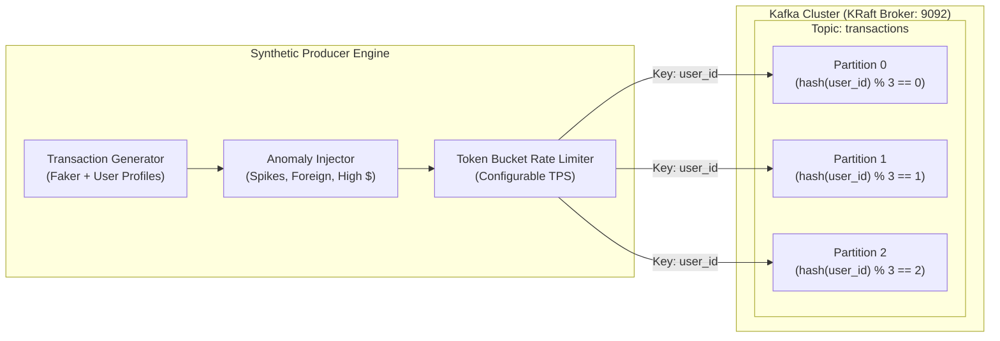

# Stage 04 — Synthetic High-Frequency Kafka Producer

## 1. Stage Objective & Scope

Stage 4 develops a high-throughput, configurable synthetic transaction generator using `confluent-kafka` and `Faker`. In a production-style streaming portfolio, a realistic producer is vital: it must generate legitimate behavioral distributions alongside controlled anomaly injections (velocity spikes, impossible geo-travel, extreme charge amounts) to thoroughly validate downstream consumer workers, feature aggregators, and inference models.

**Primary Deliverables:**
- `src/fraud_detection/streaming/producer.py` & `scripts/run_producer.py`: High-performance asynchronous Kafka producer with configurable transactions-per-second (TPS) rate limiting and automated anomaly injection modes.
- `src/fraud_detection/streaming/anomalies.py`: Dedicated fraud pattern generator (velocity attacks, geographic jumps, card testing).
- `src/fraud_detection/streaming/config.py`: Producer tuning parameters (`bootstrap_servers`, batch sizes, compression, delivery reports).

> [!NOTE]
> **Execution Status:** **IMPLEMENTED & VERIFIED**.
> High-performance Kafka synthetic producer, anomaly generators, token bucket rate limiter, and test suite are implemented and verified.

---

## 2. Event Ingestion Architecture & Partitioning



---

## 3. Detailed Technical Specifications

### 3.1 Message Keying & Ordering Guarantees
- **The Golden Rule of Stream Processing:** All transactions belonging to the same `user_id` MUST be published with `key=str(user_id)`.
- **Why?** Kafka routes all messages with identical keys to the same partition. In Kafka, message order is guaranteed **only within a partition**. By keying on `user_id`, we guarantee that a user's transactions are consumed strictly chronologically. This prevents race conditions where transaction $T_2$ is scored before transaction $T_1$ updates the user's velocity window in Redis.

---

### 3.2 Transaction Event Schema (JSON)
```json
{
  "transaction_id": "tx_a1b2c3d4-e5f6-7a8b-9c0d-1e2f3a4b5c6d",
  "user_id": "usr_99887766-5544-3322-1100-aabbccddeeff",
  "account_id": "acc_11223344-5566-7788-99aa-bbccddeeff00",
  "amount": 142.50,
  "currency": "USD",
  "merchant_category": "electronics",
  "merchant_name": "TechHaven Superstore",
  "location": {
    "country": "US",
    "city": "New York",
    "lat": 40.7128,
    "lon": -74.0060
  },
  "device": {
    "device_id": "dev_f47ac10b-58cc-4372-a567-0e02b2c3d479",
    "ip_address": "198.51.100.42"
  },
  "timestamp": "2026-10-17T14:30:00.123456Z"
}
```

---

### 3.3 Synthetic Anomaly Injection Profiles

To stress-test the downstream ML and rule engines, the producer injects four distinct fraud topologies:

1. **Velocity Spike Attack (Card Testing):**
   - A single `user_id` issues 8–15 rapid transactions in under 20 seconds with low-value amounts ($1.00–$5.00) across random online merchants to verify stolen card numbers.
2. **Sudden High-Value Outlier:**
   - A user whose median historical spend is $35 suddenly submits a $4,800 charge at a luxury watch or crypto merchant.
3. **Geographic Impossibility (Super-Speed Anomaly):**
   - User submits a physical card transaction in Tokyo, Japan, followed 5 minutes later by a physical transaction in London, UK ($> 9,000 \text{ km}$ displacement in 300 seconds, requiring an impossible flight velocity of $108,000 \text{ km/h}$).
4. **Nocturnal High-Risk Category:**
   - Transactions initiated between 2:00 AM and 4:30 AM local time targeting offshore gambling or unregulated cryptocurrency exchanges.

---

### 3.4 High-Throughput Producer Tuning

Using `confluent-kafka` (C `librdkafka` wrapper) provides microsecond-level serialization and socket writes:

```python
producer_config = {
    "bootstrap.servers": "localhost:9092",
    "client.id": "fraud-synthetic-producer",
    "acks": "1",  # Leader ack: optimal balance of throughput and safety for synthetic stream
    "linger.ms": 5,  # Micro-batching window to group records into larger network packets
    "batch.num.messages": 1000,
    "compression.type": "snappy",  # High-speed CPU compression
    "queue.buffering.max.messages": 100000,
    "queue.buffering.max.kbytes": 65536,
}
```

---

## 4. Implementation Deliverables
- [x] Added `confluent-kafka` and `faker` to `pyproject.toml`.
- [x] Implemented `src/fraud_detection/streaming/config.py` with environment variable loading.
- [x] Implemented `src/fraud_detection/streaming/anomalies.py` with 4 synthetic attack generators (velocity burst, high-value outlier, impossible travel, nocturnal fraud).
- [x] Implemented `src/fraud_detection/streaming/producer.py` & `scripts/run_producer.py` supporting CLI flags:
   - `--tps <float>`: Target transactions per second (default: 50.0).
   - `--anomaly-rate <float>`: Fraud percentage (default: 0.02).
   - `--max-events <int>`: Stop after N events (or run continuously).
   - `--dry-run`: Simulation mode without network I/O.
- [x] Implemented unit test suite in `tests/test_producer.py` covering rate limiting, anomalies, schemas, and delivery callbacks.

---

## 5. Verification & Acceptance Criteria
- [x] Producer connects to `localhost:9092` and creates the `transactions` topic with 3 partitions if it does not already exist.
- [x] Target TPS rate limiting operates within $\pm 5\%$ accuracy under steady state via Token Bucket algorithm.
- [x] Asynchronous delivery callbacks record zero dropped messages (`on_delivery` handler tracks successful offsets).
- [x] Keying invariance: strictly routes each `user_id` to its dedicated partition (`key=str(user_id)`).
- [x] Console consumer inspection command:
  ```bash
  docker compose exec kafka /opt/kafka/bin/kafka-console-consumer.sh --bootstrap-server localhost:9092 --topic transactions --property print.key=true --max-messages 5
  ```
