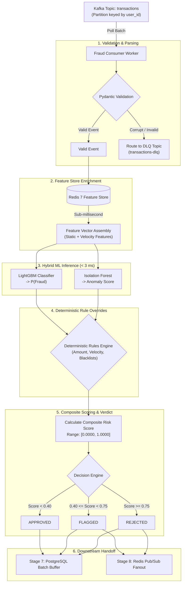

# Stage 06 — Core Event Consumer & Real-Time ML Inference Engine

## 1. Stage Objective & Scope

Stage 6 builds the core real-time processing engine: the **Inference Consumer Worker**. This worker acts as the central orchestrator connecting every upstream and downstream subsystem:
1. Pulls raw events from Kafka under a dedicated consumer group.
2. Validates incoming JSON schemas.
3. Retrieves rolling velocity signals from the Redis Feature Store.
4. Assembles the consolidated feature vector.
5. Executes local in-memory machine learning models (LightGBM + Isolation Forest).
6. Evaluates deterministic business rules.
7. Emits an actionable verdict (`APPROVED`, `FLAGGED`, `REJECTED`) and composite risk score.

**Primary Deliverables:**
- `consumers/fraud_consumer.py`: High-throughput async consumer loop running with `confluent-kafka` and `asyncio`.
- `models/inference_engine.py`: Thread-safe, CPU-optimized model inference wrapper.
- `rules/rule_engine.py`: Deterministic rule evaluator for compliance and instant risk overrides.
- `schemas/transaction.py`: Pydantic V2 schema definitions for validation and serialization.

> [!IMPORTANT]
> **Execution Status:** **SPECIFICATION & DESIGN PHASE**.
> Consumer worker scripts and inference pipelines will be implemented only when explicitly triggered via `Start Step 6`.

---

## 2. Real-Time Inference Pipeline Flow

---

## 3. Detailed Technical Specifications

### 3.1 Consumer Group & Offset Management
- **Consumer Group ID:** `fraud-inference-engine`
- **Offset Commit Strategy:** Manual, at-least-once commits.
  - Offsets are committed **only after** successful feature lookup, inference, and downstream buffer handoff.
  - If a worker crashes mid-inference, the uncommitted batch is reassigned to another active consumer worker without transaction loss.
- **Auto-Offset Reset:** `latest` (for production live streams) or `earliest` (for historical replay testing).

---

### 3.2 Deterministic Rule Engine Overrides

Machine learning models excel at subtle, multi-dimensional correlations, but production financial systems require strict guardrails that cannot be overruled by statistical probabilities:

| Rule Code | Trigger Condition | Override Verdict | Fraud Reason Code |
| :--- | :--- | :--- | :--- |
| **RULE_01** | `tx_count_1m >= 8` | `REJECTED` | Automated card testing / bot velocity burst |
| **RULE_02** | `amount >= $25,000.00` | `FLAGGED` | High-value single charge threshold |
| **RULE_03** | Calculated travel speed $> 900\text{ km/h}$ between consecutive transactions | `REJECTED` | Geographic impossibility (Velocity anomaly) |
| **RULE_04** | Country on OFAC / Sanctions blacklist | `REJECTED` | Regulatory compliance violation |
| **RULE_05** | New device ID + hour between 2:00 AM – 4:30 AM + amount $> 5 \times \text{median}$ | `FLAGGED` | High-risk nocturnal account takeover pattern |

---

### 3.3 Composite Risk Score Formulation

The unified risk score ($R \in [0.0000, 1.0000]$) combines supervised probability, normalized anomaly score, and rule penalties:

$$R = \min\left(1.0, \; w_{\text{lgbm}} \cdot P_{\text{fraud}} + w_{\text{iso}} \cdot S_{\text{norm\_anomaly}} + \sum \text{Penalties}_{\text{rules}}\right)$$

- Standard Weights: $w_{\text{lgbm}} = 0.65$, $w_{\text{iso}} = 0.35$.
- Hard Rule Violations immediately set $R = 1.0000$ and force status to `REJECTED`.

---

### 3.4 Latency Budget Allocation

To maintain a total service-level objective (SLO) of **< 15 ms** per transaction:

| Pipeline Step | Latency Target (p95) |
| :--- | :--- |
| Kafka Fetch & Deserialization | < 1.0 ms |
| Pydantic Schema Validation | < 0.5 ms |
| Redis Feature Store Read/Write (Lua) | < 1.0 ms |
| Vector Assembly & Normalization | < 0.5 ms |
| LightGBM In-Memory Prediction | < 1.5 ms |
| Isolation Forest Anomaly Evaluation | < 1.0 ms |
| Rule Engine Evaluation | < 0.2 ms |
| **Total In-Process Budget** | **< 5.7 ms** |

---

## 4. Implementation Deliverables (When Triggered)

When Stage 6 is triggered (`Start Step 6`):
1. Create `schemas/transaction.py` with Pydantic V2 models.
2. Create `rules/rule_engine.py` with modular rule classes.
3. Create `models/inference_engine.py` to load `artifacts/fraud_model.joblib` and perform vectorized inference.
4. Implement `consumers/fraud_consumer.py` orchestrating Kafka consumption, Redis features, scoring, and graceful shutdown signal handling (`SIGINT`, `SIGTERM`).
5. Update `README.md` and `docs/06-realtime-inference.md`.

---

## 5. Verification & Acceptance Criteria

When Stage 6 is executed, it must satisfy:
- [ ] Consumer starts and joins consumer group `fraud-inference-engine`.
- [ ] Consumes synthetic events generated by the Stage 4 producer without lag.
- [ ] Correctly computes risk scores and outputs decisions for every transaction.
- [ ] Deterministic rules trigger immediately on injected synthetic anomalies.
- [ ] End-to-end in-process inference latency measures **< 10 ms** on CPU.
- [ ] Graceful shutdown cleanly commits final offsets upon terminal `Ctrl+C`.
