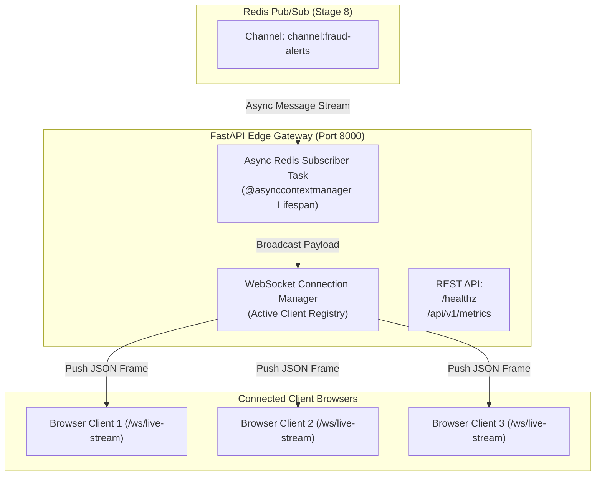

# Stage 09 — FastAPI WebSocket Hub

## 1. Stage Objective & Scope

Stage 9 builds the edge streaming gateway: an asynchronous **FastAPI WebSocket Hub**. This service acts as the bridge between internal Redis Pub/Sub channels and external browser dashboards.

**Primary Responsibilities:**
- Maintain persistent, low-overhead bidirectional WebSocket connections with client dashboards.
- Run an asynchronous background subscriber reading alerts from Redis `channel:fraud-alerts`.
- Fan out incoming alerts concurrently across all active WebSocket clients.
- Handle connection lifecycles, ping/pong heartbeats, and graceful disconnection cleanup.
- Expose REST endpoints for health checks, system metrics, and initial dashboard hydration.

**Primary Deliverables:**
- `api/main.py`: FastAPI application entrypoint with lifespan events and route registration.
- `api/websocket_manager.py`: Thread-safe active WebSocket connection manager.
- `api/routes/ws.py`: WebSocket endpoint handler (`/ws/live-stream`).
- `api/routes/health.py`: Health checks (`/healthz`) and system telemetry endpoints.

> [!IMPORTANT]
> **Execution Status:** **SPECIFICATION & DESIGN PHASE**.
> FastAPI gateway components and WebSocket routes will be implemented only when explicitly triggered via `Start Step 9`.

---

## 2. Gateway Streaming Architecture



---

## 3. Detailed Technical Specifications

### 3.1 Connection Manager (`ConnectionManager`)
- Maintains a thread-safe registry `set[WebSocket]` of active client sockets.
- **Concurrent Fan-Out:** Uses `asyncio.gather` with `return_exceptions=True` to broadcast JSON frames simultaneously to all connected clients without letting a slow client block others.
- **Dead Connection Purging:** Catches `WebSocketDisconnect` and socket errors, immediately removing dead sockets from the active pool to avoid memory leaks.

---

### 3.2 Lifespan Background Subscriber

FastAPI utilizes an `@asynccontextmanager` lifespan handler to supervise the Redis subscriber task:

```python
from contextlib import asynccontextmanager
from fastapi import FastAPI
import asyncio


@asynccontextmanager
async def lifespan(app: FastAPI):
    # Startup: Initialize Redis pool & launch background subscriber
    subscriber_task = asyncio.create_task(start_redis_pubsub_listener())
    yield
    # Shutdown: Cancel subscriber task & drain active WebSockets
    subscriber_task.cancel()
    await subscriber_task
```

---

### 3.3 Endpoints Specification

| Method | Path | Purpose |
| :--- | :--- | :--- |
| **WS** | `/ws/live-stream` | Persistent WebSocket streaming live fraud alert frames. |
| **GET** | `/healthz` | Kubernetes/Docker health check verifying Redis and DB connectivity. |
| **GET** | `/api/v1/metrics` | JSON metrics: active WebSocket client count, total alerts broadcasted, uptime. |
| **GET** | `/api/v1/alerts/recent` | Returns last 20 `FLAGGED`/`REJECTED` transactions from PostgreSQL for initial UI hydration. |

---

## 4. Implementation Deliverables (When Triggered)

When Stage 9 is triggered (`Start Step 9`):
1. Add `fastapi>=0.110.0` and `uvicorn[standard]>=0.28.0` to `pyproject.toml`.
2. Implement `api/websocket_manager.py` with broadcast and disconnect mechanics.
3. Implement `api/routes/ws.py` and `api/routes/health.py`.
4. Implement `api/main.py` configuring CORS, lifespan tasks, and router inclusion.
5. Update `README.md` and `docs/01-architecture.md`.

---

## 5. Verification & Acceptance Criteria

When Stage 9 is executed, it must satisfy:
- [ ] FastAPI server starts cleanly via `uv run uvicorn api.main:app --port 8000`.
- [ ] `/healthz` returns `{"status": "ok"}`.
- [ ] WebSocket clients can connect to `ws://localhost:8000/ws/live-stream`.
- [ ] Publishing a synthetic message to Redis `channel:fraud-alerts` broadcasts the JSON frame to all active WebSocket clients within **< 5 ms**.
- [ ] Disconnecting a browser client cleanly decrements the active connection counter.
