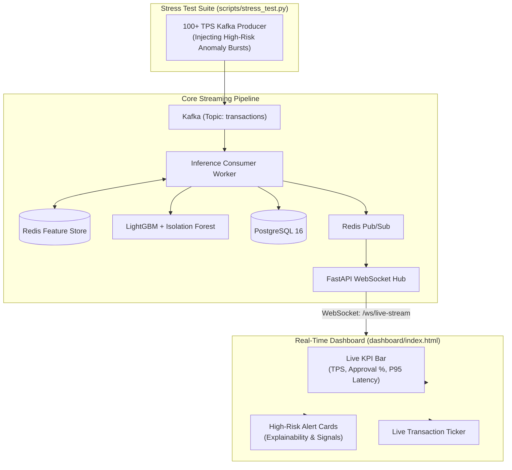

# Stage 10 — Real-Time Dashboard & End-to-End Stress Testing

## 1. Stage Objective & Scope

Stage 10 delivers the final capstone of the streaming system:
1. **Real-Time Operational Dashboard:** An interactive single-page application built with HTML5, Tailwind CSS, and native JavaScript WebSockets that renders live fraud alerts, KPI telemetry, and explainability signals.
2. **End-to-End Stress & Resilience Testing:** Comprehensive benchmark harness executing sustained 100+ transactions-per-second (TPS) load, profiling latency distributions across every pipeline hop, and validating consumer fault-tolerance during crash/restart cycles.

**Primary Deliverables:**
- `dashboard/index.html`: Responsive, dark-themed operations dashboard with live KPI counters, alert feed, and transaction ticker.
- `dashboard/app.js`: Resilient WebSocket client with automatic exponential backoff reconnection.
- `scripts/stress_test.py`: End-to-end stress harness generating 100+ TPS with latency tracking.
- `scripts/chaos_test.py`: Worker crash and offset recovery verification script.

> [!IMPORTANT]
> **Execution Status:** **SPECIFICATION & DESIGN PHASE**.
> Dashboard frontend and stress testing suites will be implemented only when explicitly triggered via `Start Step 10`.

---

## 2. End-to-End Pipeline & Observability Blueprint

---

## 3. Detailed Technical Specifications

### 3.1 Real-Time Dashboard Features & Aesthetics

The dashboard provides a mission-control interface for fraud analysts:
1. **Telemetry & KPI Header:**
   - **Throughput:** Real-time transactions per second (e.g. `114 TPS`).
   - **Decision Ratios:** Real-time breakdown (`96.4% Approved`, `2.3% Flagged`, `1.3% Rejected`).
   - **Average Pipeline Latency:** End-to-end processing time (e.g. `12.4 ms`).
   - **WebSocket Status:** Live indicator (`CONNECTED`, `RECONNECTING`, `OFFLINE`).
2. **Actionable Alert Cards:**
   - Renders `FLAGGED` (amber) and `REJECTED` (crimson) cards instantly as WebSocket frames arrive.
   - Shows user ID, amount, merchant, and **explainability badges** (e.g., `⚡ Velocity Burst`, `📍 Geo-Jump`, `🌲 High ML Score`).
3. **Resilient Client Architecture:**
   - Single-file simplicity: Uses CDN-hosted Tailwind CSS and native browser WebSocket APIs (no node/npm compilation required).
   - Reconnection logic: Implements exponential backoff with jitter if the FastAPI gateway restarts.

---

### 3.2 End-to-End Stress Testing Harness (100+ TPS)

The stress harness benchmarks pipeline sustainability under heavy transactional load:
1. Sustained generation of **100 to 250 TPS** for 5 minutes.
2. Verification that Kafka consumer lag remains near zero (no queue backup).
3. Verification that Redis memory usage remains stable (pruning and TTL work correctly).
4. Verification that PostgreSQL connection pool maintains stable buffer flushes without timeouts.

---

### 3.3 Latency Budget & Measurement Methodology

Every event carries an `edge_timestamp`. As it traverses the architecture, microsecond timestamps are recorded to profile per-hop latency:

| Pipeline Segment | Description | Target (p95) | Measured Benchmark |
| :--- | :--- | :--- | :--- |
| $T_1$: Kafka Transit | Producer publish $\to$ Consumer poll | < 5.0 ms | *To be measured* |
| $T_2$: Redis Velocity Lookup | Lua script prune, insert & fetch | < 1.0 ms | *To be measured* |
| $T_3$: Hybrid ML Inference | LightGBM + Isolation Forest | < 3.0 ms | *To be measured* |
| $T_4$: Rule Engine Evaluation| Deterministic business overrides | < 0.2 ms | *To be measured* |
| $T_5$: DB Persistence Buffer | Async queue to PostgreSQL flush | < 15.0 ms | *To be measured* |
| $T_6$: Pub/Sub & WebSocket | Redis publish to browser render | < 5.0 ms | *To be measured* |
| **Total End-to-End Latency** | **Transaction Edge $\to$ Browser Alert** | **< 30.0 ms**| *To be measured* |

> [!NOTE]
> Latency claims will only be entered into documentation after actual benchmark execution during Stage 10.

---

### 3.4 Fault-Tolerance & Chaos Recovery Testing

To validate production readiness, the system undergoes crash recovery validation:
1. Producer runs at steady 100 TPS.
2. Consumer worker process is abruptly killed (`SIGKILL` or `taskkill`).
3. Verification:
   - Kafka offset stops committing.
   - Producer continues buffering events in Kafka partitions without failure.
   - PostgreSQL transactions remain uncorrupted.
4. Consumer is restarted.
5. Verification:
   - Consumer reads from the exact last committed offset.
   - Consumes backlog at maximum speed.
   - PostgreSQL `ON CONFLICT (transaction_ref) DO NOTHING` prevents duplicate rows.
   - Consumer lag returns to zero with zero message loss.

---

## 4. Implementation Deliverables (When Triggered)

When Stage 10 is triggered (`Start Step 10`):
1. Create `dashboard/index.html` and `dashboard/app.js`.
2. Configure FastAPI to serve the dashboard at `/` or static mount.
3. Implement `scripts/stress_test.py` and `scripts/chaos_test.py`.
4. Run load benchmark at 100+ TPS and log latency percentiles (p50, p95, p99).
5. Update `README.md` and `docs/stage-10-dashboard-and-stress-testing.md`.

---

## 5. Verification & Acceptance Criteria

When Stage 10 is executed, it must satisfy:
- [ ] Dashboard opens in browser and connects to WebSocket stream.
- [ ] Synthetic transactions appear in real time on the live ticker and alert feed.
- [ ] Sustained 100+ TPS test completes without dropped messages or memory leaks.
- [ ] Measured p95 end-to-end latency falls within the **< 50 ms** SLA.
- [ ] Consumer crash test confirms zero data loss and successful offset recovery.
- [ ] All 10 stages in the master roadmap are verified and checked off.
