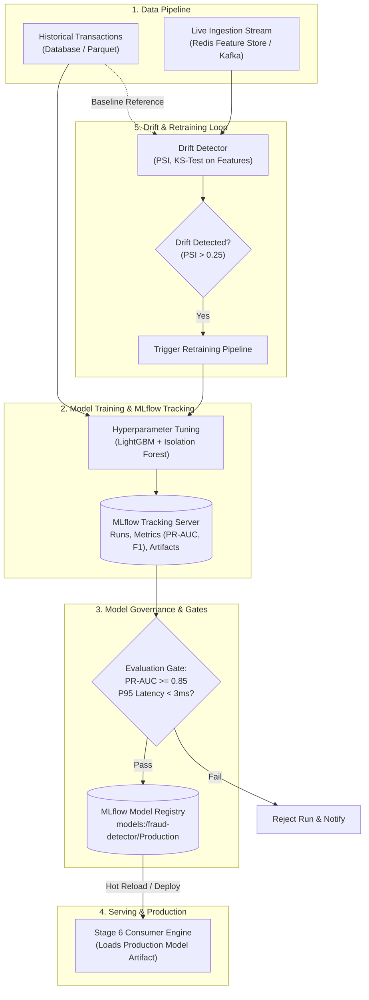

# Stage 11 — MLOps: Experiment Tracking, Model Registry & Drift Monitoring

## 1. Stage Objective & Scope

Stage 11 elevates the offline machine learning model developed in Stage 3 into a production-grade **MLOps pipeline**. In a real-time financial fraud engine, model performance naturally degrades over time as fraudsters adapt their evasion techniques (concept drift) and consumer spending patterns shift (data drift).

**Core MLOps Pillars:**
1. **Experiment Tracking:** Logging hyperparameter tuning runs, cross-validation metrics, confusion matrices, and artifacts using **MLflow**.
2. **Model Registry & Governance:** Enforcing versioning, metadata lineage, and stage transitions (`Development` $\to$ `Staging` $\to$ `Production`) gated by automated PR-AUC criteria.
3. **Continuous Data & Concept Drift Monitoring:** Calculating Population Stability Index (PSI) and Kolmogorov-Smirnov (KS) test statistics on incoming real-time feature distributions versus baseline training distributions.
4. **Automated Retraining Trigger:** Generating alerts and initiating scheduled or drift-triggered retraining workflows.

**Primary Deliverables:**
- `mlops/tracking.py`: MLflow tracking integration capturing runs, parameters, metrics, and models.
- `mlops/registry.py`: Automated model promotion script enforcing deployment gates.
- `mlops/drift_detector.py`: Real-time and batch drift evaluation engine (PSI, KS-test, Wasserstein distance).
- `docker-compose.mlops.yml`: Optional local/remote MLflow tracking server setup with SQLite/Postgres backend and artifact store.

> [!IMPORTANT]
> **Execution Status:** **SPECIFICATION & DESIGN PHASE**.
> MLOps scripts, MLflow servers, and drift jobs will be implemented only when explicitly triggered via `Start Step 11`.

---

## 2. MLOps Architecture & Lifecycle



---

## 3. Detailed Technical Specifications

### 3.1 MLflow Experiment Tracking Integration

During Stage 3 model training, all runs are tracked with granular metadata:
- **Parameters:** `learning_rate`, `n_estimators`, `max_depth`, `num_leaves`, `scale_pos_weight`, `contamination`.
- **Metrics:** `pr_auc`, `roc_auc`, `f1_score`, `precision`, `recall`, `brier_score_loss`, `inference_latency_p95_ms`.
- **Artifacts:**
  - Precision-Recall curves (`pr_curve.png`)
  - Confusion matrix heatmap (`confusion_matrix.png`)
  - Feature importance ranking plot (`feature_importance.png`)
  - Serialized model bundle (`model_bundle.joblib`)
  - Feature schema contract (`schema.json`)

---

### 3.2 Automated Promotion Gates

A model cannot enter production simply by being trained. The registry enforces automated programmatic gates:

```python
PROMOTION_GATES = {
    "min_pr_auc": 0.850,
    "min_f1_score": 0.800,
    "max_inference_latency_ms": 3.0,
    "max_false_positive_rate": 0.05
}
```

If the candidate run passes all validation criteria, `mlops/registry.py` automatically transitions the model to the `Production` alias in the MLflow Model Registry and tags the previous champion as `Archived`.

---

### 3.3 Data Drift & Concept Drift Detection

#### 1. Population Stability Index (PSI)
Used to detect shifts in continuous feature distributions (e.g., `amount`, `tx_sum_10m`, `amount_to_avg_ratio`):

$$\text{PSI} = \sum \left( (\% \text{ Actual}_i - \% \text{ Expected}_i) \times \ln\left(\frac{\% \text{ Actual}_i}{\% \text{ Expected}_i}\right) \right)$$

- **$\text{PSI} < 0.10$:** No significant distribution change (Model stable).
- **$0.10 \le \text{PSI} < 0.25$:** Moderate drift (Log warning, schedule review).
- **$\text{PSI} \ge 0.25$:** Severe drift (Trigger automated retraining alert).

#### 2. Concept Drift Detection (Target Drift)
Monitors the rolling ratio of model fraud predictions (`FLAGGED` + `REJECTED`) versus historical ground truth. A sudden jump in alert volume without corresponding marketing or promotional campaigns indicates emerging attack patterns.

---

## 4. Implementation Deliverables (When Triggered)

When Stage 11 is triggered (`Start Step 11`):
1. Add `mlflow>=2.15.0`, `scipy>=1.13.0`, and `matplotlib>=3.9.0` to `pyproject.toml`.
2. Implement `mlops/tracking.py` to log training runs, artifacts, and parameters to MLflow.
3. Implement `mlops/registry.py` to automate version registration and transition gates.
4. Implement `mlops/drift_detector.py` providing PSI and KS-test calculation modules.
5. Create `docker-compose.mlops.yml` allowing local spin-up of an MLflow Tracking Server with UI at `http://localhost:5000`.
6. Update `README.md` and `docs/04-ml-pipeline.md`.

---

## 5. Verification & Acceptance Criteria

When Stage 11 is executed, it must satisfy:
- [ ] Training script logs metrics, hyperparameters, and plots to MLflow without errors.
- [ ] MLflow UI at `http://localhost:5000` renders runs, parameters, and comparison charts.
- [ ] Model registry automatically evaluates gates and tags champion model as `Production`.
- [ ] Drift detector detects simulated distribution shifts (e.g. injected 3x amount spike) with $\text{PSI} > 0.25$.
- [ ] Zero impact on real-time inference latency.
