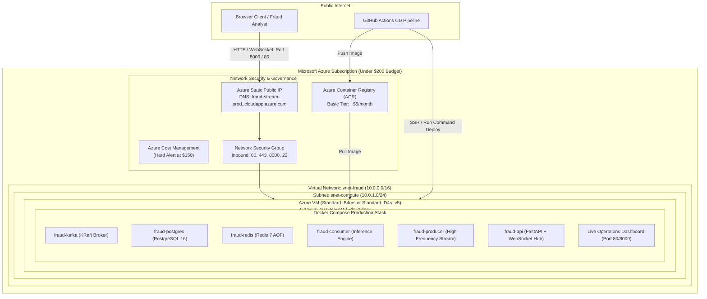

# Stage 13 — Microsoft Azure Cloud Deployment & Cost-Optimized Orchestration

## 1. Stage Objective & Scope

Stage 13 orchestrates the end-to-end production deployment of the Real-Time Fraud Detection System on **Microsoft Azure**, complete with public web access to the real-time dashboard and WebSocket stream.

### The $200 Azure Credit Constraint & Cost Engineering

> [!CAUTION]
> **Budget Guardrail ($200 / 30-Day Credit):**
> Deploying enterprise cloud services (e.g., multi-node Azure Kubernetes Service (AKS), Azure Event Hubs Dedicated, or Premium Azure Cache for Redis) will **incinerate a $200 credit in less than 5 days**.
>
> We employ a **production-grade, cost-optimized single-node / containerized cloud architecture** that runs the complete streaming, ML, database, and UI stack within a **$90–$140/month envelope**, preserving over $60 of safety margin.

**Primary Deliverables:**
- `infra/azure/deploy_azure.sh`: Automated Azure CLI / Bicep provisioning script creating resource groups, VNet, NSG, public IP, ACR, and compute.
- `infra/azure/budget_alert.sh`: Automated Azure Cost Management budget alert configured at $150 (75% threshold).
- `infra/azure/cloud-init.txt`: Cloud-init script auto-configuring Docker, Docker Compose, and environment variables on boot.
- `.github/workflows/cd-azure.yml`: GitHub Actions Continuous Deployment workflow pushing images to Azure Container Registry (ACR) and updating the Azure workload.
- Publicly accessible live URL for the Real-Time Dashboard.

> [!IMPORTANT]
> **Execution Status:** **SPECIFICATION & DESIGN PHASE**.
> Cloud provisioning and Azure deployment will be executed only when explicitly triggered via `Start Step 13`.

---

## 2. Cloud Architecture on Microsoft Azure



---

## 3. Financial Breakdown: Cost Optimization Matrix

| Resource | Azure SKU / Tier | Specifications | Estimated Cost (30 Days) | Budget Impact |
| :--- | :--- | :--- | :--- | :--- |
| **Virtual Machine** | `Standard_B4ms` (Burstable) or `Standard_D4s_v5` | 4 vCPUs, 16 GB RAM | ~$115.00 – $138.00 | Primary compute |
| **OS Disk** | Premium SSD (P10) | 64 GB persistent storage | ~$9.50 | Fast disk I/O for Kafka & PG |
| **Container Registry** | Azure Container Registry (Basic) | 10 GB storage | ~$5.00 | Image repository |
| **Static Public IP** | Standard IPv4 Public IP | Dynamic/Static | ~$3.60 | Ingress connectivity |
| **Outbound Bandwidth**| Egress Data Transfer | First 100 GB/month free | ~$0.00 – $2.00 | Dashboard streaming |
| **Total Estimated Spend** | — | — | **~$133.10 – $158.10** | **Safely within $200 Credit** |

### Why This Architecture Beats AKS for Portfolio Demonstrations:
1. **Zero Control Plane Cost:** AKS clusters incur managed control plane or minimum worker node pool expenses ($150+ before even adding storage and ingress).
2. **Simplified Operational Surface:** The entire distributed stack (Kafka, Postgres, Redis, Workers, FastAPI) runs under identical Docker Compose definitions tested locally in Stages 1–10.
3. **Instant Portability:** No Kubernetes YAML divergence; what works on your local workstation works identically on the Azure VM.

---

## 4. Detailed Technical Specifications

### 4.1 Automated Infrastructure Provisioning (Azure CLI / Bicep)

The deployment script executes the following declarative steps:

```bash
# 1. Create dedicated Resource Group
az group create --name rg-fraud-streaming-prod --location eastus

# 2. Create Cost Management Budget Alert ($150 limit)
az consumption budget create \
  --amount 150 \
  --budget-name "Fraud-System-30Day-Budget" \
  --category cost \
  --time-grain monthly \
  --start-date "2026-11-01" \
  --end-date "2026-11-30" \
  --resource-group rg-fraud-streaming-prod \
  --notification-threshold 75 \
  --contact-emails "developer@example.com"

# 3. Provision Azure Container Registry (ACR)
az acr create \
  --resource-group rg-fraud-streaming-prod \
  --name acrfraudstreaming \
  --sku Basic \
  --admin-enabled true

# 4. Provision Network Security Group (NSG) with strict ingress rules
az network nsg create --resource-group rg-fraud-streaming-prod --name nsg-fraud
az network nsg rule create -g rg-fraud-streaming-prod --nsg-name nsg-fraud -n Allow-HTTP --priority 100 --destination-port-ranges 80 8000 --protocol Tcp --access Allow
az network nsg rule create -g rg-fraud-streaming-prod --nsg-name nsg-fraud -n Allow-SSH --priority 110 --destination-port-ranges 22 --protocol Tcp --access Allow

# 5. Provision Virtual Machine with cloud-init
az vm create \
  --resource-group rg-fraud-streaming-prod \
  --name vm-fraud-engine \
  --image Ubuntu2204 \
  --size Standard_B4ms \
  --admin-username azureuser \
  --generate-ssh-keys \
  --public-ip-address-dns-name "fraud-stream-demo" \
  --custom-data infra/azure/cloud-init.txt
```

---

### 4.2 Cloud-Init Bootstrap (`infra/azure/cloud-init.txt`)
Installs Docker Engine, Docker Compose Plugin, configures system limits (e.g. `vm.max_map_count=262144` for high-throughput memory), and pulls the production deployment repository.

---

### 4.3 GitHub Actions Continuous Deployment (`.github/workflows/cd-azure.yml`)
When code merges to `main` and passes CI (Stage 12):
1. Authenticates with Azure using **OpenID Connect (OIDC)** or Azure Service Principal.
2. Builds and pushes production container tags to `acrfraudstreaming.azurecr.io`.
3. Connects securely to the Azure VM via SSH or `az vm run-command invoke`.
4. Pulls updated container images and executes:
   ```bash
   docker compose -f docker-compose.prod.yml pull
   docker compose -f docker-compose.prod.yml up -d --remove-orphans
   ```
5. Executes automated health check against `http://<azure-public-dns>:8000/healthz`.

---

### 4.4 Live UI & WebSocket Public Exposure

The dashboard will be publicly viewable over the internet:
- **Public URL:** `http://fraud-stream-demo.eastus.cloudapp.azure.com:8000/`
- **Live Stream WebSocket:** `ws://fraud-stream-demo.eastus.cloudapp.azure.com:8000/ws/live-stream`
- **Live Metrics Endpoint:** `http://fraud-stream-demo.eastus.cloudapp.azure.com:8000/api/v1/metrics`

---

## 5. Teardown & Zero-Cost Cleanup

When the portfolio demonstration or review is complete, the entire Azure infrastructure can be destroyed with a single command to prevent ongoing charges:

```bash
az group delete --name rg-fraud-streaming-prod --yes --no-wait
```
This guarantees immediate de-allocation of all VM, disk, IP, and registry resources.

---

## 6. Implementation Deliverables (When Triggered)

When Stage 13 is triggered (`Start Step 13`):
1. Implement `infra/azure/deploy_azure.sh` and `infra/azure/cloud-init.txt`.
2. Implement `infra/azure/budget_alert.sh`.
3. Create `docker-compose.prod.yml` configured for ACR image registries.
4. Implement `.github/workflows/cd-azure.yml` with Azure OIDC deployment steps.
5. Update `README.md` with live Azure deployment and verification instructions.

---

## 7. Verification & Acceptance Criteria

When Stage 13 is executed, it must satisfy:
- [ ] Automated script provisions all Azure resources without manual portal intervention.
- [ ] Azure budget alert is verified active in Azure Cost Management.
- [ ] Docker Compose production stack is running and healthy on the Azure VM.
- [ ] Public IP / DNS endpoint serves the live operational dashboard in a web browser.
- [ ] Real-time transactions generated in Azure stream across WebSockets to external browsers.
- [ ] Single-command teardown script cleanly deletes all resources.
