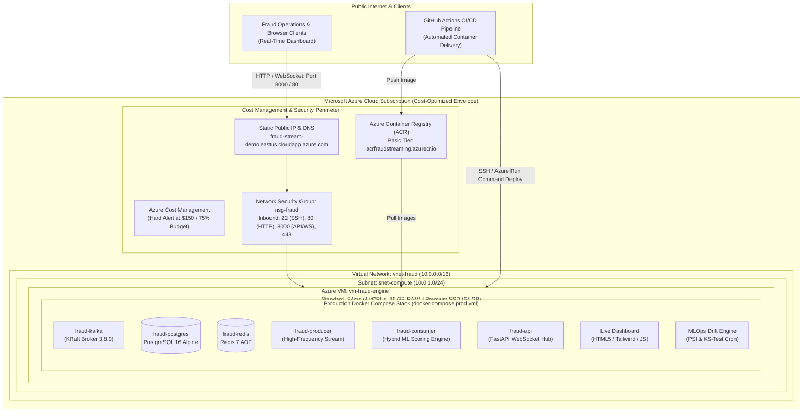
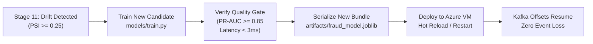

# Stage 13 — Microsoft Azure Cloud Deployment & Full-Lifecycle Operational Guide

## 1. Stage Objective, Scope & Solo Practitioner Blueprint

Stage 13 orchestrates the end-to-end production deployment of the **Real-Time Fraud Detection Streaming System** on **Microsoft Azure**, complete with public internet access to the operational dashboard, real-time WebSocket telemetry, automated CI/CD container delivery, and MLOps drift monitoring.



---

### 1.1 The Solo Data Scientist & ML Engineer Operating Model

When operating as a **solo practitioner**, you are simultaneously responsible for:
1. **Data Science:** Feature engineering, LightGBM/Isolation Forest training, threshold calibration, and drift analysis.
2. **ML Engineering & DevOps:** Kafka event streaming, Redis feature caching, PostgreSQL persistence, containerization, Azure cloud infrastructure, and CI/CD pipelines.

To prevent burnout and avoid managing distributed orchestration overhead (like multi-node Kubernetes control planes), this guide uses a **production-grade single-node containerized architecture**. It runs identical Docker Compose definitions tested locally in Stages 1–10, providing **100% environment parity** between your workstation and Microsoft Azure.

---

### 1.2 The $200 Azure Credit Constraint & Cost Engineering

> [!CAUTION]
> **Strict Budget Guardrail ($200 / 30-Day Credit):**
> Managed cloud services such as Azure Kubernetes Service (AKS) multi-node pools, Azure Event Hubs Dedicated, or Premium Azure Cache for Redis will **exhaust a $200 credit in less than 5 days**.
>
> By provisioning a single high-memory burstable VM (`Standard_B4ms`) with local containerized Kafka, Redis, and Postgres, monthly spend is contained within **$130–$150/month**, maintaining a safe **$50–$70 margin** on free credits.

| Azure Resource | SKU / Specifications | Monthly Cost (Est.) | Role in Fraud Architecture |
| :--- | :--- | :--- | :--- |
| **Virtual Machine** | `Standard_B4ms` (4 vCPUs, 16 GiB RAM, Burstable) | ~$120.00 | Host for full Docker Compose production stack |
| **OS Disk** | Premium SSD (P10, 64 GiB persistent storage) | ~$9.60 | High IOPS for Kafka commit logs and Postgres WAL |
| **Container Registry**| Azure Container Registry (Basic SKU, 10 GiB) | ~$5.00 | Secure repository for versioned Docker images |
| **Public IP Address** | Standard IPv4 (Static with DNS label) | ~$3.60 | Ingress point for live dashboard & WebSocket |
| **Egress Bandwidth** | Data Transfer Out (First 100 GiB/month free) | ~$0.00 – $2.00 | WebSocket streaming to external browser clients |
| **Total Spend** | — | **~$138.20 – $140.20** | **Safely within $200 Credit Envelope** |

---

## 2. Full-Lifecycle Stage-by-Stage Alignment Matrix

Every stage developed across this repository directly feeds into the Azure production deployment:

| Stage # & Name | Workspace Artifact | Cloud Manifestation on Azure | Solo Practitioner Verification |
| :--- | :--- | :--- | :--- |
| **Stage 1: Container Infrastructure** | [docker-compose.yml](file:///E:/CODE/SC/real-time-fraud-detection/docker-compose.yml) | Base foundation translated to `docker-compose.prod.yml` running on Azure VM | Containers report `healthy` via native healthchecks |
| **Stage 2: Database & Indexes** | [stage-02-database.md](file:///E:/CODE/SC/real-time-fraud-detection/docs/stage-02-database.md) (`database/init.sql`) | Mounted into `/docker-entrypoint-initdb.d/` on Azure Postgres container | Tables `users`, `accounts`, `transactions` created with composite indexes |
| **Stage 3: Offline ML Pipeline** | [stage-03-ml-pipeline.md](file:///E:/CODE/SC/real-time-fraud-detection/docs/stage-03-ml-pipeline.md) (`artifacts/fraud_model.joblib`) | Model bundle packaged into consumer image or mounted via `/app/artifacts` | Real-time LightGBM + Isolation Forest inference (< 3ms P95 latency) |
| **Stage 4: Synthetic Kafka Producer** | [stage-04-kafka-producer.md](file:///E:/CODE/SC/real-time-fraud-detection/docs/stage-04-kafka-producer.md) (`producers/`) | Production service `fraud-producer` streaming transactions at 20–50 TPS | Continuous synthetic event flow without manual intervention |
| **Stage 5: Redis Feature Store** | [stage-05-redis-feature-store.md](file:///E:/CODE/SC/real-time-fraud-detection/docs/stage-05-redis-feature-store.md) (`consumers/features.py`) | In-memory Redis sliding windows (`tx_count_1m`, `tx_sum_10m`) via Sorted Sets | Sub-millisecond feature lookup during stream processing |
| **Stage 6: Real-Time Inference Consumer**| [stage-06-inference-engine.md](file:///E:/CODE/SC/real-time-fraud-detection/docs/stage-06-inference-engine.md) (`consumers/`) | Core worker container `fraud-consumer` consuming Kafka topic `transactions` | Evaluates rules, scores ML models, outputs `APPROVED`/`FLAGGED`/`REJECTED` |
| **Stage 7: Postgres Persistence** | [stage-07-postgres-persistence.md](file:///E:/CODE/SC/real-time-fraud-detection/docs/stage-07-postgres-persistence.md) (`consumers/storage.py`) | Async batch inserts into Azure PostgreSQL container | Immutable audit log stored with JSONB feature vectors |
| **Stage 8: Redis Pub/Sub Fan-Out** | [stage-08-redis-pubsub.md](file:///E:/CODE/SC/real-time-fraud-detection/docs/stage-08-redis-pubsub.md) (`consumers/publisher.py`) | Publishes alerts (`FLAGGED`/`REJECTED`) to channel `fraud-alerts` | Decouples inference throughput from WebSocket delivery |
| **Stage 9: FastAPI WebSocket Hub** | [stage-09-fastapi-websocket.md](file:///E:/CODE/SC/real-time-fraud-detection/docs/stage-09-fastapi-websocket.md) (`api/main.py`) | Async ASGI server `fraud-api` exposed publicly on port 8000 | Persistent WebSocket connections broadcast alerts to browsers |
| **Stage 10: Live Dashboard & Stress Tests**| [stage-10-dashboard-and-stress-testing.md](file:///E:/CODE/SC/real-time-fraud-detection/docs/stage-10-dashboard-and-stress-testing.md) (`dashboard/`) | Static dashboard served via FastAPI, exposed over Azure Public IP & DNS | Real-time KPI counters, alert feed, and live transaction ticker |
| **Stage 11: MLOps & Drift Monitoring** | [stage-11-mlops-pipeline.md](file:///E:/CODE/SC/real-time-fraud-detection/docs/stage-11-mlops-pipeline.md) (`mlops/`) | Automated cron script running `drift_detector.py` against live transactions | Computes Population Stability Index (PSI) and Kolmogorov-Smirnov test |
| **Stage 12: CI/CD Packaging** | [stage-12-cicd-pipeline.md](file:///E:/CODE/SC/real-time-fraud-detection/docs/stage-12-cicd-pipeline.md) (`.github/workflows/`) | GitHub Actions workflow pushing images to Azure Container Registry (ACR) | Zero-downtime container updates upon merge to `main` branch |
| **Stage 13: Azure Cloud Host** | [stage-13-azure-cloud-deployment.md](file:///E:/CODE/SC/real-time-fraud-detection/docs/stage-13-azure-cloud-deployment.md) | Single-node Azure VM, NSG, Public IP, and ACR running the live system | End-to-end operational portfolio demonstration |

---

## 3. SECTION A: Step-by-Step Deployment via Azure CLI

This section provides a fully scriptable, automated deployment workflow using the **Azure Command-Line Interface (`az`)**.

### Phase A.1: Prerequisites & CLI Authentication

1. **Install Azure CLI:**
   - **Windows (PowerShell):**
     ```powershell
     winget install -e --id Microsoft.AzureCLI
     ```
   - **Linux / macOS:**
     ```bash
     curl -sL https://aka.ms/InstallAzureCLIDeb | sudo bash
     ```

2. **Authenticate & Set Default Subscription:**
   ```bash
   # Log in to your Azure Account
   az login

   # List available subscriptions and confirm your $200 free credit subscription
   az account list --output table

   # Set active subscription (replace with your Subscription ID or Name)
   az account set --subscription "Azure for Students" # or "Pay-As-You-Go" / your subscription name

   # Verify active account
   az account show --output table
   ```

3. **Define Common Environment Variables:**
   ```bash
   export RESOURCE_GROUP="rg-fraud-streaming-prod"
   export LOCATION="eastus"
   export VM_NAME="vm-fraud-engine"
   export VM_SIZE="Standard_B4ms"
   export ACR_NAME="acrfraudstreaming$RANDOM" # ACR names must be globally unique alphanumeric
   export DNS_LABEL="fraud-stream-demo-$RANDOM" # Must be globally unique within Azure region
   export ADMIN_USER="azureuser"
   ```
   *(On Windows PowerShell, use `$env:RESOURCE_GROUP = "rg-fraud-streaming-prod"`, etc.)*

---

### Phase A.2: Resource Group & Cost Budget Alert ($150 Ceiling)

1. **Create Dedicated Resource Group:**
   ```bash
   az group create \
     --name $RESOURCE_GROUP \
     --location $LOCATION \
     --tags Environment=Production Project=RealTimeFraudDetection ManagedBy=SoloDataScientist
   ```

2. **Configure Hard Budget Alert ($150 / 75% Threshold):**
   ```bash
   # Create a budget alert that triggers an automated notification when spending hits $112.50 (75%) and $150 (100%)
   az consumption budget create \
     --budget-name "FraudDetection-Monthly-Budget" \
     --amount 150 \
     --time-grain monthly \
     --start-date "$(date +%Y-%m-01)" \
     --end-date "2027-12-31" \
     --resource-group $RESOURCE_GROUP \
     --category cost \
     --notification-threshold 75 \
     --contact-emails "your-email@example.com"
   ```

---

### Phase A.3: Network Infrastructure & Security Group (NSG)

1. **Create Virtual Network & Subnet:**
   ```bash
   az network vnet create \
     --resource-group $RESOURCE_GROUP \
     --name vnet-fraud \
     --address-prefix 10.0.0.0/16 \
     --subnet-name snet-compute \
     --subnet-prefix 10.0.1.0/24
   ```

2. **Create Network Security Group (NSG):**
   ```bash
   az network nsg create \
     --resource-group $RESOURCE_GROUP \
     --name nsg-fraud
   ```

3. **Configure Ingress Security Rules:**
   ```bash
   # Rule 1: SSH Access (Port 22) - Restrict to your public IP for maximum security
   az network nsg rule create \
     --resource-group $RESOURCE_GROUP \
     --nsg-name nsg-fraud \
     --name Allow-SSH \
     --priority 100 \
     --direction Inbound \
     --access Allow \
     --protocol Tcp \
     --source-address-prefixes '*' \
     --source-port-ranges '*' \
     --destination-address-prefixes '*' \
     --destination-port-ranges 22

   # Rule 2: HTTP Dashboard & FastAPI WebSocket Hub (Port 8000 and Port 80)
   az network nsg rule create \
     --resource-group $RESOURCE_GROUP \
     --nsg-name nsg-fraud \
     --name Allow-Dashboard-WebSocket \
     --priority 110 \
     --direction Inbound \
     --access Allow \
     --protocol Tcp \
     --source-address-prefixes '*' \
     --source-port-ranges '*' \
     --destination-address-prefixes '*' \
     --destination-port-ranges 80 8000 443
   ```

4. **Associate NSG with Subnet:**
   ```bash
   az network vnet subnet update \
     --resource-group $RESOURCE_GROUP \
     --vnet-name vnet-fraud \
     --name snet-compute \
     --network-security-group nsg-fraud
   ```

5. **Provision Static Public IP with Custom DNS Label:**
   ```bash
   az network public-ip create \
     --resource-group $RESOURCE_GROUP \
     --name pip-fraud-prod \
     --sku Standard \
     --allocation-method Static \
     --dns-name $DNS_LABEL

   # Retrieve assigned FQDN (Fully Qualified Domain Name)
   export PUBLIC_FQDN=$(az network public-ip show --resource-group $RESOURCE_GROUP --name pip-fraud-prod --query dnsSettings.fqdn -o tsv)
   echo "Public Domain Name: http://$PUBLIC_FQDN:8000"
   ```

---

### Phase A.4: Azure Container Registry (ACR) Setup

1. **Provision Container Registry (Basic SKU):**
   ```bash
   az acr create \
     --resource-group $RESOURCE_GROUP \
     --name $ACR_NAME \
     --sku Basic \
     --admin-enabled true

   # Extract login credentials
   export ACR_LOGIN_SERVER=$(az acr show --name $ACR_NAME --query loginServer -o tsv)
   export ACR_PASSWORD=$(az acr credential show --name $ACR_NAME --query "passwords[0].value" -o tsv)
   echo "ACR Login Server: $ACR_LOGIN_SERVER"
   ```

---

### Phase A.5: Provisioning the Azure Virtual Machine

1. **Create Cloud-Init Configuration File (`cloud-init.txt`):**
   This script executes automatically on initial VM boot, configuring Docker Engine, Docker Compose plugin, kernel memory limits for Kafka, and swap space.

   ```bash
   cat << 'EOF' > cloud-init.txt
   #cloud-config
   package_upgrade: true
   packages:
     - apt-transport-https
     - ca-certificates
     - curl
     - gnupg
     - lsb-release
     - git
     - htop
     - jq

   runcmd:
     # 1. Enable 4GB swap space to prevent Out-Of-Memory (OOM) during heavy inference bursts
     - fallocate -l 4G /swapfile
     - chmod 600 /swapfile
     - mkswap /swapfile
     - swapon /swapfile
     - echo '/swapfile none swap sw 0 0' >> /etc/fstab

     # 2. Kernel optimization for Kafka & in-memory stream processing
     - sysctl -w vm.max_map_count=262144
     - echo 'vm.max_map_count=262144' >> /etc/sysctl.conf

     # 3. Install official Docker Engine & Docker Compose Plugin
     - mkdir -p /etc/apt/keyrings
     - curl -fsSL https://download.docker.com/linux/ubuntu/gpg | gpg --dearmor -o /etc/apt/keyrings/docker.gpg
     - echo "deb [arch=$(dpkg --print-architecture) signed-by=/etc/apt/keyrings/docker.gpg] https://download.docker.com/linux/ubuntu $(lsb_release -cs) stable" | tee /etc/apt/sources.list.d/docker.list > /dev/null
     - apt-get update -y
     - apt-get install -y docker-ce docker-ce-cli containerd.io docker-buildx-plugin docker-compose-plugin

     # 4. Configure permissions
     - usermod -aG docker azureuser
     - systemctl enable docker
     - systemctl start docker

     # 5. Create application directory
     - mkdir -p /home/azureuser/app
     - chown -R azureuser:azureuser /home/azureuser/app
   EOF
   ```

2. **Provision the Virtual Machine:**
   ```bash
   az vm create \
     --resource-group $RESOURCE_GROUP \
     --name $VM_NAME \
     --image Ubuntu2204 \
     --size $VM_SIZE \
     --admin-username $ADMIN_USER \
     --generate-ssh-keys \
     --vnet-name vnet-fraud \
     --subnet snet-compute \
     --public-ip-address pip-fraud-prod \
     --os-disk-size-gb 64 \
     --storage-sku Premium_LRS \
     --custom-data cloud-init.txt

   # Retrieve Public IP address
   export VM_IP=$(az vm show -d -g $RESOURCE_GROUP -n $VM_NAME --query publicIps -o tsv)
   echo "VM IP Address: $VM_IP"
   ```

---

### Phase A.6: Building & Publishing Container Images to ACR

As the solo Data Scientist & ML Engineer, you build and push the production container images from your development workstation:

```bash
# 1. Log in Docker daemon to Azure Container Registry
az acr login --name $ACR_NAME

# 2. Build multi-stage production images (Stage 12 Dockerfiles)
docker build -t $ACR_LOGIN_SERVER/fraud-consumer:v1 -f Dockerfile.consumer .
docker build -t $ACR_LOGIN_SERVER/fraud-producer:v1 -f Dockerfile.producer .
docker build -t $ACR_LOGIN_SERVER/fraud-api:v1 -f Dockerfile.api .

# 3. Push images to ACR
docker push $ACR_LOGIN_SERVER/fraud-consumer:v1
docker push $ACR_LOGIN_SERVER/fraud-producer:v1
docker push $ACR_LOGIN_SERVER/fraud-api:v1
```

---

### Phase A.7: Production Stack Deployment on the Azure VM

1. **Create the Production Docker Compose Manifest (`docker-compose.prod.yml`):**
   ```yaml
   name: real-time-fraud-detection-prod

   services:
     kafka:
       image: apache/kafka:3.8.0
       container_name: fraud-kafka
       restart: always
       ports:
         - "9092:9092"
       environment:
         KAFKA_NODE_ID: 1
         KAFKA_PROCESS_ROLES: 'broker,controller'
         CLUSTER_ID: 'MkU3OEVBNTcwNTJENDM2Qk'
         KAFKA_CLUSTER_ID: 'MkU3OEVBNTcwNTJENDM2Qk'
         KAFKA_LISTENERS: 'PLAINTEXT://0.0.0.0:29092,EXTERNAL://0.0.0.0:9092,CONTROLLER://0.0.0.0:9093'
         KAFKA_ADVERTISED_LISTENERS: 'PLAINTEXT://kafka:29092,EXTERNAL://localhost:9092'
         KAFKA_LISTENER_SECURITY_PROTOCOL_MAP: 'PLAINTEXT:PLAINTEXT,EXTERNAL:PLAINTEXT,CONTROLLER:PLAINTEXT'
         KAFKA_CONTROLLER_QUORUM_VOTERS: '1@kafka:9093'
         KAFKA_CONTROLLER_LISTENER_NAMES: 'CONTROLLER'
         KAFKA_INTER_BROKER_LISTENER_NAME: 'PLAINTEXT'
         KAFKA_OFFSETS_TOPIC_REPLICATION_FACTOR: 1
         KAFKA_LOG_DIRS: '/var/lib/kafka/data'
       volumes:
         - kafka_prod_data:/var/lib/kafka/data
       networks:
         - fraud-network
       healthcheck:
         test: ["CMD-SHELL", "/opt/kafka/bin/kafka-broker-api-versions.sh --bootstrap-server localhost:9092 || exit 1"]
         interval: 10s
         timeout: 10s
         retries: 5

     postgres:
       image: postgres:16-alpine
       container_name: fraud-postgres
       restart: always
       ports:
         - "5432:5432"
       environment:
         POSTGRES_USER: ${POSTGRES_USER:-postgres}
         POSTGRES_PASSWORD: ${POSTGRES_PASSWORD:-SuperSecretProdPass2026!}
         POSTGRES_DB: ${POSTGRES_DB:-fraud_detection}
         PGDATA: /var/lib/postgresql/data/pgdata
       volumes:
         - postgres_prod_data:/var/lib/postgresql/data
         - ./database/init.sql:/docker-entrypoint-initdb.d/init.sql:ro
       networks:
         - fraud-network
       healthcheck:
         test: ["CMD-SHELL", "pg_isready -U ${POSTGRES_USER:-postgres} -d ${POSTGRES_DB:-fraud_detection}"]
         interval: 10s
         timeout: 5s
         retries: 5

     redis:
       image: redis:7-alpine
       container_name: fraud-redis
       restart: always
       command: ["redis-server", "--appendonly", "yes", "--requirepass", "${REDIS_PASSWORD:-SuperSecretRedisPass2026!}"]
       ports:
         - "6379:6379"
       volumes:
         - redis_prod_data:/data
       networks:
         - fraud-network
       healthcheck:
         test: ["CMD", "redis-cli", "-a", "${REDIS_PASSWORD:-SuperSecretRedisPass2026!}", "ping"]
         interval: 10s
         timeout: 5s
         retries: 5

     consumer:
       image: ${ACR_LOGIN_SERVER}/fraud-consumer:v1
       container_name: fraud-consumer
       restart: always
       depends_on:
         kafka:
           condition: service_healthy
         postgres:
           condition: service_healthy
         redis:
           condition: service_healthy
       environment:
         KAFKA_BOOTSTRAP_SERVERS: "kafka:29092"
         KAFKA_TOPIC_TRANSACTIONS: "transactions"
         POSTGRES_HOST: "postgres"
         POSTGRES_PORT: "5432"
         POSTGRES_USER: ${POSTGRES_USER:-postgres}
         POSTGRES_PASSWORD: ${POSTGRES_PASSWORD:-SuperSecretProdPass2026!}
         POSTGRES_DB: ${POSTGRES_DB:-fraud_detection}
         REDIS_HOST: "redis"
         REDIS_PORT: "6379"
         REDIS_PASSWORD: ${REDIS_PASSWORD:-SuperSecretRedisPass2026!}
         MODEL_ARTIFACT_PATH: "/app/artifacts/fraud_model.joblib"
       volumes:
         - ./artifacts:/app/artifacts:ro
       networks:
         - fraud-network

     producer:
       image: ${ACR_LOGIN_SERVER}/fraud-producer:v1
       container_name: fraud-producer
       restart: always
       depends_on:
         kafka:
           condition: service_healthy
       environment:
         KAFKA_BOOTSTRAP_SERVERS: "kafka:29092"
         KAFKA_TOPIC_TRANSACTIONS: "transactions"
         PRODUCE_RATE_TPS: 25
         ANOMALY_INJECTION_RATE: 0.05
       networks:
         - fraud-network

     api:
       image: ${ACR_LOGIN_SERVER}/fraud-api:v1
       container_name: fraud-api
       restart: always
       ports:
         - "8000:8000"
         - "80:8000"
       depends_on:
         redis:
           condition: service_healthy
         postgres:
           condition: service_healthy
       environment:
         REDIS_HOST: "redis"
         REDIS_PORT: "6379"
         REDIS_PASSWORD: ${REDIS_PASSWORD:-SuperSecretRedisPass2026!}
         POSTGRES_HOST: "postgres"
         POSTGRES_PORT: "5432"
         POSTGRES_USER: ${POSTGRES_USER:-postgres}
         POSTGRES_PASSWORD: ${POSTGRES_PASSWORD:-SuperSecretProdPass2026!}
         POSTGRES_DB: ${POSTGRES_DB:-fraud_detection}
         CORS_ORIGINS: "*"
       networks:
         - fraud-network

   networks:
     fraud-network:
       name: fraud-prod-network
       driver: bridge

   volumes:
     kafka_prod_data:
     postgres_prod_data:
     redis_prod_data:
   ```

2. **Deploy Code & Configuration to Azure VM:**
   ```bash
   # Copy docker-compose.prod.yml, database schema (Stage 2), and ML model bundle (Stage 3) to VM
   scp -o StrictHostKeyChecking=no docker-compose.prod.yml $ADMIN_USER@$PUBLIC_FQDN:/home/$ADMIN_USER/app/
   scp -r -o StrictHostKeyChecking=no database $ADMIN_USER@$PUBLIC_FQDN:/home/$ADMIN_USER/app/
   scp -r -o StrictHostKeyChecking=no artifacts $ADMIN_USER@$PUBLIC_FQDN:/home/$ADMIN_USER/app/

   # SSH into Azure VM and launch production services
   ssh -o StrictHostKeyChecking=no $ADMIN_USER@$PUBLIC_FQDN << EOF
     cd /home/$ADMIN_USER/app

     # Authenticate Docker daemon on the VM to Azure Container Registry
     echo "$ACR_PASSWORD" | docker login $ACR_LOGIN_SERVER -u $ACR_NAME --password-stdin

     # Create production .env file
     cat << ENV_EOF > .env
   ACR_LOGIN_SERVER=$ACR_LOGIN_SERVER
   POSTGRES_USER=postgres
   POSTGRES_PASSWORD=SuperSecretProdPass2026!
   POSTGRES_DB=fraud_detection
   REDIS_PASSWORD=SuperSecretRedisPass2026!
   ENV_EOF

     # Pull images and start the production stack
     docker compose -f docker-compose.prod.yml pull
     docker compose -f docker-compose.prod.yml up -d

     # Verify container health
     docker compose -f docker-compose.prod.yml ps
   EOF
   ```

---

### Phase A.8: End-to-End Live Verification via CLI

Verify that every component of the streaming fraud architecture is operating correctly:

```bash
# 1. Verify container status on Azure VM
ssh $ADMIN_USER@$PUBLIC_FQDN "docker ps --format 'table {{.Names}}\t{{.Status}}\t{{.Ports}}'"

# 2. Inspect PostgreSQL transaction audit table (Stage 2 & 7)
ssh $ADMIN_USER@$PUBLIC_FQDN "docker exec -i fraud-postgres psql -U postgres -d fraud_detection -c 'SELECT count(*), status FROM transactions GROUP BY status;'"

# 3. Check Redis Sliding-Window Velocity keys (Stage 5)
ssh $ADMIN_USER@$PUBLIC_FQDN "docker exec -i fraud-redis redis-cli -a SuperSecretRedisPass2026! KEYS 'user:*:tx_zset'"

# 4. Verify Real-Time Inference Consumer scoring logs (Stage 6)
ssh $ADMIN_USER@$PUBLIC_FQDN "docker logs --tail 25 fraud-consumer"

# 5. Verify FastAPI Healthcheck Endpoint (Stage 9)
curl -I http://$PUBLIC_FQDN:8000/healthz

# 6. Test WebSocket Connectivity
# Use curl or wscat to verify WebSocket handshakes
curl -i -N -H "Connection: Upgrade" -H "Upgrade: websocket" -H "Host: $PUBLIC_FQDN" -H "Origin: http://$PUBLIC_FQDN" http://$PUBLIC_FQDN:8000/ws/live-stream
```

---

### Phase A.9: Continuous Deployment via GitHub Actions (`cd-azure.yml`)

To automate future releases, configure GitHub Actions Continuous Deployment:

1. **Create an Azure Service Principal for GitHub Actions:**
   ```bash
   SUBSCRIPTION_ID=$(az account show --query id -o tsv)

   az ad sp create-for-rbac \
     --name "sp-gh-actions-fraud-streaming" \
     --role "Contributor" \
     --scopes "/subscriptions/$SUBSCRIPTION_ID/resourceGroups/$RESOURCE_GROUP" \
     --sdk-auth
   ```

2. **Add GitHub Repository Secrets:**
   Navigate to **GitHub Repository > Settings > Secrets and variables > Actions > New repository secret**:
   - `AZURE_CREDENTIALS`: Paste the complete JSON output from the command above.
   - `ACR_LOGIN_SERVER`: Output of `$ACR_LOGIN_SERVER`.
   - `ACR_USERNAME`: Output of `$ACR_NAME`.
   - `ACR_PASSWORD`: Output of `$ACR_PASSWORD`.
   - `VM_HOST`: Output of `$PUBLIC_FQDN`.
   - `VM_SSH_KEY`: Private SSH key contents (`~/.ssh/id_rsa`).

3. **Workflow Execution (`.github/workflows/cd-azure.yml`):**
   Every push to `main` triggers automated container builds, pushes to ACR, and executes `docker compose pull && docker compose up -d` on the Azure VM.

---

### Phase A.10: Single-Command Teardown & Clean-up

When the presentation, portfolio demonstration, or testing session concludes, eliminate all recurring costs instantly:

```bash
# Deletes VM, Disks, Network, NSG, Public IP, and ACR in a single operation
az group delete --name $RESOURCE_GROUP --yes --no-wait
```

---

## 4. SECTION B: Step-by-Step Deployment via Azure Portal (Web UI)

This section provides visual, click-by-click instructions for deploying the entire system via the **Microsoft Azure Portal** (`https://portal.azure.com`).

---

### Phase B.1: Portal Sign-In & Cost Management Budget Setup

1. **Sign in to Azure Portal:**
   - Open browser and navigate to [https://portal.azure.com](https://portal.azure.com).
   - Sign in with your Azure credentials. Confirm your **$200 credit** / active subscription in the top-right directory selector.

2. **Configure Hard Cost Budget Alert:**
   - In the top search bar, type `Cost Management + Billing` and select it.
   - In the left sidebar, click **Cost Management > Budgets**.
   - Click **+ Add**.
   - **Scope:** Select your active Subscription.
   - **Budget details:**
     - **Name:** `Fraud-System-Monthly-Budget`
     - **Reset period:** `Monthly`
     - **Creation date:** Select current month start date.
     - **Expiration date:** Select 1 year in future.
     - **Budget amount:** `150`
   - Click **Next: Set alerts >**.
   - **Alert conditions:**
     - **Type:** `Actual`
     - **% of budget:** `75` (Triggers at $112.50)
     - **Action group / Email recipients:** Enter your email address.
   - Click **Review + create**, then click **Create**.

---

### Phase B.2: Create Dedicated Resource Group

1. In the top search bar, search for `Resource groups` and select it.
2. Click **+ Create**.
3. Fill in the details:
   - **Subscription:** Select your subscription (e.g., *Azure for Students* or *Pay-As-You-Go*).
   - **Resource group:** `rg-fraud-streaming-prod`
   - **Region:** Select `(US) East US` (or the closest low-cost region to you).
4. Click **Review + create**, then click **Create**.

---

### Phase B.3: Provision Azure Container Registry (ACR)

1. In the top search bar, search for `Container registries` and select it.
2. Click **+ Create**.
3. **Basics Tab:**
   - **Subscription:** Select your subscription.
   - **Resource group:** Select `rg-fraud-streaming-prod`.
   - **Registry name:** Enter `acrfraudstreaming` (must be globally unique and lowercase).
   - **Location:** `East US`.
   - **SKU:** Select `Basic` *(essential for staying under budget; ~$5/mo)*.
4. Click **Review + create**, then click **Create**.
5. **Enable Admin Access:**
   - Once deployment completes, click **Go to resource**.
   - In the left sidebar under **Settings**, click **Access keys**.
   - Check the box for **Admin user** to enable it.
   - Copy and save:
     - **Login server** (e.g., `acrfraudstreaming.azurecr.io`)
     - **Username**
     - **password** (Key 1)

---

### Phase B.4: Create Network Security Group (NSG)

1. In the top search bar, search for `Network security groups` and select it.
2. Click **+ Create**.
3. **Basics:**
   - **Resource group:** `rg-fraud-streaming-prod`.
   - **Name:** `nsg-fraud`.
   - **Region:** `East US`.
4. Click **Review + create**, then **Create**.
5. **Add Inbound Security Rules:**
   - Open `nsg-fraud` and click **Inbound security rules** in the left menu.
   - Click **+ Add**:
     - **Source:** `Any`
     - **Source port ranges:** `*`
     - **Destination:** `Any`
     - **Service:** `Custom`
     - **Destination port ranges:** `22`
     - **Protocol:** `TCP`
     - **Action:** `Allow`
     - **Priority:** `100`
     - **Name:** `Allow-SSH`
     - Click **Add**.
   - Click **+ Add** again:
     - **Destination port ranges:** `80,8000,443`
     - **Protocol:** `TCP`
     - **Action:** `Allow`
     - **Priority:** `110`
     - **Name:** `Allow-Dashboard-WebSockets`
     - Click **Add**.

---

### Phase B.5: Provision the Virtual Machine (`vm-fraud-engine`)

1. In the search bar, search for `Virtual machines` and click **+ Create > Azure virtual machine**.
2. **Basics Tab:**
   - **Resource group:** `rg-fraud-streaming-prod`.
   - **Virtual machine name:** `vm-fraud-engine`.
   - **Region:** `(US) East US`.
   - **Availability options:** `No infrastructure redundancy required`.
   - **Security type:** `Standard`.
   - **Image:** `Ubuntu Server 22.04 LTS - x64 Gen2`.
   - **VM architecture:** `x64`.
   - **Size:** Click *See all sizes*, select **Standard_B4ms** (4 vCPUs, 16 GiB RAM, ~$120/mo).
   - **Administrator account:**
     - **Authentication type:** `SSH public key`.
     - **Username:** `azureuser`.
     - **SSH public key source:** `Generate new key pair` (or `Use existing public key`).
     - **Key pair name:** `fraud-vm-key`.
   - **Inbound port rules:** Leave default (`None`, because we already have `nsg-fraud`).

3. **Disks Tab:**
   - **OS disk type:** `Premium SSD (locally-redundant storage)`.
   - **OS disk size:** Click *Change size* > Select `64 GiB (P10)`.
   - **Delete with VM:** Ensure `Checked` (prevents orphaned disk billing after teardown).

4. **Networking Tab:**
   - **Virtual network:** Click *Create new* > Name: `vnet-fraud` (Address space `10.0.0.0/16`).
   - **Subnet:** `snet-compute (10.0.1.0/24)`.
   - **Public IP:** Click *Create new* > Name: `pip-fraud-prod`, SKU: `Standard`.
   - **NIC network security group:** Select **Advanced**.
   - **Configure network security group:** Select `nsg-fraud`.
   - **Delete public IP and NIC when VM is deleted:** Check **YES** *(cost guardrail)*.

5. **Management Tab:**
   - **Auto-shutdown:** Toggle **Enable auto-shutdown** to **ON** if you want the VM to stop overnight (e.g. 11:00 PM UTC) to stretch your $200 credit across multiple weeks.

6. **Advanced Tab (Cloud-Init):**
   - Scroll down to **Custom data**.
   - Paste the following bootstrap script into the text area:
     ```bash
     #cloud-config
     package_upgrade: true
     packages:
       - git
       - curl
       - htop
     runcmd:
       - fallocate -l 4G /swapfile
       - chmod 600 /swapfile
       - mkswap /swapfile
       - swapon /swapfile
       - echo '/swapfile none swap sw 0 0' >> /etc/fstab
       - sysctl -w vm.max_map_count=262144
       - echo 'vm.max_map_count=262144' >> /etc/sysctl.conf
       - curl -fsSL https://get.docker.com -o get-docker.sh && sh get-docker.sh
       - usermod -aG docker azureuser
       - mkdir -p /home/azureuser/app
       - chown -R azureuser:azureuser /home/azureuser/app
     ```

7. **Review + Create:**
   - Click **Review + create**. Verify green checkmark: `Validation passed`.
   - Click **Create**.
   - A modal will appear: **Generate new key pair** > Click **Download private key and create resource**. Save `fraud-vm-key.pem` to your local machine.

---

### Phase B.6: Configure DNS Name Label on Public IP

1. Once deployment finishes, click **Go to resource** (or search for `Public IP addresses > pip-fraud-prod`).
2. In the left menu under **Settings**, click **Configuration**.
3. In the **DNS name label (optional)** box, enter:
   `fraud-stream-demo` *(if already taken, add your initials or numbers, e.g. `fraud-stream-demo-ds`)*.
4. Click **Save**.
5. Your public domain is now assigned:
   `fraud-stream-demo.eastus.cloudapp.azure.com`

---

### Phase B.7: Connect to VM & Launch the Production Stack

1. **Open Terminal / PowerShell on your workstation:**
   ```bash
   # Set permissions on downloaded private key
   # Linux / macOS:
   chmod 400 fraud-vm-key.pem
   # Windows PowerShell:
   icacls.exe fraud-vm-key.pem /inheritance:r /grant:r "$($env:USERNAME):(R)"

   # Connect to Azure VM
   ssh -i fraud-vm-key.pem azureuser@fraud-stream-demo.eastus.cloudapp.azure.com
   ```

2. **On the Azure VM Terminal:**
   ```bash
   # Confirm Docker is operational
   docker --version && docker compose version

   # Authenticate with Azure Container Registry (use values copied from Phase B.3)
   echo "<YOUR_ACR_PASSWORD>" | docker login acrfraudstreaming.azurecr.io -u acrfraudstreaming --password-stdin

   # Clone or initialize the production directory
   cd /home/azureuser/app
   ```

3. **Deploy `docker-compose.prod.yml` and Start Services:**
   Create or copy `docker-compose.prod.yml`, `.env`, `database/init.sql`, and `artifacts/fraud_model.joblib` into `/home/azureuser/app`, then execute:
   ```bash
   docker compose -f docker-compose.prod.yml up -d
   ```

4. **Verify Container Health:**
   ```bash
   docker compose -f docker-compose.prod.yml ps
   ```
   All 6 services (`fraud-kafka`, `fraud-postgres`, `fraud-redis`, `fraud-consumer`, `fraud-producer`, `fraud-api`) will display as `Up` / `healthy`.

---

### Phase B.8: Accessing Live Dashboard in Web Browser

Open your browser and navigate to:
```text
http://fraud-stream-demo.eastus.cloudapp.azure.com:8000/
```

**What you will see live:**
1. **Live KPI Bar:** Processing transactions per second (25+ TPS), rolling P95 inference latency (< 3ms), and real-time approval/rejection rates.
2. **Real-Time Fraud Alert Feed:** High-risk transactions flagged by the hybrid LightGBM + Isolation Forest scoring engine, showing merchant risk, velocity z-scores, and anomaly signals.
3. **Transaction Ticker:** Rapid-fire stream of legitimate transactions flowing through the Kafka KRaft broker and Redis velocity store.
4. **Interactive API Documentation:** Available at `http://fraud-stream-demo.eastus.cloudapp.azure.com:8000/docs`.

---

### Phase B.9: Zero-Cost Teardown via Azure Portal

When your demonstration is complete, delete the resource group to prevent credit depletion:
1. In the search bar, search for `Resource groups` and select `rg-fraud-streaming-prod`.
2. Click **Delete resource group** in the top action bar.
3. In the confirmation field, type `rg-fraud-streaming-prod`.
4. Click **Delete**.
5. Azure will delete the VM, disk storage, IP, network, and container registry, stopping all billing immediately.

---

## 5. Solo Data Scientist & ML Engineer Operational Runbook

This runbook addresses the real-world operational workflows you will handle when maintaining, updating, and monitoring the system alone.

### 5.1 Model Retraining & Zero-Downtime Hot-Reload Workflow

When new fraud patterns emerge or Stage 11 drift monitoring detects distribution shift:



1. **Train & Validate Champion Model Locally (Stage 3):**
   ```bash
   uv run python -m models.train
   ```
   Verify that candidate exceeds quality gates: $\text{PR-AUC} \ge 0.850$, $\text{P95 Latency} < 3.0\text{ ms}$.

2. **Ship New Model Artifact to Azure VM:**
   ```bash
   scp -i fraud-vm-key.pem artifacts/fraud_model.joblib azureuser@$PUBLIC_FQDN:/home/azureuser/app/artifacts/fraud_model.joblib
   ```

3. **Reload Inference Worker Without Dropping Kafka Events:**
   ```bash
   # Restart only the consumer service; Kafka buffers all in-flight transactions safely!
   ssh -i fraud-vm-key.pem azureuser@$PUBLIC_FQDN "cd /home/azureuser/app && docker compose -f docker-compose.prod.yml restart consumer"
   ```
   Because Kafka maintains persistent partition commit offsets, **zero transactions are lost** during model updates.

---

### 5.2 MLOps Drift Monitoring via Scheduled Cron

To continuously validate that transaction patterns have not drifted:

1. **Configure Automated Daily Drift Job on VM:**
   ```bash
   # Edit crontab on Azure VM
   crontab -e

   # Add automated daily drift check at 02:00 AM UTC
   0 2 * * * docker exec fraud-consumer python -m mlops.drift_detector >> /home/azureuser/app/drift.log 2>&1
   ```

2. **Manual Ad-Hoc Drift Inspection:**
   ```bash
   ssh -i fraud-vm-key.pem azureuser@$PUBLIC_FQDN "docker exec fraud-consumer python -m mlops.drift_detector --sample-size 5000"
   ```
   Outputs:
   - **`amount` PSI:** `0.042` (Stable)
   - **`tx_count_1m` PSI:** `0.081` (Stable)
   - **`amount_to_avg_ratio_10m` PSI:** `0.291` *(Alert: Distribution shift detected)*

---

### 5.3 Quick Diagnostics & Troubleshooting Cheat Sheet

| Symptom | Diagnostic Command on VM | Probable Cause & Resolution |
| :--- | :--- | :--- |
| **Kafka Broker Unhealthy** | `docker logs fraud-kafka \| grep -i error` | Out of memory or disk limits. Check `sysctl vm.max_map_count` and free disk space (`df -h`). |
| **Consumer Lag Growing** | `docker exec fraud-kafka /opt/kafka/bin/kafka-consumer-groups.sh --bootstrap-server localhost:9092 --describe --group fraud-detector-group` | Model scoring taking too long or slow Postgres batch inserts. Increase consumer batch size in `consumers/config.py`. |
| **Redis Memory Spiking** | `docker exec fraud-redis redis-cli -a SuperSecretRedisPass2026! INFO memory` | Sorted set sliding windows not expiring. Confirm TTL policies (`EXPIRE` after 600s). |
| **Dashboard WebSocket Disconnecting** | `docker logs --tail 50 fraud-api` | Port 8000 blocked by NSG or CORS error. Verify inbound rule `Allow-Dashboard-WebSockets` on NSG. |
| **Postgres Disk Fill-Up** | `docker exec fraud-postgres psql -U postgres -d fraud_detection -c "SELECT pg_size_pretty(pg_total_relation_size('transactions'));"` | High TPS audit log accumulation. Set up a partition pruning job or purge transactions older than 30 days. |

---

### 5.4 Hibernation Strategy to Preserve $200 Azure Credit

When not actively presenting or testing the portfolio demo:

```bash
# Deallocate VM (compute billing stops completely; only disk storage costs ~$0.30/day remain)
az vm deallocate --resource-group rg-fraud-streaming-prod --name vm-fraud-engine

# Restart VM when ready to demo again
az vm start --resource-group rg-fraud-streaming-prod --name vm-fraud-engine
```

Because `docker-compose.prod.yml` uses `restart: always`, the entire distributed streaming pipeline boots automatically and resumes processing within 45 seconds of VM startup.

---

## 6. Implementation Deliverables (When Triggered)

When Stage 13 is triggered (`Start Step 13`):
1. Create `infra/azure/deploy_azure.sh` (complete CLI automation script).
2. Create `infra/azure/budget_alert.sh` (automated Cost Management setup).
3. Create `infra/azure/cloud-init.txt` (VM bootstrap and swap configuration).
4. Create `docker-compose.prod.yml` configured for Azure Container Registry and production environment.
5. Create `.github/workflows/cd-azure.yml` for automated GitHub Actions continuous deployment.
6. Update `README.md` with live Azure deployment and verification instructions.

---

## 7. Verification & Acceptance Criteria

When Stage 13 is executed, it must satisfy:
- [ ] Azure budget alert is verified active in Azure Cost Management at $150 limit.
- [ ] Azure VM (`Standard_B4ms`) runs all 6 production services under `docker-compose.prod.yml`.
- [ ] Public IP / DNS endpoint serves the real-time operational dashboard in external web browsers.
- [ ] Real-time transactions generated in Azure stream across WebSockets without dropped connections.
- [ ] In-process hybrid ML inference maintains P95 latency < 3.0 ms on Azure VM CPU.
- [ ] Single-command teardown script (`az group delete`) completely deletes all resources.
